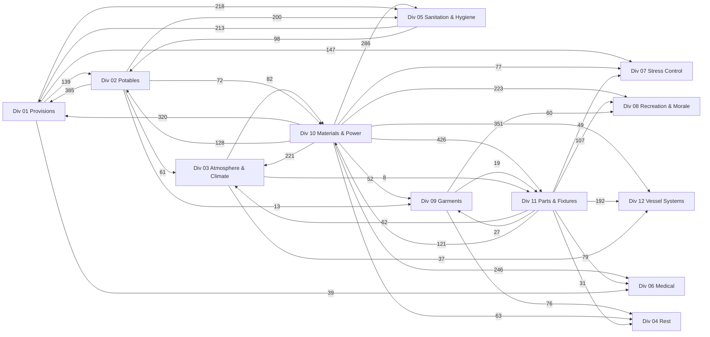
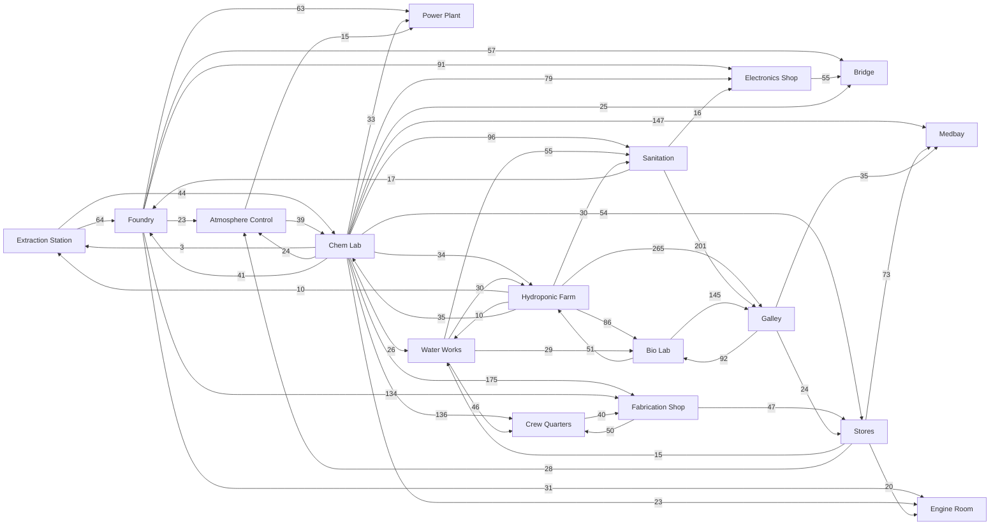
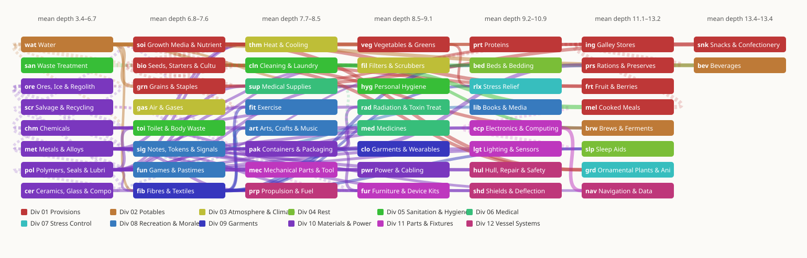

# The resource tree

Generated by `qq economy tree` from the catalogue ([../catalog/sections.md](../catalog/sections.md)); edit the catalogue, never this file. What it means is [design.md](design.md). Every item can be browsed with `qq economy explore`, and one printed with `qq economy item <id>`.

**5000 items** in 50 subsections of 12 sections, made and ended by **6062 ways** on 329 devices across 17 roles, the universal fixtures and the crew's own hands.

- **Made**, the ways an item is had — made by a way, left by a use, decayed into: none 1, 1 3818, 2 772, 3 166, 4+ 243.
- **Ended**, the ways it goes — taken by a way, used, decayed: 1 2371, 2 1289, 3 425, 4+ 915.
- **Reach**, the fewest other roles any way to it takes, down to nothing: solo 457, pair 668, trio 810, crew 3065.
- **Door reach**, the fewest other roles whose goods a way to it takes straight in — the neighbours it trades with: solo 2729, pair 1800, trio 443, crew 28.

## How the sections feed each other

Each section and its 3 biggest suppliers; an arrow's number is how many way inputs cross it. Power (pwr-001), which most ways take, is left off.



## How the roles feed each other

Each role — a capsule, on a ship that lays one role a capsule — and its 3 biggest suppliers, by the role that most often makes each input.



## The subsections, shallow to deep

The subsections in 7 columns by their items' mean depth — the rounds of ways from nothing — coloured by section, each with arrows from its 2 biggest suppliers (at least 3 way inputs; dashed where the supplier sits further right). Power is left off.



## The subsections

| subsection | section | ways | made 1 · 2 · 3 · 4+ | ended 1 · 2 · 3 · 4+ | reach: solo · pair · trio · crew | takes most from |
|---|---|---|---|---|---|---|
| [soi](../catalog/soi.md) Growth Media & Nutrients | food | 161 | 59 · 20 · 6 · 15 | 26 · 26 · 15 · 33 | 26 · 19 · 27 · 28 | pwr 174, wat 125, bio 99, grn 31 |
| [bio](../catalog/bio.md) Seeds, Starters & Cultures | food | 127 | 40 · 57 · 1 · 1 | 20 · 27 · 26 · 27 | 34 · 6 · 15 · 45 | pwr 58, grn 29, soi 28, wat 23 |
| [grn](../catalog/grn.md) Grains & Staples | food | 99 | 74 · 13 · 7 · 6 | 15 · 33 · 22 · 30 | 38 · 29 · 16 · 17 | pwr 79, wat 36, bio 24, soi 21 |
| [veg](../catalog/veg.md) Vegetables & Greens | food | 104 | 67 · 22 · 3 · 8 | 21 · 22 · 12 · 45 | 29 · 3 · 17 · 51 | soi 78, pwr 61, wat 56, bio 50 |
| [frt](../catalog/frt.md) Fruit & Berries | food | 95 | 68 · 16 · 6 · 10 | 30 · 35 · 14 · 21 | 5 · 3 · 3 · 89 | pwr 69, soi 58, bio 31, wat 29 |
| [prt](../catalog/prt.md) Proteins | food | 122 | 66 · 22 · 9 · 3 | 28 · 33 · 14 · 25 | 0 · 12 · 38 · 50 | pwr 57, ing 32, wat 23, bio 20 |
| [ing](../catalog/ing.md) Galley Stores | food | 120 | 76 · 13 · 5 · 6 | 24 · 30 · 12 · 34 | 1 · 14 · 8 · 77 | pwr 79, veg 34, grn 23, wat 21 |
| [mel](../catalog/mel.md) Cooked Meals | food | 137 | 70 · 20 · 7 · 3 | 68 · 22 · 3 · 7 | 0 · 2 · 7 · 91 | cln 141, ing 118, pwr 105, grn 63 |
| [prs](../catalog/prs.md) Rations & Preserves | food | 116 | 82 · 15 · 1 · 2 | 65 · 28 · 4 · 3 | 0 · 2 · 5 · 93 | pak 82, pwr 68, ing 67, veg 32 |
| [snk](../catalog/snk.md) Snacks & Confectionery | food | 103 | 87 · 7 · 1 · 5 | 62 · 31 · 5 · 2 | 0 · 7 · 11 · 82 | ing 112, pwr 80, grn 46, frt 20 |
| [wat](../catalog/wat.md) Water | drink | 119 | 69 · 16 · 7 · 8 | 48 · 34 · 3 · 15 | 35 · 14 · 11 · 40 | pwr 75, chm 28, pak 15, met 15 |
| [bev](../catalog/bev.md) Beverages | drink | 106 | 91 · 6 · 2 · 1 | 72 · 15 · 1 · 12 | 0 · 4 · 5 · 91 | pwr 73, wat 68, cln 57, ing 26 |
| [brw](../catalog/brw.md) Brews & Ferments | drink | 97 | 82 · 10 · 1 · 7 | 63 · 22 · 7 · 8 | 0 · 5 · 13 · 82 | bio 31, cln 29, pwr 21, wat 18 |
| [gas](../catalog/gas.md) Air & Gases | air | 119 | 83 · 9 · 1 · 7 | 52 · 31 · 7 · 10 | 12 · 19 · 4 · 65 | pwr 78, pak 33, bio 27, brw 26 |
| [fil](../catalog/fil.md) Filters & Scrubbers | air | 103 | 71 · 23 · 3 · 3 | 69 · 25 · 2 · 4 | 0 · 7 · 19 · 74 | pwr 33, chm 18, met 13, wat 12 |
| [thm](../catalog/thm.md) Heat & Cooling | air | 113 | 79 · 15 · 3 · 3 | 53 · 27 · 8 · 12 | 3 · 12 · 19 · 66 | pwr 86, met 24, pol 21, mec 15 |
| [bed](../catalog/bed.md) Beds & Bedding | sleep | 118 | 76 · 19 · 2 · 3 | 62 · 22 · 8 · 8 | 0 · 25 · 21 · 54 | pwr 98, fib 46, pol 8, scr 7 |
| [slp](../catalog/slp.md) Sleep Aids | sleep | 113 | 86 · 13 · 1 · 0 | 68 · 21 · 3 · 8 | 0 · 7 · 9 · 84 | pwr 83, fib 23, pol 18, veg 14 |
| [toi](../catalog/toi.md) Toilet & Body Waste | toilet | 131 | 69 · 12 · 6 · 13 | 42 · 40 · 5 · 13 | 18 · 10 · 15 · 57 | pwr 42, pol 30, mec 15, met 14 |
| [san](../catalog/san.md) Waste Treatment | toilet | 166 | 48 · 24 · 9 · 19 | 39 · 38 · 10 · 13 | 48 · 9 · 17 · 26 | pwr 146, wat 118, cln 87, toi 35 |
| [hyg](../catalog/hyg.md) Personal Hygiene | toilet | 131 | 76 · 16 · 4 · 4 | 55 · 26 · 5 · 14 | 9 · 17 · 13 · 61 | pwr 34, pol 27, wat 14, met 14 |
| [cln](../catalog/cln.md) Cleaning & Laundry | toilet | 145 | 65 · 25 · 3 · 7 | 47 · 29 · 6 · 18 | 2 · 10 · 34 · 54 | pwr 73, wat 46, ing 41, mel 33 |
| [med](../catalog/med.md) Medicines | medicine | 118 | 75 · 21 · 0 · 4 | 62 · 17 · 8 · 13 | 0 · 7 · 17 · 76 | pwr 80, pak 56, chm 49, wat 13 |
| [sup](../catalog/sup.md) Medical Supplies | medicine | 112 | 83 · 10 · 1 · 6 | 56 · 24 · 5 · 15 | 0 · 11 · 14 · 75 | pwr 49, pol 27, med 21, fib 17 |
| [rad](../catalog/rad.md) Radiation & Toxin Treatment | medicine | 109 | 84 · 13 · 0 · 3 | 64 · 21 · 9 · 6 | 0 · 3 · 18 · 79 | pwr 56, chm 25, pak 20, med 15 |
| [rlx](../catalog/rlx.md) Stress Relief | relax | 165 | 72 · 24 · 2 · 2 | 69 · 17 · 7 · 7 | 0 · 17 · 18 · 65 | fib 20, pwr 17, veg 15, fur 15 |
| [grd](../catalog/grd.md) Ornamental Plants & Animals | relax | 110 | 56 · 30 · 11 · 3 | 44 · 39 · 9 · 8 | 0 · 5 · 13 · 82 | soi 65, bio 39, wat 34, prt 10 |
| [fun](../catalog/fun.md) Games & Pastimes | recreation | 146 | 90 · 8 · 1 · 1 | 71 · 12 · 5 · 12 | 4 · 8 · 31 · 57 | pwr 52, sig 33, pol 26, met 12 |
| [art](../catalog/art.md) Arts, Crafts & Music | recreation | 133 | 78 · 18 · 4 · 0 | 66 · 17 · 9 · 8 | 0 · 12 · 17 · 71 | pwr 43, sig 25, fib 17, pol 15 |
| [lib](../catalog/lib.md) Books & Media | recreation | 164 | 87 · 9 · 0 · 4 | 77 · 15 · 0 · 8 | 0 · 5 · 11 · 84 | pwr 85, sig 22, ecp 20, pol 10 |
| [fit](../catalog/fit.md) Exercise | recreation | 146 | 87 · 10 · 1 · 2 | 73 · 19 · 2 · 6 | 1 · 4 · 27 · 68 | pwr 48, pol 28, fib 24, met 18 |
| [sig](../catalog/sig.md) Notes, Tokens & Signals | recreation | 124 | 86 · 8 · 1 · 5 | 70 · 17 · 2 · 11 | 4 · 33 · 20 · 43 | pwr 35, met 13, fib 11, fun 10 |
| [fib](../catalog/fib.md) Fibres & Textiles | clothing | 127 | 76 · 17 · 5 · 2 | 18 · 28 · 7 · 47 | 3 · 37 · 26 · 34 | pwr 99, wat 13, pol 12, fur 7 |
| [clo](../catalog/clo.md) Garments & Wearables | clothing | 112 | 88 · 12 · 0 · 0 | 64 · 19 · 7 · 10 | 0 · 15 · 19 · 66 | pwr 86, fib 64, met 12, pol 9 |
| [ore](../catalog/ore.md) Ores, Ice & Regolith | materials | 83 | 78 · 17 · 1 · 4 | 36 · 33 · 12 · 19 | 81 · 7 · 2 · 10 | pwr 75, met 16, wat 12, mec 10 |
| [pwr](../catalog/pwr.md) Power & Cabling | materials | 117 | 78 · 18 · 0 · 4 | 45 · 30 · 13 · 12 | 1 · 7 · 16 · 76 | met 52, chm 21, cer 21, pol 16 |
| [met](../catalog/met.md) Metals & Alloys | materials | 109 | 86 · 5 · 3 · 6 | 18 · 18 · 9 · 55 | 33 · 42 · 13 · 12 | pwr 108, ore 35, scr 11, cer 9 |
| [cer](../catalog/cer.md) Ceramics, Glass & Composites | materials | 115 | 83 · 11 · 2 · 4 | 29 · 23 · 13 · 35 | 3 · 36 · 21 · 40 | pwr 92, ore 35, pol 20, chm 13 |
| [chm](../catalog/chm.md) Chemicals | materials | 149 | 54 · 29 · 8 · 9 | 19 · 17 · 9 · 55 | 1 · 67 · 17 · 15 | pwr 94, ore 42, wat 28, gas 25 |
| [pol](../catalog/pol.md) Polymers, Seals & Lubricants | materials | 117 | 74 · 15 · 7 · 4 | 22 · 17 · 8 · 53 | 5 · 18 · 58 · 19 | pwr 88, chm 46, met 25, mec 16 |
| [scr](../catalog/scr.md) Salvage & Recycling | materials | 148 | 59 · 16 · 6 · 19 | 35 · 38 · 15 · 12 | 51 · 26 · 8 · 15 | pwr 122, pak 20, fur 17, mec 14 |
| [pak](../catalog/pak.md) Containers & Packaging | materials | 120 | 67 · 15 · 5 · 13 | 34 · 31 · 7 · 28 | 1 · 14 · 17 · 68 | pwr 87, pol 40, met 29, wat 23 |
| [mec](../catalog/mec.md) Mechanical Parts & Tools | parts | 99 | 89 · 3 · 2 · 6 | 44 · 23 · 5 · 28 | 3 · 13 · 22 · 62 | pol 70, met 65, pwr 47, scr 9 |
| [ecp](../catalog/ecp.md) Electronics & Computing | parts | 106 | 83 · 9 · 7 · 1 | 28 · 21 · 13 · 38 | 4 · 7 · 6 · 83 | pwr 45, met 28, pol 27, cer 18 |
| [lgt](../catalog/lgt.md) Lighting & Sensors | parts | 106 | 91 · 7 · 1 · 1 | 44 · 23 · 11 · 22 | 0 · 4 · 8 · 88 | ecp 51, pwr 37, pol 26, met 20 |
| [fur](../catalog/fur.md) Furniture & Device Kits | parts | 116 | 84 · 11 · 2 · 3 | 54 · 31 · 3 · 12 | 1 · 11 · 18 · 70 | pwr 73, pak 23, met 22, mec 19 |
| [hul](../catalog/hul.md) Hull, Repair & Safety | ship | 115 | 84 · 15 · 1 · 0 | 47 · 41 · 4 · 8 | 0 · 7 · 4 · 89 | pwr 92, pol 46, met 31, mec 20 |
| [nav](../catalog/nav.md) Navigation & Data | ship | 107 | 90 · 6 · 2 · 2 | 47 · 27 · 17 · 9 | 0 · 2 · 10 · 88 | pwr 91, ecp 52, met 16, lgt 13 |
| [shd](../catalog/shd.md) Shields & Deflection | ship | 112 | 90 · 7 · 3 · 0 | 47 · 26 · 15 · 12 | 0 · 5 · 9 · 86 | pwr 103, met 25, cer 25, ecp 15 |
| [prp](../catalog/prp.md) Propulsion & Fuel | ship | 118 | 82 · 15 · 2 · 1 | 59 · 28 · 9 · 4 | 1 · 9 · 23 · 67 | pwr 102, met 28, pak 24, chm 22 |

## How the common goods flow

Each pinned item ([../catalog/sections.md](../catalog/sections.md#pinned-items)): every way it is made and ended, counted, and the first 6 of each.

### pwr-001 Power, Grid

Made 9 ways, ended 3288 ways.

| made by | ended by |
|---|---|
| catch sunlight (any.solarstrip), 60 min: nothing → 1 pwr-001 Power, Grid | boil water (any.bench), 20 min: 2 wat-002 Water, Raw, 1 pwr-001 Power, Grid → 2 wat-001 Water, Drinking |
| pedal the cycle generator (fit.cycle), 60 min: nothing → 1 pwr-001 Power, Grid; fitness +12, hygiene -5 | run the heater (any.lifesupport), 30 min: 1 pwr-001 Power, Grid → cabin.heat +4 |
| burn a fuel slug (pwr.reactor), 480 min: 1 pwr-020 Slug, Fuel → 20 pwr-001 Power, Grid, 1 pwr-021 Slug, Fuel, Spent | mix hydroponic solution (soi.mixer), 30 min: 1 soi-021 Concentrate, Nutrient, Part A, 1 soi-022 Concentrate, Nutrient, Part B, 4 wat-002 Water, Raw, 1 pwr-001 Power, Grid → 4 soi-001 Solution, Hydroponic |
| run the solar array (pwr.solararray), 60 min: nothing → 4 pwr-001 Power, Grid | dilute urine fertilizer (soi.mixer), 20 min: 1 soi-004 Fertilizer, Urine, 3 wat-002 Water, Raw, 1 pwr-001 Power, Grid → 3 soi-001 Solution, Hydroponic |
| run the fuel cell stack (pwr.fuelstack), 60 min: 2 gas-004 Hydrogen, 1 gas-001 Oxygen → 3 pwr-001 Power, Grid, 1 wat-018 Water, Fuel Cell | rebalance acid drift (soi.mixer), 20 min: 3 soi-031 Solution, Nutrient, Depleted, 1 soi-030 Buffer, pH Up, 1 soi-079 Strip, pH Test, Nutrient, 1 pwr-001 Power, Grid → 3 soi-001 Solution, Hydroponic |
| run a hydrogen cartridge (pwr.fuelstack), 60 min: 1 gas-067 Cartridge, Hydrogen, Fuel Cell, 1 gas-001 Oxygen → 3 pwr-001 Power, Grid, 1 wat-018 Water, Fuel Cell, 1 pak-006 Canister, Empty | rebalance alkaline drift (soi.mixer), 20 min: 3 soi-031 Solution, Nutrient, Depleted, 1 soi-029 Buffer, pH Down, 1 soi-079 Strip, pH Test, Nutrient, 1 pwr-001 Power, Grid → 3 soi-001 Solution, Hydroponic |

### wat-001 Water, Drinking

Made 20 ways, ended 306 ways.

| made by | ended by |
|---|---|
| boil water (any.bench), 20 min: 2 wat-002 Water, Raw, 1 pwr-001 Power, Grid → 2 wat-001 Water, Drinking | sprout seeds (any.sprouter), 240 min: 1 wat-001 Water, Drinking → 1 veg-001 Sprouts |
| sterilise filtered water (wat.purifier), 30 min: 4 wat-025 Water, Filtered, 1 pwr-001 Power, Grid → 4 wat-001 Water, Drinking | wash (any.washbasin), 10 min: 2 wat-001 Water, Drinking → 2 san-001 Water, Grey; hygiene +15 |
| purify raw water (wat.purifier), 90 min: 4 wat-002 Water, Raw, 2 pwr-001 Power, Grid → 3 wat-001 Water, Drinking, 1 wat-036 Water, Backwash | wash with soap (any.washbasin), 10 min: 2 wat-001 Water, Drinking, 1 hyg-001 Soap → 2 san-001 Water, Grey; hygiene +30 |
| polish urine distillate (wat.purifier), 60 min: 4 wat-015 Distillate, Urine, 1 pwr-001 Power, Grid → 4 wat-001 Water, Drinking | proof dried yeast (bio.culturetank), 60 min: 1 bio-049 Yeast, Baking, Dried, 1 ing-003 Sugar, Refined, 2 wat-001 Water, Drinking → 4 bio-009 Yeast, Baking |
| polish reclaimed water (wat.purifier), 45 min: 3 wat-016 Water, Reclaimed, 1 pwr-001 Power, Grid → 3 wat-001 Water, Drinking | wash spent brewing yeast (bio.culturetank), 60 min: 2 brw-070 Slurry, Yeast, Spent, 1 wat-001 Water, Drinking, 1 pwr-001 Power, Grid → 2 bio-009 Yeast, Baking |
| polish fuel cell water (wat.purifier), 20 min: 3 wat-018 Water, Fuel Cell, 1 pwr-001 Power, Grid → 3 wat-001 Water, Drinking | start sourdough in a jar (any.bench), 720 min: 2 grn-002 Flour, Wheat, 2 wat-001 Water, Drinking → 1 bio-052 Starter, Sourdough |

### wat-002 Water, Raw

Made 21 ways, ended 245 ways.

| made by | ended by |
|---|---|
| condense water (any.condenser), 120 min: nothing → 1 wat-002 Water, Raw | boil water (any.bench), 20 min: 2 wat-002 Water, Raw, 1 pwr-001 Power, Grid → 2 wat-001 Water, Drinking |
| crystallise urine nitrate (soi.nitrifier), 180 min: 3 soi-014 Urine, Nitrified, 1 pwr-001 Power, Grid → 1 soi-005 Fertilizer, Nitrogen, 1 wat-002 Water, Raw | mix hydroponic solution (soi.mixer), 30 min: 1 soi-021 Concentrate, Nutrient, Part A, 1 soi-022 Concentrate, Nutrient, Part B, 4 wat-002 Water, Raw, 1 pwr-001 Power, Grid → 4 soi-001 Solution, Hydroponic |
| melt water ice (wat.melter), 45 min: 3 ore-002 Ice, Water, 1 pwr-001 Power, Grid → 3 wat-002 Water, Raw | dilute urine fertilizer (soi.mixer), 20 min: 1 soi-004 Fertilizer, Urine, 3 wat-002 Water, Raw, 1 pwr-001 Power, Grid → 3 soi-001 Solution, Hydroponic |
| settle meltwater (wat.melter), 60 min: 3 wat-014 Meltwater → 3 wat-002 Water, Raw, 1 wat-034 Sludge, Sediment | steep compost in water (any.bench), 120 min: 2 soi-002 Compost, Garden, 2 wat-002 Water, Raw → 1 soi-001 Solution, Hydroponic, 1 soi-035 Screenings, Compost |
| settle regolith water (wat.melter), 60 min: 3 wat-020 Water, Regolith → 2 wat-002 Water, Raw, 1 wat-034 Sludge, Sediment | feed leachate to solution (soi.mixer), 30 min: 2 soi-036 Leachate, Compost, 2 wat-002 Water, Raw, 1 pwr-001 Power, Grid → 2 soi-001 Solution, Hydroponic |
| dry saturated silica gel (fil.regenerator), 60 min: 3 fil-034 Silica Gel, Saturated, 1 pwr-001 Power, Grid → 3 fil-033 Beads, Silica Gel, 1 wat-002 Water, Raw | brew compost tea (soi.compostbin), 240 min: 1 soi-034 Compost, Sifted, 3 wat-002 Water, Raw, 1 pwr-001 Power, Grid → 3 soi-037 Tea, Compost |

### gas-001 Oxygen

Made 9 ways, ended 32 ways.

| made by | ended by |
|---|---|
| bottle algae oxygen (any.algaejar), 360 min: 1 wat-002 Water, Raw → 1 gas-001 Oxygen | make ozone (gas.electrolyser), 30 min: 2 gas-001 Oxygen, 1 pwr-001 Power, Grid → 1 gas-060 Ozone |
| split feedwater (gas.electrolyser), 60 min: 2 wat-040 Feedwater, Electrolysis, 2 pwr-001 Power, Grid → 2 gas-001 Oxygen, 2 gas-004 Hydrogen | liquefy oxygen (gas.separator), 90 min: 3 gas-001 Oxygen, 2 pwr-001 Power, Grid → 2 gas-027 Oxygen, Liquid |
| split drinking water (gas.electrolyser), 90 min: 3 wat-001 Water, Drinking, 3 pwr-001 Power, Grid → 2 gas-001 Oxygen, 2 gas-004 Hydrogen | blend breathing mix (gas.blender), 30 min: 1 gas-001 Oxygen, 2 gas-003 Nitrogen, 1 pwr-001 Power, Grid → 2 gas-007 Mix, Breathing |
| split heavy water (gas.electrolyser), 120 min: 1 wat-038 Water, Heavy, 2 pwr-001 Power, Grid → 1 gas-063 Deuterium, 1 gas-001 Oxygen | blend heliox (gas.blender), 30 min: 1 gas-001 Oxygen, 1 gas-015 Helium, 1 pwr-001 Power, Grid → 2 gas-030 Mix, Heliox |
| separate oxygen frost (gas.separator), 60 min: 2 ore-037 Frost, Oxygen, 1 pwr-001 Power, Grid → 3 gas-001 Oxygen | blend oxygen rich mix (gas.blender), 30 min: 2 gas-001 Oxygen, 1 gas-003 Nitrogen, 1 pwr-001 Power, Grid → 2 gas-031 Mix, Oxygen Rich |
| shock the cabin air with ozone (crew), 10 min: 1 gas-060 Ozone → 1 gas-001 Oxygen; cabin.clean +5, toxin +2 | blend nitrogen rich mix (gas.blender), 30 min: 1 gas-001 Oxygen, 3 gas-003 Nitrogen, 1 pwr-001 Power, Grid → 3 gas-032 Mix, Nitrogen Rich |

### gas-002 Carbon Dioxide

Made 46 ways, ended 11 ways.

| made by | ended by |
|---|---|
| ferment ale (brw.fermenter), 720 min: 3 brw-055 Wort, Hopped, 1 bio-050 Yeast, Ale → 3 brw-062 Beer, Green, 1 brw-070 Slurry, Yeast, Spent, 1 gas-002 Carbon Dioxide | reduce carbon dioxide to carbon (gas.sabatier), 180 min: 1 gas-002 Carbon Dioxide, 2 gas-004 Hydrogen, 2 pwr-001 Power, Grid → 1 gas-024 Carbon, Pyrolysis, 2 wat-019 Water, Sabatier |
| ferment stout (brw.fermenter), 720 min: 3 brw-055 Wort, Hopped, 1 brw-051 Malt, Roasted, 1 bio-050 Yeast, Ale, 3 cln-002 Dish, Clean → 3 brw-014 Stout, Dark, 1 brw-070 Slurry, Yeast, Spent, 1 gas-002 Carbon Dioxide | blend shielding gas (gas.blender), 30 min: 2 gas-014 Argon, 1 gas-002 Carbon Dioxide, 1 pwr-001 Power, Grid → 3 gas-041 Gas, Shielding |
| ferment wheat beer (brw.fermenter), 720 min: 3 brw-055 Wort, Hopped, 1 brw-052 Malt, Wheat, 1 bio-050 Yeast, Ale, 3 cln-002 Dish, Clean → 3 brw-015 Beer, Wheat, 1 brw-070 Slurry, Yeast, Spent, 1 gas-002 Carbon Dioxide | blend sabatier feed (gas.blender), 20 min: 1 gas-002 Carbon Dioxide, 2 gas-004 Hydrogen, 1 pwr-001 Power, Grid → 1 gas-019 Mix, Sabatier Feed |
| ferment rice lager (brw.fermenter), 960 min: 2 brw-055 Wort, Hopped, 1 brw-056 Mash, Rice, 1 bio-050 Yeast, Ale, 3 cln-002 Dish, Clean → 3 brw-016 Lager, Rice, 1 brw-070 Slurry, Yeast, Spent, 1 gas-002 Carbon Dioxide | fill a carbon dioxide canister (gas.compressor), 30 min: 3 gas-002 Carbon Dioxide, 1 pak-005 Canister, Serviced, 1 pwr-001 Power, Grid → 1 gas-011 Canister, Carbon Dioxide |
| ferment small beer (brw.fermenter), 480 min: 1 brw-055 Wort, Hopped, 3 wat-001 Water, Drinking, 1 brw-070 Slurry, Yeast, Spent, 3 cln-002 Dish, Clean → 3 brw-017 Beer, Small, 1 gas-002 Carbon Dioxide | carbonate caustic soda (chm.crystallizer), 60 min: 1 chm-002 Sodium Hydroxide, 1 gas-002 Carbon Dioxide, 1 pwr-001 Power, Grid → 1 chm-011 Sodium Carbonate |
| ferment spiced ale (brw.fermenter), 720 min: 3 brw-055 Wort, Hopped, 1 ing-004 Spice Mix, General, 1 bio-050 Yeast, Ale, 3 cln-002 Dish, Clean → 3 brw-019 Ale, Spiced, 1 brw-070 Slurry, Yeast, Spent, 1 gas-002 Carbon Dioxide | carbonate soda ash (chm.crystallizer), 45 min: 1 chm-011 Sodium Carbonate, 1 gas-002 Carbon Dioxide, 1 wat-002 Water, Raw → 2 chm-012 Sodium Bicarbonate |

### veg-001 Sprouts

Made 2 ways, ended 1 ways.

| made by | ended by |
|---|---|
| sprout seeds (any.sprouter), 240 min: 1 wat-001 Water, Drinking → 1 veg-001 Sprouts | used: satiety +4, bowel +1, hydration +1; decays after 48 h |
| sprout seed mix (veg.sprouter), 240 min: 1 bio-008 Seed, Sprouting Mix, 2 wat-001 Water, Drinking → 5 veg-001 Sprouts, 1 veg-053 Mats, Sprouting, Spent |  |

### toi-001 Urine

Made 5 ways, ended 12 ways.

| made by | ended by |
|---|---|
| urinate (any.toilet), 2 min: nothing → 1 toi-001 Urine; bladder -100 | nitrify urine (soi.nitrifier), 480 min: 4 toi-001 Urine, 1 pwr-001 Power, Grid → 3 soi-014 Urine, Nitrified |
| urinate in the composting toilet (toi.compostloo), 2 min: nothing → 1 toi-001 Urine; bladder -100 | seeded urine nitrification (soi.nitrifier), 240 min: 4 toi-001 Urine, 1 bio-066 Culture, Nitrifying Bacteria, 1 pwr-001 Power, Grid → 4 soi-014 Urine, Nitrified |
| urinate in the vacuum toilet (toi.vacloo), 1 min: 1 pwr-001 Power, Grid → 1 toi-001 Urine; bladder -100, hygiene +2 | dilute fresh urine (crew), 10 min: 1 toi-001 Urine, 3 wat-002 Water, Raw → 1 soi-004 Fertilizer, Urine |
| test a urine sample (crew), 5 min: 1 toi-047 Sample, Urine, 1 sup-018 Strip, Test, Urine → 1 sup-047 Strip, Test, Spent, 1 toi-001 Urine | precipitate struvite (soi.nitrifier), 180 min: 3 toi-001 Urine, 1 chm-058 Magnesium Sulfate, 1 pwr-001 Power, Grid → 1 soi-015 Struvite, Crystalline, 2 san-011 Urine, Stripped |
| empty the bedpan (crew), 10 min: 1 toi-031 Bedpan, Filled → 1 toi-030 Bedpan, 1 toi-002 Waste, Solid, 1 toi-001 Urine; hygiene -3 | culture nitrifying bacteria (bio.culturetank), 240 min: 1 san-020 Culture, Activated Sludge, 1 toi-001 Urine, 1 pwr-001 Power, Grid → 3 bio-066 Culture, Nitrifying Bacteria |
|  | revive nitrifying bacteria (bio.culturetank), 240 min: 1 bio-001 Sample, Gene Vault, 1 toi-001 Urine, 1 pwr-001 Power, Grid → 3 bio-066 Culture, Nitrifying Bacteria |

### toi-002 Waste, Solid

Made 4 ways, ended 5 ways.

| made by | ended by |
|---|---|
| defecate (any.toilet), 8 min: 1 toi-003 Paper, Toilet → 1 toi-002 Waste, Solid; bowel -100 | cover tank waste with litter (toi.compostloo), 30 min: 2 toi-002 Waste, Solid, 1 toi-053 Litter, Toilet Cover → 2 toi-015 Mix, Toilet Compost |
| defecate without paper (any.toilet), 8 min: nothing → 1 toi-002 Waste, Solid; bowel -100, hygiene -10 | compact tank waste (toi.vacloo), 30 min: 3 toi-002 Waste, Solid, 1 toi-004 Bag, Waste, 1 pwr-001 Power, Grid → 1 toi-016 Puck, Waste, Compacted |
| test a stool sample (crew), 10 min: 1 toi-048 Sample, Stool, 1 sup-017 Strip, Test, Infection → 1 sup-047 Strip, Test, Spent, 1 toi-002 Waste, Solid | bag tank waste (toi.bagger), 15 min: 2 toi-002 Waste, Solid, 1 toi-004 Bag, Waste, 1 pwr-001 Power, Grid → 1 toi-005 Bag, Waste, Filled |
| empty the bedpan (crew), 10 min: 1 toi-031 Bedpan, Filled → 1 toi-030 Bedpan, 1 toi-002 Waste, Solid, 1 toi-001 Urine; hygiene -3 | fill a waste canister (toi.tank), 20 min: 1 toi-023 Canister, Waste, 3 toi-002 Waste, Solid, 1 pwr-001 Power, Grid → 1 toi-024 Canister, Waste, Filled |
|  | decays after 72 h |

### toi-003 Paper, Toilet

Made 4 ways, ended 13 ways.

| made by | ended by |
|---|---|
| cut toilet paper (toi.tissue), 30 min: 1 toi-057 Roll, Tissue, Parent, 1 pwr-001 Power, Grid → 8 toi-003 Paper, Toilet | defecate (any.toilet), 8 min: 1 toi-003 Paper, Toilet → 1 toi-002 Waste, Solid; bowel -100 |
| cut toilet paper by hand (any.bench), 30 min: 1 toi-057 Roll, Tissue, Parent → 4 toi-003 Paper, Toilet | defecate in the diverting toilet (toi.divertloo), 8 min: 1 toi-003 Paper, Toilet → 1 toi-014 Faeces, Dry; bowel -100, stress -1 |
| open a toilet paper pack (crew), 1 min: 1 toi-100 Pack, Toilet Paper → 6 toi-003 Paper, Toilet | use the composting toilet (toi.compostloo), 8 min: 1 toi-003 Paper, Toilet, 1 toi-053 Litter, Toilet Cover → 1 toi-015 Mix, Toilet Compost; bowel -100, cabin.clean +1 |
| decay of toi-060 Tissue, Toilet, Moist, after 240 h | use the composting toilet with fibre litter (toi.compostloo), 8 min: 1 toi-003 Paper, Toilet, 1 toi-054 Litter, Fibre, Shredded → 1 toi-015 Mix, Toilet Compost; bowel -100, cabin.clean +1 |
|  | use the composting toilet with charcoal litter (toi.compostloo), 8 min: 1 toi-003 Paper, Toilet, 1 toi-055 Litter, Toilet, Charcoal → 1 toi-015 Mix, Toilet Compost; bowel -100, cabin.clean +3 |
|  | use the composting toilet with enzyme (toi.compostloo), 8 min: 1 toi-003 Paper, Toilet, 1 toi-053 Litter, Toilet Cover, 1 toi-052 Sachet, Composting Enzyme → 1 toi-015 Mix, Toilet Compost; bowel -100, cabin.clean +2 |

### toi-004 Bag, Waste

Made 4 ways, ended 9 ways.

| made by | ended by |
|---|---|
| seal waste bags (toi.bagger), 30 min: 1 toi-042 Film, Waste Bag, 1 pwr-001 Power, Grid → 4 toi-004 Bag, Waste | compact tank waste (toi.vacloo), 30 min: 3 toi-002 Waste, Solid, 1 toi-004 Bag, Waste, 1 pwr-001 Power, Grid → 1 toi-016 Puck, Waste, Compacted |
| seal bags from recycled film (toi.bagger), 30 min: 2 scr-058 Film, Bag, Recycled, 1 pwr-001 Power, Grid → 4 toi-004 Bag, Waste | relieve into a waste bag (crew), 10 min: 1 toi-004 Bag, Waste, 1 toi-003 Paper, Toilet → 1 toi-005 Bag, Waste, Filled; bowel -100, hygiene -5 |
| fold a bag from plastic film (any.bench), 20 min: 1 pol-002 Film, Plastic → 2 toi-004 Bag, Waste | bag tank waste (toi.bagger), 15 min: 2 toi-002 Waste, Solid, 1 toi-004 Bag, Waste, 1 pwr-001 Power, Grid → 1 toi-005 Bag, Waste, Filled |
| unroll waste bags (crew), 2 min: 1 toi-041 Roll, Waste Bag → 8 toi-004 Bag, Waste | double bag waste (toi.bagger), 10 min: 1 toi-005 Bag, Waste, Filled, 1 toi-004 Bag, Waste, 1 pwr-001 Power, Grid → 1 toi-040 Waste, Double Bagged |
|  | rebag a leaking bag (crew), 15 min: 1 toi-008 Bag, Waste, Leaking, 1 toi-004 Bag, Waste → 1 toi-005 Bag, Waste, Filled; hygiene -5, cabin.clean +2 |
|  | bag a soiled brief (crew), 5 min: 1 toi-044 Brief, Absorbent, Soiled, 1 toi-004 Bag, Waste → 1 toi-005 Bag, Waste, Filled; cabin.clean +1 |

### toi-005 Bag, Waste, Filled

Made 6 ways, ended 6 ways.

| made by | ended by |
|---|---|
| relieve into a waste bag (crew), 10 min: 1 toi-004 Bag, Waste, 1 toi-003 Paper, Toilet → 1 toi-005 Bag, Waste, Filled; bowel -100, hygiene -5 | double bag waste (toi.bagger), 10 min: 1 toi-005 Bag, Waste, Filled, 1 toi-004 Bag, Waste, 1 pwr-001 Power, Grid → 1 toi-040 Waste, Double Bagged |
| bag tank waste (toi.bagger), 15 min: 2 toi-002 Waste, Solid, 1 toi-004 Bag, Waste, 1 pwr-001 Power, Grid → 1 toi-005 Bag, Waste, Filled | dose a waste bag (crew), 5 min: 1 toi-005 Bag, Waste, Filled, 1 toi-051 Tablet, Holding Tank → 1 toi-039 Bag, Waste, Treated |
| rebag a leaking bag (crew), 15 min: 1 toi-008 Bag, Waste, Leaking, 1 toi-004 Bag, Waste → 1 toi-005 Bag, Waste, Filled; hygiene -5, cabin.clean +2 | bale waste bags (toi.bagger), 30 min: 4 toi-005 Bag, Waste, Filled, 1 toi-042 Film, Waste Bag, 1 pwr-001 Power, Grid → 1 toi-029 Bale, Waste |
| bag a soiled brief (crew), 5 min: 1 toi-044 Brief, Absorbent, Soiled, 1 toi-004 Bag, Waste → 1 toi-005 Bag, Waste, Filled; cabin.clean +1 | load the waste tote (crew), 10 min: 1 toi-026 Tote, Waste, 3 toi-005 Bag, Waste, Filled → 1 toi-027 Tote, Waste, Full; cabin.clean +2 |
| bag sanitary waste (crew), 5 min: 2 toi-045 Sanitary Product, Used, 1 toi-004 Bag, Waste → 1 toi-005 Bag, Waste, Filled; cabin.clean +1 | open waste bags into the digester (san.digester), 20 min: 3 toi-005 Bag, Waste, Filled → 3 san-033 Mix, Wet Waste, 1 scr-002 Scrap, Plastic |
| unload the waste tote (crew), 10 min: 1 toi-027 Tote, Waste, Full → 3 toi-005 Bag, Waste, Filled, 1 toi-026 Tote, Waste | decays after 168 h |

### san-001 Water, Grey

Made 111 ways, ended 3 ways.

| made by | ended by |
|---|---|
| wash (any.washbasin), 10 min: 2 wat-001 Water, Drinking → 2 san-001 Water, Grey; hygiene +15 | settle grey water (san.reclaimer), 60 min: 4 san-001 Water, Grey, 1 pwr-001 Power, Grid → 3 san-013 Water, Grey, Settled, 1 san-022 Skim, Grease |
| wash with soap (any.washbasin), 10 min: 2 wat-001 Water, Drinking, 1 hyg-001 Soap → 2 san-001 Water, Grey; hygiene +30 | let grey water stand (any.bench), 240 min: 3 san-001 Water, Grey → 2 san-013 Water, Grey, Settled, 1 san-019 Sludge, Grey Water |
| wash sludge biochar (soi.mixer), 30 min: 2 san-064 Biochar, Sludge, 1 wat-002 Water, Raw → 2 soi-012 Biochar, 1 san-001 Water, Grey | decays after 72 h |
| rinse clay pebbles (soi.steamer), 60 min: 3 soi-063 Pebbles, Clay, Used, 1 wat-002 Water, Raw, 1 pwr-001 Power, Grid → 3 soi-009 Pebbles, Clay, 1 san-001 Water, Grey |  |
| autoclave spent media (bio.cleanbench), 60 min: 3 bio-073 Medium, Culture, Spent, 1 pwr-001 Power, Grid → 2 san-001 Water, Grey |  |
| wash out wheat gluten (grn.kneader), 30 min: 3 grn-002 Flour, Wheat, 2 wat-001 Water, Drinking, 1 pwr-001 Power, Grid → 1 grn-055 Gluten, Wheat, 1 grn-062 Starch, Corn, 2 san-001 Water, Grey |  |

### san-002 Scraps, Food

Made 136 ways, ended 20 ways.

| made by | ended by |
|---|---|
| save fruiting vegetable seed (bio.seedbank), 60 min: 2 veg-003 Tomatoes, Fresh, 1 veg-020 Peppers, Chili, 1 veg-015 Cucumbers, Fresh → 2 bio-007 Seed, Tomato, 1 bio-019 Seed, Pepper, 1 bio-020 Seed, Cucurbit, 1 san-002 Scraps, Food | build scrap heap (soi.compostbin), 60 min: 3 san-002 Scraps, Food, 1 grn-036 Chaff, Grain, 1 soi-050 Activator, Compost, Powder → 3 soi-033 Compost, Unfinished |
| save bolted green seed (bio.seedbank), 60 min: 3 veg-040 Greens, Wilted → 1 bio-006 Seed, Leafy Green, 1 san-002 Scraps, Food | heap scraps by hand (crew), 30 min: 4 san-002 Scraps, Food → 2 soi-033 Compost, Unfinished |
| chop tomatoes (veg.prep), 10 min: 2 veg-003 Tomatoes, Fresh → 2 veg-061 Tomatoes, Chopped, 1 san-002 Scraps, Food | chop green waste by hand (crew), 30 min: 2 san-002 Scraps, Food → 1 soi-032 Green Waste, Shredded |
| mince cultured meat by hand (crew), 30 min: 2 prt-004 Meat, Cultured → 1 prt-043 Mince, Cultured, 1 san-002 Scraps, Food | vermicompost food scraps (soi.wormbin), 480 min: 1 bio-077 Worm Stock, Composting, 1 soi-051 Bedding, Worm Bin, 4 san-002 Scraps, Food → 3 soi-010 Castings, Worm, 2 soi-038 Tea, Worm |
| concentrate lentil protein (prt.tofupress), 60 min: 3 grn-017 Lentils, Dried, 2 wat-001 Water, Drinking, 1 pwr-001 Power, Grid → 2 prt-072 Concentrate, Lentil Protein, 1 san-002 Scraps, Food | pack bokashi bucket (soi.compostbin), 30 min: 1 soi-039 Bran, Bokashi, 4 san-002 Scraps, Food → 2 soi-040 Mash, Bokashi |
| simmer scrap vegetable stock (ing.saucekettle), 90 min: 2 veg-041 Trimmings, Root, 1 veg-047 Skins, Onion, 1 veg-052 Stems, Herb, 3 wat-001 Water, Drinking, 1 pwr-001 Power, Grid → 3 ing-005 Stock, Vegetable, 1 san-002 Scraps, Food | revive methanogens (bio.culturetank), 240 min: 1 bio-001 Sample, Gene Vault, 1 san-002 Scraps, Food, 1 pwr-001 Power, Grid → 2 bio-067 Culture, Methanogen |

### san-003 Food, Spoiled

Made 371 ways, ended 3 ways.

| made by | ended by |
|---|---|
| scrub a fouled caddy (crew), 20 min: 1 san-039 Caddy, Scrap, Fouled, 1 cln-008 Disinfectant → 1 san-037 Caddy, Scrap, 2 san-003 Food, Spoiled; hygiene -3 | mash spoiled food (san.composter), 30 min: 3 san-003 Food, Spoiled, 1 pwr-001 Power, Grid → 2 san-032 Mash, Scrap; cabin.clean +2 |
| decay of bio-004 Seed, Potato, after 720 h | brew mould broth (med.fermenter), 480 min: 1 san-003 Food, Spoiled, 1 grn-062 Starch, Corn, 1 wat-003 Water, Distilled, 1 pwr-001 Power, Grid → 2 med-065 Broth, Antibiotic, Mould |
| decay of bio-009 Yeast, Baking, after 168 h | decays after 168 h |
| decay of bio-010 Culture, Lactic Acid, after 240 h |  |
| decay of bio-033 Spawn, Mushroom, Oyster, after 336 h |  |
| decay of bio-034 Spawn, Mushroom, Button, after 336 h |  |

### hyg-001 Soap

Made 3 ways, ended 12 ways.

| made by | ended by |
|---|---|
| mould soap (hyg.moulder), 45 min: 2 hyg-017 Base, Soap, 1 hyg-018 Oil, Fragrance, 1 pwr-001 Power, Grid → 4 hyg-001 Soap | wash with soap (any.washbasin), 10 min: 2 wat-001 Water, Drinking, 1 hyg-001 Soap → 2 san-001 Water, Grey; hygiene +30 |
| cut soap by hand (any.bench), 60 min: 2 hyg-017 Base, Soap → 2 hyg-001 Soap | mix soap spray by hand (crew), 10 min: 1 hyg-001 Soap, 2 wat-002 Water, Raw → 2 soi-072 Spray, Soap, Plant |
| split used frying oil (chm.reactor), 90 min: 2 ing-042 Oil, Frying, Used, 1 chm-002 Sodium Hydroxide, 1 pwr-001 Power, Grid → 1 chm-064 Glycerol, 2 hyg-001 Soap | shower with soap (hyg.shower), 15 min: 4 wat-001 Water, Drinking, 1 hyg-001 Soap, 1 pwr-001 Power, Grid → 4 san-001 Water, Grey, 1 hyg-014 Slivers, Soap; hygiene +40 |
|  | scrub in the shower with a loofah (hyg.shower), 20 min, with 1 hyg-073 Scrubber, Loofah: 4 wat-001 Water, Drinking, 1 hyg-001 Soap, 1 pwr-001 Power, Grid → 4 san-001 Water, Grey, 1 hyg-014 Slivers, Soap; hygiene +45 |
|  | wash with a face cloth (any.washbasin), 12 min, with 1 hyg-058 Cloth, Face: 2 wat-001 Water, Drinking, 1 hyg-001 Soap → 2 san-001 Water, Grey; hygiene +34 |
|  | pack a travel hygiene kit (hyg.grooming), 20 min: 1 hyg-001 Soap, 1 hyg-003 Toothpaste, 1 hyg-009 Deodorant, 1 hyg-006 Wipes, Wet, 1 pol-002 Film, Plastic → 1 hyg-069 Kit, Hygiene, Travel |

### cln-001 Dish, Dirty

Made 211 ways, ended 6 ways.

| made by | ended by |
|---|---|
| plate tofu curry and rice (mel.servery), 5 min: 1 mel-031 Curry, Tofu, 1 mel-007 Rice, Steamed → 1 mel-033 Plate, Curry and Rice, 1 cln-001 Dish, Dirty | wash dishes by hand (any.washbasin), 15 min, with 1 cln-046 Sponge, Cleaning: 3 cln-001 Dish, Dirty, 1 wat-001 Water, Drinking, 1 cln-005 Soap, Dish → 3 cln-002 Dish, Clean, 1 san-016 Water, Grey, Greasy |
| plate vegetable curry and rice (mel.servery), 5 min: 1 mel-032 Curry, Vegetable, 1 mel-007 Rice, Steamed → 1 mel-033 Plate, Curry and Rice, 1 cln-001 Dish, Dirty | rinse dishes without soap (any.washbasin), 15 min: 2 cln-001 Dish, Dirty, 1 wat-001 Water, Drinking → 2 cln-002 Dish, Clean, 1 san-001 Water, Grey |
| plate a breakfast (mel.servery), 10 min: 1 mel-067 Eggs, Quail, Scrambled, 1 mel-051 Toast, Buttered, 1 prs-032 Beans, Baked, 1 prt-040 Bacon Strips, Cultured → 1 mel-069 Plate, Breakfast, 1 cln-001 Dish, Dirty, 1 pak-008 Can, Tin, Empty | run the dishwasher (cln.dishwasher), 60 min: 6 cln-001 Dish, Dirty, 1 cln-029 Tablet, Dishwasher, 2 wat-001 Water, Drinking, 1 pwr-001 Power, Grid → 6 cln-002 Dish, Clean, 2 san-016 Water, Grey, Greasy |
| lay a harvest feast (mel.servery), 60 min: 1 mel-003 Stew, Vegetable, 1 mel-002 Bread, Loaf, 1 mel-027 Vegetables, Roasted, 1 snk-052 Pie, Apple, 2 cln-075 Cutlery, Clean → 1 mel-081 Feast, Harvest, 1 cln-001 Dish, Dirty, 2 cln-074 Cutlery, Dirty; stress -3 | run the dishwasher with rinse aid (cln.dishwasher), 60 min: 6 cln-001 Dish, Dirty, 1 cln-005 Soap, Dish, 1 cln-025 Rinse Aid, Dishwasher, 2 wat-001 Water, Drinking, 1 pwr-001 Power, Grid → 6 cln-002 Dish, Clean, 2 san-016 Water, Grey, Greasy |
| lay a celebration platter (mel.servery), 45 min: 1 mel-056 Burrito, Bean, 1 mel-027 Vegetables, Roasted, 1 mel-057 Dumplings, Vegetable, 1 snk-074 Platter, Party Snack, 2 cln-075 Cutlery, Clean → 1 mel-083 Platter, Celebration, 2 cln-001 Dish, Dirty, 2 cln-074 Cutlery, Dirty; fun +3 | run the dishwasher on treated water (cln.dishwasher), 60 min: 6 cln-001 Dish, Dirty, 1 cln-029 Tablet, Dishwasher, 2 san-004 Water, Grey, Treated, 1 pwr-001 Power, Grid → 6 cln-002 Dish, Clean, 2 san-016 Water, Grey, Greasy |
| lay a garden feast (mel.servery), 45 min: 1 mel-027 Vegetables, Roasted, 1 mel-037 Stir-Fry, Vegetable, 1 mel-013 Soup, Vegetable, 1 veg-068 Salad, Garden, 2 cln-075 Cutlery, Clean → 1 mel-084 Feast, Garden, 2 cln-001 Dish, Dirty, 2 cln-074 Cutlery, Dirty; stress -2 | decays after 48 h |

### cln-002 Dish, Clean

Made 9 ways, ended 211 ways.

| made by | ended by |
|---|---|
| wash dishes by hand (any.washbasin), 15 min, with 1 cln-046 Sponge, Cleaning: 3 cln-001 Dish, Dirty, 1 wat-001 Water, Drinking, 1 cln-005 Soap, Dish → 3 cln-002 Dish, Clean, 1 san-016 Water, Grey, Greasy | toss a garden salad (veg.prep), 10 min: 1 veg-011 Salad Greens, Washed, 1 veg-061 Tomatoes, Chopped, 1 veg-060 Cucumbers, Sliced, 1 cln-002 Dish, Clean → 1 veg-068 Salad, Garden |
| rinse dishes without soap (any.washbasin), 15 min: 2 cln-001 Dish, Dirty, 1 wat-001 Water, Drinking → 2 cln-002 Dish, Clean, 1 san-001 Water, Grey | toss a salad by hand (crew), 10 min: 1 veg-002 Lettuce, 1 veg-003 Tomatoes, Fresh, 1 cln-002 Dish, Clean → 1 veg-068 Salad, Garden |
| run the dishwasher (cln.dishwasher), 60 min: 6 cln-001 Dish, Dirty, 1 cln-029 Tablet, Dishwasher, 2 wat-001 Water, Drinking, 1 pwr-001 Power, Grid → 6 cln-002 Dish, Clean, 2 san-016 Water, Grey, Greasy | fill a fruit salad cup (frt.prep), 10 min: 1 frt-062 Apples, Sliced, 1 frt-060 Segments, Citrus, 1 cln-002 Dish, Clean → 1 frt-064 Fruit Salad, Cup |
| run the dishwasher with rinse aid (cln.dishwasher), 60 min: 6 cln-001 Dish, Dirty, 1 cln-005 Soap, Dish, 1 cln-025 Rinse Aid, Dishwasher, 2 wat-001 Water, Drinking, 1 pwr-001 Power, Grid → 6 cln-002 Dish, Clean, 2 san-016 Water, Grey, Greasy | fill a fruit cup by hand (crew), 10 min: 1 frt-003 Bananas, Ripe, 1 frt-006 Grapes, 1 cln-002 Dish, Clean → 1 frt-064 Fruit Salad, Cup, 1 frt-030 Peels, Banana, 1 frt-034 Stems, Grape |
| run the dishwasher on treated water (cln.dishwasher), 60 min: 6 cln-001 Dish, Dirty, 1 cln-029 Tablet, Dishwasher, 2 san-004 Water, Grey, Treated, 1 pwr-001 Power, Grid → 6 cln-002 Dish, Clean, 2 san-016 Water, Grey, Greasy | cook porridge (mel.stove), 20 min: 2 grn-006 Oats, Rolled, 2 wat-001 Water, Drinking, 2 cln-002 Dish, Clean, 1 cln-017 Cookpot, Clean, 1 pwr-001 Power, Grid → 2 mel-001 Porridge, Oat, 1 cln-015 Cookpot, Dirty |
| soak crusted dishes (cln.dishwasher), 90 min: 4 cln-013 Dish, Crusted, 1 cln-034 Degreaser, 2 wat-001 Water, Drinking, 1 pwr-001 Power, Grid → 4 cln-002 Dish, Clean, 2 san-016 Water, Grey, Greasy | cook porridge on the bench (any.bench), 40 min: 1 grn-006 Oats, Rolled, 1 wat-001 Water, Drinking, 1 cln-002 Dish, Clean, 1 pwr-001 Power, Grid → 1 mel-001 Porridge, Oat |

### cln-003 Laundry, Dirty

Made 87 ways, ended 7 ways.

| made by | ended by |
|---|---|
| decay of bed-002 Blanket, after 480 h | wash laundry by hand (any.washbasin), 45 min: 3 cln-003 Laundry, Dirty, 2 wat-001 Water, Drinking, 1 hyg-001 Soap → 3 cln-011 Laundry, Wet, 2 san-001 Water, Grey |
| decay of bed-003 Sheet, Bed, after 240 h | machine wash laundry (cln.washer), 60 min: 6 cln-003 Laundry, Dirty, 1 cln-006 Detergent, Laundry, 3 wat-001 Water, Drinking, 1 pwr-001 Power, Grid → 6 cln-011 Laundry, Wet, 3 san-001 Water, Grey |
| decay of bed-006 Sleeping Bag, after 720 h | machine wash with pods (cln.washer), 60 min: 6 cln-003 Laundry, Dirty, 1 cln-028 Pods, Laundry, 3 wat-001 Water, Drinking, 1 pwr-001 Power, Grid → 6 cln-011 Laundry, Wet, 3 san-001 Water, Grey |
| decay of bed-007 Pillowcase, after 240 h | machine wash on treated water (cln.washer), 60 min: 6 cln-003 Laundry, Dirty, 1 cln-006 Detergent, Laundry, 3 san-004 Water, Grey, Treated, 1 pwr-001 Power, Grid → 6 cln-011 Laundry, Wet, 3 san-001 Water, Grey |
| decay of bed-008 Cover, Duvet, after 240 h | treat stains and wash (cln.washer), 60 min: 4 cln-003 Laundry, Dirty, 1 cln-027 Remover, Stain, 1 cln-006 Detergent, Laundry, 2 wat-001 Water, Drinking, 1 pwr-001 Power, Grid → 4 cln-011 Laundry, Wet, 2 san-001 Water, Grey |
| decay of bed-012 Linen, Bed, Laundered, after 240 h | bleach whites (cln.washer), 60 min: 4 cln-003 Laundry, Dirty, 1 cln-024 Solution, Bleach, 2 wat-001 Water, Drinking, 1 pwr-001 Power, Grid → 4 cln-011 Laundry, Wet, 2 san-001 Water, Grey |

### scr-001 Scrap, Metal

Made 199 ways, ended 5 ways.

| made by | ended by |
|---|---|
| strip burnt candle casings (any.bench), 15 min: 2 gas-056 Casing, Candle, Burnt → 1 scr-001 Scrap, Metal | remelt scrap metal (met.furnace), 90 min: 3 scr-001 Scrap, Metal, 1 pwr-001 Power, Grid → 2 met-001 Ingot, Iron, 1 met-010 Slag |
| autoclave full sharps container (sup.steriliser), 90 min: 1 sup-055 Container, Sharps, Full, 1 pwr-001 Power, Grid → 1 scr-001 Scrap, Metal, 1 scr-002 Scrap, Plastic | sort scrap metal (scr.sorter), 30 min: 4 scr-001 Scrap, Metal, 1 pwr-001 Power, Grid → 2 scr-022 Scrap, Ferrous, 2 scr-023 Scrap, Non-Ferrous |
| cut up a frayed resistance cable (fit.gearbench), 10 min: 1 fit-092 Cable, Resistance, Frayed → 1 scr-001 Scrap, Metal | sort scrap with a magnet by hand (any.bench), 60 min: 3 scr-001 Scrap, Metal → 1 scr-022 Scrap, Ferrous, 1 scr-023 Scrap, Non-Ferrous |
| strip dead cells (pwr.cellline), 60 min: 3 pwr-004 Cell, Dead, 1 pwr-001 Power, Grid → 1 scr-041 Black Mass, Battery, 1 scr-001 Scrap, Metal | melt scrap metal (scr.furnace), 90 min: 4 scr-001 Scrap, Metal, 1 pwr-001 Power, Grid → 2 scr-007 Ingot, Scrap, 1 scr-069 Slag, Furnace |
| strip a burnt grid regulator (pwr.switchbench), 30 min: 1 pwr-013 Regulator, Grid, Burnt → 1 scr-035 Scrap, Circuit Board, 1 scr-001 Scrap, Metal | bale scrap metal (scr.baler), 30 min: 4 scr-001 Scrap, Metal, 1 pwr-001 Power, Grid → 1 scr-064 Bale, Scrap, Compacted |
| salvage hull scrap (scr.salvager), 240 min: 1 pwr-001 Power, Grid → 2 scr-001 Scrap, Metal, 1 scr-016 Flakes, Hull |  |

### scr-002 Scrap, Plastic

Made 150 ways, ended 8 ways.

| made by | ended by |
|---|---|
| strip used sticky traps (soi.potting), 20 min: 3 soi-078 Trap, Insect, Sticky, Used → 1 scr-002 Scrap, Plastic | carve dice from scrap (any.bench), 60 min: 1 scr-002 Scrap, Plastic → 1 fun-002 Set, Dice |
| strip spent tap filters (fil.washer), 20 min: 2 fil-069 Filter, Tap, Spent → 1 fil-022 Carbon, Activated, Spent, 1 scr-002 Scrap, Plastic | cut a token from scrap (any.bench), 20 min: 1 scr-002 Scrap, Plastic → 2 sig-010 Token, Blank |
| strip used filter straws (fil.washer), 20 min: 3 fil-052 Straw, Filter, Used → 1 fil-022 Carbon, Activated, Spent, 1 scr-002 Scrap, Plastic | regrind plastic scrap (pol.extruder), 90 min: 3 scr-002 Scrap, Plastic, 1 pwr-001 Power, Grid → 2 pol-014 Pellets, Plastic, Reclaimed |
| open waste bags into the digester (san.digester), 20 min: 3 toi-005 Bag, Waste, Filled → 3 san-033 Mix, Wet Waste, 1 scr-002 Scrap, Plastic | melt scrap into pellets by hand (any.bench), 240 min: 4 scr-002 Scrap, Plastic, 1 pwr-001 Power, Grid → 1 pol-014 Pellets, Plastic, Reclaimed |
| open treated bags into the digester (san.digester), 20 min: 3 toi-039 Bag, Waste, Treated → 3 san-033 Mix, Wet Waste, 1 scr-002 Scrap, Plastic | bale plastic scrap (scr.baler), 30 min: 4 scr-002 Scrap, Plastic, 1 pwr-001 Power, Grid → 1 scr-065 Bale, Plastic |
| open double bags into the digester (san.digester), 20 min: 2 toi-040 Waste, Double Bagged → 2 san-033 Mix, Wet Waste, 1 scr-002 Scrap, Plastic | wash and flake plastic (scr.shredder), 45 min: 3 scr-002 Scrap, Plastic, 1 wat-002 Water, Raw, 1 pwr-001 Power, Grid → 3 scr-026 Flakes, Plastic, Washed, 1 san-001 Water, Grey |

### scr-003 Scrap, Electronic

Made 88 ways, ended 2 ways.

| made by | ended by |
|---|---|
| strip a worn cleaning bot (cln.botbay), 60 min: 1 cln-072 Bot, Cleaning, Worn → 1 cln-060 Chassis, Cleaning Bot, 1 scr-003 Scrap, Electronic, 1 scr-004 Parts, Broken | sort e-waste (scr.sorter), 45 min: 3 scr-003 Scrap, Electronic, 1 pwr-001 Power, Grid → 1 scr-035 Scrap, Circuit Board, 1 scr-014 Battery, Spent, 1 scr-040 Displays, Salvaged, 1 scr-019 Scrap, Cable |
| salvage wreck debris (scr.salvager), 360 min: 2 pwr-001 Power, Grid → 1 scr-004 Parts, Broken, 1 scr-003 Scrap, Electronic, 1 scr-018 Tangle, Wire, 1 scr-019 Scrap, Cable | take apart e-waste by hand (any.bench), 60 min: 2 scr-003 Scrap, Electronic → 1 scr-035 Scrap, Circuit Board, 1 scr-019 Scrap, Cable |
| test salvaged chips (scr.stripper), 45 min: 3 scr-038 Chips, Salvaged, 1 pwr-001 Power, Grid → 1 ecp-006 Circuit, Integrated, 1 scr-003 Scrap, Electronic |  |
| repair faulty boards (ecp.reflow), 60 min: 2 ecp-082 Board, Circuit, Faulty, 1 ecp-017 Wire, Solder, 1 ecp-001 Resistor, 1 ecp-002 Capacitor → 1 ecp-010 Board, Controller, 1 scr-003 Scrap, Electronic |  |
| strip a faulty computer (any.bench), 30 min: 1 ecp-083 Computer, Faulty → 1 scr-003 Scrap, Electronic, 1 scr-001 Scrap, Metal |  |
| discard a corrupted data card (crew), 5 min: 1 nav-086 Card, Data, Corrupted → 1 scr-003 Scrap, Electronic |  |

### scr-004 Parts, Broken

Made 221 ways, ended 4 ways.

| made by | ended by |
|---|---|
| strip a burnt-out heater (thm.heaterbench), 45 min: 1 thm-013 Heater, Burnt Out, 1 pwr-001 Power, Grid → 1 thm-062 Wire, Heating Coil, 1 scr-004 Parts, Broken | tear down broken parts (scr.sorter), 45 min: 3 scr-004 Parts, Broken, 1 pwr-001 Power, Grid → 1 scr-045 Bearing, Salvaged, 1 scr-046 Fasteners, Salvaged, 1 scr-022 Scrap, Ferrous, 1 scr-002 Scrap, Plastic |
| refurbish a worn cleaning bot (cln.botdock), 90 min: 1 cln-072 Bot, Cleaning, Worn, 1 cln-061 Roller, Brush, Bot, 1 cln-067 Battery, Cleaning Bot, 1 pwr-001 Power, Grid → 1 cln-010 Bot, Cleaning, 1 scr-004 Parts, Broken | strip motors from broken parts (scr.sorter), 60 min: 4 scr-004 Parts, Broken, 1 pwr-001 Power, Grid → 1 scr-044 Motor, Salvaged, 1 scr-047 Gears, Salvaged, 1 scr-023 Scrap, Non-Ferrous |
| strip a worn cleaning bot (cln.botbay), 60 min: 1 cln-072 Bot, Cleaning, Worn → 1 cln-060 Chassis, Cleaning Bot, 1 scr-003 Scrap, Electronic, 1 scr-004 Parts, Broken | pull valves from broken parts (scr.sorter), 45 min: 3 scr-004 Parts, Broken, 1 pwr-001 Power, Grid → 1 scr-048 Valve, Salvaged, 1 scr-074 Scrap, Rubber, 1 scr-022 Scrap, Ferrous |
| salvage wreck debris (scr.salvager), 360 min: 2 pwr-001 Power, Grid → 1 scr-004 Parts, Broken, 1 scr-003 Scrap, Electronic, 1 scr-018 Tangle, Wire, 1 scr-019 Scrap, Cable | tear down parts by hand (any.bench), 60 min: 2 scr-004 Parts, Broken → 1 scr-046 Fasteners, Salvaged, 1 scr-001 Scrap, Metal |
| sort refuse by hand (crew), 45 min: 3 scr-013 Refuse, Mixed → 1 scr-002 Scrap, Plastic, 1 scr-004 Parts, Broken |  |
| break up broken crates (pak.crusher), 30 min: 2 pak-084 Crate, Cargo, Broken, 1 pwr-001 Power, Grid → 2 scr-004 Parts, Broken |  |

### scr-005 Scrap, Fabric

Made 96 ways, ended 29 ways.

| made by | ended by |
|---|---|
| empty spent charcoal filters (fil.washer), 20 min: 2 fil-010 Filter, Charcoal, Spent → 1 fil-022 Carbon, Activated, Spent, 1 scr-005 Scrap, Fabric | sew nest liner from scraps (crew), 40 min: 2 scr-005 Scrap, Fabric → 1 prt-086 Nest Liner, Quail Coop |
| strip a saturated scrubber curtain (fil.washer), 20 min: 1 fil-065 Curtain, Scrubber, Saturated → 1 fil-030 Granules, Hydroxide, Spent, 1 scr-005 Scrap, Fabric | stuff a rag batt (any.bench), 45 min: 3 scr-005 Scrap, Fabric, 1 pol-002 Film, Plastic → 1 thm-003 Batt, Insulation |
| bin used dust masks (crew), 5 min: 4 fil-055 Mask, Dust, Used → 1 scr-005 Scrap, Fabric | shred rag stuffing (bed.stuffer), 30 min: 3 scr-005 Scrap, Fabric, 1 pwr-001 Power, Grid → 3 bed-013 Stuffing, Rag |
| unpick a flat pillow (bed.stuffer), 30 min: 1 bed-009 Pillow, Flat, 1 pwr-001 Power, Grid → 2 bed-019 Fill, Recovered, 1 scr-005 Scrap, Fabric | sew a rag pillow by hand (crew), 45 min: 5 scr-005 Scrap, Fabric → 1 bed-052 Pillow, Rag |
| unpick a threadbare quilt (bed.sewing), 45 min: 1 bed-011 Quilt, Threadbare, 1 pwr-001 Power, Grid → 3 bed-019 Fill, Recovered, 2 scr-005 Scrap, Fabric | piece a patchwork throw (bed.quilter), 90 min: 4 scr-005 Scrap, Fabric, 1 bed-038 Backing, Quilt, 1 pwr-001 Power, Grid → 1 bed-061 Throw, Patchwork |
| strip a worn mattress (bed.foamcutter), 45 min: 1 bed-010 Mattress, Worn, 1 pwr-001 Power, Grid → 3 bed-024 Crumb, Foam, 1 scr-005 Scrap, Fabric | hand-piece a patchwork throw (crew), 180 min: 6 scr-005 Scrap, Fabric, 1 bed-038 Backing, Quilt, 1 fib-010 Thread, Sewing → 1 bed-061 Throw, Patchwork |

### pak-001 Pouch, New

Made 4 ways, ended 43 ways.

| made by | ended by |
|---|---|
| form pouches (pak.pouchline), 30 min: 2 pak-052 Blank, Pouch, 1 pak-047 Spout, Pouch, 1 pwr-001 Power, Grid → 2 pak-001 Pouch, New | press ration bars (prs.barpress), 40 min: 2 grn-006 Oats, Rolled, 1 ing-003 Sugar, Refined, 1 ing-088 Butter, Peanut, 1 prt-007 Powder, Algae Protein, 4 pak-001 Pouch, New, 1 pwr-001 Power, Grid → 4 prs-001 Ration Bar, Standard |
| fold a pouch by hand (any.bench), 30 min: 1 pol-002 Film, Plastic → 1 pak-001 Pouch, New | pack ration bars on the bench (any.bench), 60 min: 2 grn-006 Oats, Rolled, 1 ing-003 Sugar, Refined, 2 pak-001 Pouch, New, 1 pwr-001 Power, Grid → 2 prs-001 Ration Bar, Standard |
| wash empty pouches (pak.washer), 30 min: 4 pak-002 Pouch, Empty, 1 chm-061 Concentrate, Surfactant, 2 wat-002 Water, Raw, 1 pwr-001 Power, Grid → 4 pak-001 Pouch, New, 2 san-001 Water, Grey | freeze-dry stew into pouches (prs.freezedryer), 360 min: 2 mel-003 Stew, Vegetable, 2 pak-001 Pouch, New, 2 pwr-001 Power, Grid → 2 prs-002 Meal Pouch, Freeze-Dried, 2 cln-001 Dish, Dirty |
| rinse pouches by hand (any.washbasin), 15 min: 2 pak-002 Pouch, Empty, 1 wat-002 Water, Raw → 2 pak-001 Pouch, New, 1 san-001 Water, Grey | freeze-dry sausages and mash (prs.freezedryer), 360 min: 2 mel-044 Plate, Sausages and Mash, 2 pak-001 Pouch, New, 2 pwr-001 Power, Grid → 2 prs-002 Meal Pouch, Freeze-Dried, 2 cln-001 Dish, Dirty |
|  | seal an emergency ration pack (prs.sealer), 30 min: 1 prs-001 Ration Bar, Standard, 1 prs-005 Hardtack, 1 wat-051 Sachet, Water, Emergency, 1 pak-001 Pouch, New → 1 prs-004 Ration Pack, Emergency |
|  | freeze-dry instant rice (prs.freezedryer), 240 min: 3 grn-003 Rice, White, 2 wat-001 Water, Drinking, 3 pak-001 Pouch, New, 1 pwr-001 Power, Grid → 3 prs-012 Rice Pouch, Instant |

### pak-002 Pouch, Empty

Made 44 ways, ended 4 ways.

| made by | ended by |
|---|---|
| soak freeze-dried porridge (crew), 10 min: 1 prs-064 Porridge, Freeze-Dried, 1 wat-006 Water, Hot, 1 cln-002 Dish, Clean → 1 mel-001 Porridge, Oat, 1 pak-002 Pouch, Empty | urinate into a pouch (crew), 3 min: 1 pak-002 Pouch, Empty → 1 toi-022 Pouch, Urine, Sealed; bladder -100 |
| soak an instant noodle cake (crew), 10 min: 1 prs-013 Noodle Cake, Instant, 1 wat-006 Water, Hot, 1 cln-002 Dish, Clean → 1 mel-005 Bowl, Noodle, 1 pak-002 Pouch, Empty | wash empty pouches (pak.washer), 30 min: 4 pak-002 Pouch, Empty, 1 chm-061 Concentrate, Surfactant, 2 wat-002 Water, Raw, 1 pwr-001 Power, Grid → 4 pak-001 Pouch, New, 2 san-001 Water, Grey |
| soak an instant rice pouch (crew), 10 min: 1 prs-012 Rice Pouch, Instant, 1 wat-006 Water, Hot, 1 cln-002 Dish, Clean → 1 mel-007 Rice, Steamed, 1 pak-002 Pouch, Empty | rinse pouches by hand (any.washbasin), 15 min: 2 pak-002 Pouch, Empty, 1 wat-002 Water, Raw → 2 pak-001 Pouch, New, 1 san-001 Water, Grey |
| whisk an instant mash pouch (crew), 10 min: 1 prs-056 Mash Pouch, Instant, 1 wat-006 Water, Hot, 1 cln-002 Dish, Clean → 1 mel-025 Potatoes, Mashed, Buttered, 1 pak-002 Pouch, Empty | shred empty pouches (pak.crusher), 20 min: 4 pak-002 Pouch, Empty, 1 pwr-001 Power, Grid → 3 scr-002 Scrap, Plastic |
| soak a freeze-dried egg scramble (crew), 10 min: 1 prs-065 Egg Scramble, Freeze-Dried, 1 wat-006 Water, Hot, 1 cln-002 Dish, Clean → 1 mel-067 Eggs, Quail, Scrambled, 1 pak-002 Pouch, Empty |  |
| empty a urine pouch (toi.tank), 5 min: 1 toi-022 Pouch, Urine, Sealed → 1 toi-017 Urine, Stored, 1 pak-002 Pouch, Empty |  |

### pak-003 Bottle, Clean

Made 3 ways, ended 43 ways.

| made by | ended by |
|---|---|
| blow bottles (pak.blower), 30 min: 2 pak-053 Preform, Bottle, 2 pak-043 Cap, Bottle, 1 pwr-001 Power, Grid → 2 pak-003 Bottle, Clean | bottle water (wat.bottler), 20 min: 2 wat-001 Water, Drinking, 1 pak-003 Bottle, Clean, 1 pwr-001 Power, Grid → 1 wat-004 Water, Bottled |
| wash empty bottles (pak.washer), 30 min: 4 pak-004 Bottle, Empty, 1 chm-061 Concentrate, Surfactant, 2 wat-002 Water, Raw, 1 pwr-001 Power, Grid → 3 pak-003 Bottle, Clean, 1 pak-081 Bottle, Cracked, 2 san-001 Water, Grey | bottle mineral water (wat.bottler), 20 min: 2 wat-008 Water, Mineral, 1 pak-003 Bottle, Clean, 1 pwr-001 Power, Grid → 1 wat-048 Water, Mineral, Bottled |
| rinse bottles by hand (any.washbasin), 15 min: 2 pak-004 Bottle, Empty, 1 wat-002 Water, Raw → 2 pak-003 Bottle, Clean, 1 san-001 Water, Grey | bottle sparkling water (wat.bottler), 20 min: 2 wat-046 Water, Sparkling, 1 pak-003 Bottle, Clean, 1 pwr-001 Power, Grid → 1 wat-049 Water, Sparkling, Bottled |
|  | bottle distilled water (wat.bottler), 20 min: 2 wat-003 Water, Distilled, 1 pak-003 Bottle, Clean, 1 pwr-001 Power, Grid → 1 wat-050 Water, Distilled, Bottled |
|  | bottle fruit juice (bev.capper), 20 min: 2 frt-002 Apples, Fresh, 1 frt-004 Mandarins, 1 pak-003 Bottle, Clean, 1 pwr-001 Power, Grid → 1 bev-010 Juice, Fruit, Bottled, 1 frt-009 Pomace, Fruit |
|  | bottle iced tea (bev.capper), 20 min: 1 bev-018 Powder, Tea, Instant, 2 wat-001 Water, Drinking, 1 ing-003 Sugar, Refined, 1 pak-003 Bottle, Clean, 1 pwr-001 Power, Grid → 1 bev-011 Tea, Iced, Bottled |

### pak-004 Bottle, Empty

Made 43 ways, ended 5 ways.

| made by | ended by |
|---|---|
| fill a hip flask (crew), 5 min: 1 brw-082 Flask, Hip, Empty, 1 brw-011 Spirit, Bottled → 1 brw-081 Flask, Hip, Filled, 1 pak-004 Bottle, Empty | fit a funnel to a bottle (any.bench), 20 min: 1 pak-004 Bottle, Empty, 1 pol-008 Tubing, Plastic → 1 toi-019 Jug, Urine |
| soak in bath oil (rlx.soaktub), 45 min: 4 wat-001 Water, Drinking, 1 rlx-027 Oil, Bath, Aromatic, 1 pwr-001 Power, Grid → 4 san-001 Water, Grey, 1 pak-004 Bottle, Empty; stress -25, hygiene +8 | box a ship in a bottle kit (fun.modelbench), 20 min: 1 fun-049 Frame, Model Sprue, 1 pak-004 Bottle, Empty, 1 fib-003 Thread, Nylon → 1 fun-057 Kit, Ship in a Bottle |
| oil massage (rlx.massagetable), 45 min: 1 rlx-002 Oil, Massage → 1 pak-004 Bottle, Empty; stress -20, pain -15 | wash empty bottles (pak.washer), 30 min: 4 pak-004 Bottle, Empty, 1 chm-061 Concentrate, Surfactant, 2 wat-002 Water, Raw, 1 pwr-001 Power, Grid → 3 pak-003 Bottle, Clean, 1 pak-081 Bottle, Cracked, 2 san-001 Water, Grey |
| lotion massage (rlx.massagetable), 30 min: 1 rlx-020 Lotion, Massage → 1 pak-004 Bottle, Empty; stress -15, pain -8 | rinse bottles by hand (any.washbasin), 15 min: 2 pak-004 Bottle, Empty, 1 wat-002 Water, Raw → 2 pak-003 Bottle, Clean, 1 san-001 Water, Grey |
| left by using wat-004 Water, Bottled | shred empty bottles (pak.crusher), 20 min: 4 pak-004 Bottle, Empty, 1 pwr-001 Power, Grid → 3 scr-002 Scrap, Plastic |
| left by using wat-048 Water, Mineral, Bottled |  |

### pak-005 Canister, Serviced

Made 4 ways, ended 51 ways.

| made by | ended by |
|---|---|
| seam canisters (pak.canline), 45 min: 1 pak-055 Shell, Canister, 1 pak-046 Valve, Canister, 1 pwr-001 Power, Grid → 1 pak-005 Canister, Serviced | fill an oxygen canister (gas.compressor), 30 min: 3 gas-001 Oxygen, 1 pak-005 Canister, Serviced, 1 pwr-001 Power, Grid → 1 gas-005 Canister, Oxygen |
| purge empty canisters (pak.washer), 45 min: 3 pak-006 Canister, Empty, 1 gas-003 Nitrogen, 1 pwr-001 Power, Grid → 2 pak-005 Canister, Serviced, 1 pak-083 Canister, Dented | fill an oxygen canister from liquid (gas.compressor), 20 min: 2 gas-027 Oxygen, Liquid, 1 pak-005 Canister, Serviced → 1 gas-005 Canister, Oxygen |
| refurbish a canister by hand (any.bench), 60 min: 1 pak-006 Canister, Empty, 1 pol-009 O-Ring → 1 pak-005 Canister, Serviced | fill a nitrogen canister (gas.compressor), 30 min: 2 gas-003 Nitrogen, 1 pak-005 Canister, Serviced, 1 pwr-001 Power, Grid → 1 gas-006 Canister, Nitrogen |
| straighten dented canisters (pak.canline), 30 min: 1 pak-083 Canister, Dented, 1 pak-046 Valve, Canister, 1 pwr-001 Power, Grid → 1 pak-005 Canister, Serviced | fill a breathing mix canister (gas.compressor), 30 min: 3 gas-007 Mix, Breathing, 1 pak-005 Canister, Serviced, 1 pwr-001 Power, Grid → 1 gas-008 Canister, Breathing Mix |
|  | fill a carbon dioxide canister (gas.compressor), 30 min: 3 gas-002 Carbon Dioxide, 1 pak-005 Canister, Serviced, 1 pwr-001 Power, Grid → 1 gas-011 Canister, Carbon Dioxide |
|  | fill a hydrogen canister (gas.compressor), 30 min: 3 gas-004 Hydrogen, 1 pak-005 Canister, Serviced, 1 pwr-001 Power, Grid → 1 gas-012 Canister, Hydrogen |

### pak-006 Canister, Empty

Made 57 ways, ended 6 ways.

| made by | ended by |
|---|---|
| decant carbonation cartridges (gas.compressor), 20 min: 1 gas-011 Canister, Carbon Dioxide → 4 gas-043 Cartridge, Carbonation, 1 pak-006 Canister, Empty | fit a seal to a canister (any.bench), 30 min: 1 pak-006 Canister, Empty, 1 pol-009 O-Ring → 1 toi-023 Canister, Waste |
| decant fuel cell cartridges (gas.compressor), 20 min: 1 gas-012 Canister, Hydrogen, 2 pak-023 Cartridge, Refill → 2 gas-067 Cartridge, Hydrogen, Fuel Cell, 1 pak-006 Canister, Empty | bottle biogas (san.digester), 30 min: 2 san-051 Biogas, Scrubbed, 1 pak-006 Canister, Empty → 1 san-056 Canister, Biogas |
| empty a spent superoxide canister (gas.candlepress), 20 min: 1 gas-059 Canister, Superoxide, Spent → 1 pak-006 Canister, Empty, 1 chm-015 Potassium Hydroxide | bottle biomethane (san.digester), 30 min: 2 san-052 Biomethane, 1 pak-006 Canister, Empty, 1 pwr-001 Power, Grid → 1 gas-013 Canister, Methane |
| calibrate life support sensors (any.lifesupport), 15 min: 1 gas-071 Canister, Calibration Gas → 1 pak-006 Canister, Empty; cabin.o2 +2, cabin.co2 -2 | purge empty canisters (pak.washer), 45 min: 3 pak-006 Canister, Empty, 1 gas-003 Nitrogen, 1 pwr-001 Power, Grid → 2 pak-005 Canister, Serviced, 1 pak-083 Canister, Dented |
| purge a smouldering duct (any.lifesupport), 10 min: 1 gas-040 Canister, Inert Gas → 1 pak-006 Canister, Empty; cabin.clean +4, cabin.pressure +4 | refurbish a canister by hand (any.bench), 60 min: 1 pak-006 Canister, Empty, 1 pol-009 O-Ring → 1 pak-005 Canister, Serviced |
| bleed argon into the cabin (any.lifesupport), 10 min: 1 gas-016 Canister, Argon → 1 pak-006 Canister, Empty; cabin.pressure +6 | crush empty canisters (pak.crusher), 20 min: 2 pak-006 Canister, Empty, 1 pwr-001 Power, Grid → 2 scr-001 Scrap, Metal |

## Where each stat comes from

The best source of each stat at each reach — an item used or a way run: what it gives, its work-minutes, and what a work-minute buys. A durable's points are its rate over its life.

### `health`

66 sources.

| reach | best source | points | work-min | points a work-min |
|---|---|---|---|---|
| pair (1) | sup-001 Bandage, Cloth | 8 | 15 | 0.53 |
| trio (4) | sup-066 Bandage, Pressure | 12 | 119 | 0.10 |
| crew (61) | sup-022 Cast, Plaster | 672 | 437 | 1.54 |

### `satiety`

388 sources.

| reach | best source | points | work-min | points a work-min |
|---|---|---|---|---|
| solo (20) | veg-011 Salad Greens, Washed | 5 | 46 | 0.11 |
| pair (10) | mel-050 Flatbread | 16 | 72 | 0.22 |
| trio (25) | mel-002 Bread, Loaf | 20 | 178 | 0.11 |
| crew (333) | mel-082 Feast, Midwinter | 55 | 400 | 0.14 |

### `hydration`

203 sources.

| reach | best source | points | work-min | points a work-min |
|---|---|---|---|---|
| solo (24) | wat-008 Water, Mineral | 16 | 11 | 1.42 |
| pair (7) | wat-005 Water, Pouched | 20 | 62 | 0.32 |
| trio (4) | wat-047 Water, Alkaline | 15 | 58 | 0.26 |
| crew (168) | wat-004 Water, Bottled | 25 | 67 | 0.37 |

### `rest`

134 sources.

| reach | best source | points | work-min | points a work-min |
|---|---|---|---|---|
| solo (2) | way sleep (any.cot) | 40 | 480 | 0.08 |
| pair (7) | bed-084 Hammock | 3000 | 6089 | 0.49 |
| trio (13) | bed-055 Duvet, Wool | 3600 | 3587 | 1.00 |
| crew (112) | bed-073 Mattress, Memory Foam | 9600 | 2626 | 3.66 |

### `bladder`

12 sources.

| reach | best source | points | work-min | points a work-min |
|---|---|---|---|---|
| solo (5) | way urinate (any.toilet) | 100 | 2 | 50.00 |
| trio (2) | way urinate into a pouch (crew) | 100 | 3 | 33.33 |
| crew (5) | toi-043 Brief, Absorbent | 100 | 109 | 0.91 |

### `bowel`

18 sources.

| reach | best source | points | work-min | points a work-min |
|---|---|---|---|---|
| solo (6) | way defecate without paper (any.toilet) | 100 | 8 | 12.50 |
| pair (3) | way defecate (any.toilet) | 100 | 39 | 2.57 |
| trio (2) | way relieve into a waste bag (crew) | 100 | 76 | 1.32 |
| crew (7) | way use the composting toilet with charcoal litter (toi.compostloo) | 100 | 160 | 0.63 |

### `hygiene`

102 sources.

| reach | best source | points | work-min | points a work-min |
|---|---|---|---|---|
| solo (12) | way take a quick rinse (hyg.shower) | 20 | 46 | 0.43 |
| pair (4) | way shower with soap (hyg.shower) | 40 | 168 | 0.24 |
| trio (10) | clo-071 Sandals, Rubber | 1000 | 353 | 2.83 |
| crew (76) | hyg-052 Cup, Menstrual | 2000 | 222 | 9.03 |

### `fitness`

104 sources.

| reach | best source | points | work-min | points a work-min |
|---|---|---|---|---|
| solo (10) | way run on the treadmill (fit.treadmill) | 20 | 60 | 0.33 |
| pair (2) | way lift at the resistance station (fit.station) | 22 | 71 | 0.31 |
| trio (15) | fit-044 Routine Card, Bone Loading | 15 | 118 | 0.13 |
| crew (77) | way run heart rate intervals (fit.treadmill) | 24 | 55 | 0.43 |

### `immunity`

124 sources.

| reach | best source | points | work-min | points a work-min |
|---|---|---|---|---|
| solo (11) | veg-012 Kale | 3 | 81 | 0.04 |
| pair (1) | wat-052 Water, Mineral, Pouched | 1 | 61 | 0.02 |
| trio (8) | prt-034 Tablets, Chlorella | 3 | 112 | 0.03 |
| crew (104) | med-011 Ampoule, Vaccine | 40 | 837 | 0.05 |

### `pain`

78 sources.

| reach | best source | points | work-min | points a work-min |
|---|---|---|---|---|
| pair (3) | sup-021 Sling, Arm | 336 | 10 | 33.60 |
| trio (7) | way soak in magnesium salt (rlx.soaktub) | 10 | 149 | 0.07 |
| crew (68) | fit-036 Sleeve, Compression | 2000 | 224 | 8.92 |

### `stress`

808 sources.

| reach | best source | points | work-min | points a work-min |
|---|---|---|---|---|
| solo (16) | way take a warm soak (rlx.soaktub) | 12 | 107 | 0.11 |
| pair (14) | bed-084 Hammock | 1500 | 6089 | 0.25 |
| trio (52) | art-048 Hanging, Wall, Macrame | 5000 | 710 | 7.04 |
| crew (726) | art-033 Painting, Oil | 16000 | 1216 | 13.15 |

### `fun`

492 sources.

| reach | best source | points | work-min | points a work-min |
|---|---|---|---|---|
| solo (7) | way roll dice (crew) | 4 | 20 | 0.20 |
| pair (25) | snk-087 Floss, Candy | 6 | 49 | 0.12 |
| trio (46) | way play a game night (fun.gametable) | 30 | 177 | 0.17 |
| crew (414) | way screen a film night (lib.screen) | 46 | 151 | 0.31 |

### `dose`

47 sources.

| reach | best source | points | work-min | points a work-min |
|---|---|---|---|---|
| pair (1) | rad-001 Tablet, Potassium Iodide | 10 | 27 | 0.37 |
| trio (2) | way take a decon shower (rad.decon) | 15 | 310 | 0.05 |
| crew (44) | rad-039 Panel, Storm Shelter | 10000 | 1972 | 5.07 |

### `toxin`

39 sources.

| reach | best source | points | work-min | points a work-min |
|---|---|---|---|---|
| solo (5) | wat-003 Water, Distilled | 3 | 51 | 0.06 |
| pair (2) | wat-005 Water, Pouched | 2 | 62 | 0.03 |
| trio (1) | wat-047 Water, Alkaline | 3 | 58 | 0.05 |
| crew (31) | rad-033 Mask, Respirator | 336 | 923 | 0.36 |

### `cabin.o2`

157 sources.

| reach | best source | points | work-min | points a work-min |
|---|---|---|---|---|
| solo (28) | gas-001 Oxygen | 5 | 42 | 0.12 |
| pair (10) | gas-031 Mix, Oxygen Rich | 8 | 97 | 0.08 |
| trio (18) | grd-058 Bonsai, Fig, Shaggy | 250 | 51 | 4.94 |
| crew (101) | grd-003 Plant, Snake | 500 | 138 | 3.62 |

### `cabin.co2`

143 sources.

| reach | best source | points | work-min | points a work-min |
|---|---|---|---|---|
| solo (28) | way grow algae (any.algaejar) | 3 | 180 | 0.02 |
| pair (6) | way grow potatoes in grow bags (grn.tuberbed) | 1 | 921 | 0.00 |
| trio (18) | grd-058 Bonsai, Fig, Shaggy | 250 | 51 | 4.94 |
| crew (91) | cln-057 Bot, Duct Cleaner | 1200 | 1848 | 0.65 |

### `cabin.heat`

81 sources.

| reach | best source | points | work-min | points a work-min |
|---|---|---|---|---|
| solo (8) | thm-024 Fill, Cavity Insulation | 2880 | 413 | 6.97 |
| pair (1) | clo-067 Liner, Glove | 240 | 144 | 1.67 |
| trio (9) | thm-003 Batt, Insulation | 720 | 105 | 6.86 |
| crew (63) | thm-077 Core, Thermal, Habitat | 7200 | 5533 | 1.30 |

### `cabin.pressure`

32 sources.

| reach | best source | points | work-min | points a work-min |
|---|---|---|---|---|
| pair (5) | gas-003 Nitrogen | 10 | 63 | 0.16 |
| trio (2) | pol-041 Strip, Door Seal | 2000 | 332 | 6.02 |
| crew (25) | hul-089 Drone, Leak Sniffer | 600 | 5557 | 0.11 |

### `cabin.light`

37 sources.

| reach | best source | points | work-min | points a work-min |
|---|---|---|---|---|
| crew (37) | lgt-063 Panel, Daylight | 12000 | 2089 | 5.74 |

### `cabin.clean`

118 sources.

| reach | best source | points | work-min | points a work-min |
|---|---|---|---|---|
| solo (18) | scr-073 Mat, Floor, Felt | 720 | 120 | 6.00 |
| pair (7) | fur-085 Panel, Cargo Hook | 1800 | 240 | 7.51 |
| trio (28) | fur-083 Rack, Storage, Heavy | 5000 | 590 | 8.48 |
| crew (65) | cln-059 Bot, Cleaning, Mk II | 12000 | 3273 | 3.67 |

### `ship.hull`

36 sources.

| reach | best source | points | work-min | points a work-min |
|---|---|---|---|---|
| pair (2) | hul-015 Panel, Skin, Riveted | 8 | 378 | 0.02 |
| crew (34) | hul-088 Bot, Welding Arm | 1800 | 6320 | 0.28 |

### `ship.shield`

41 sources.

| reach | best source | points | work-min | points a work-min |
|---|---|---|---|---|
| crew (41) | shd-001 Emitter, Shield | 20 | 2529 | 0.01 |

### `ship.thrust`

33 sources.

| reach | best source | points | work-min | points a work-min |
|---|---|---|---|---|
| trio (3) | prp-041 Bag, Water Propellant | 3 | 162 | 0.02 |
| crew (30) | prp-081 Engine, Staged Combustion | 30 | 15882 | 0.00 |

### `ship.course`

34 sources.

| reach | best source | points | work-min | points a work-min |
|---|---|---|---|---|
| trio (4) | nav-024 Log, Star Fix | 2 | 105 | 0.02 |
| crew (30) | nav-029 Atlas, Navigator, Master | 20 | 7855 | 0.00 |

### `ship.grid`

28 sources.

| reach | best source | points | work-min | points a work-min |
|---|---|---|---|---|
| trio (4) | thm-054 Panel, Louver | 5 | 296 | 0.02 |
| crew (24) | pwr-073 Stabilizer, Grid | 20 | 3586 | 0.01 |

### `ship.data`

29 sources.

| reach | best source | points | work-min | points a work-min |
|---|---|---|---|---|
| crew (29) | nav-085 Controller, Autonomic | 25 | 13928 | 0.00 |

## The chains behind the crew's needs

Each need's best item, by its cheapest way down to nothing: `count × item ← way (by), minutes`.

### `health` — sup-022 Cast, Plaster

```
1 × sup-022 Cast, Plaster ← set a plaster cast (sup.dresser), 45 min
  2 × sup-072 Powder, Plaster of Paris ← calcine plaster of paris (sup.steriliser), 90 min
    2 × ore-072 Gypsum, Ground ← grind gypsum (ore.crusher), 40 min
      2 × ore-026 Gypsum ← drill limestone bed (ore.drill), 150 min
        1 × pwr-001 Power, Grid ← catch sunlight (any.solarstrip), 60 min
      1 × pwr-001 Power, Grid ← catch sunlight (any.solarstrip), 60 min
    1 × pwr-001 Power, Grid ← catch sunlight (any.solarstrip), 60 min
  1 × sup-073 Roll, Cast Padding ← roll cast padding (sup.dresser), 30 min
    1 × fib-018 Batt, Fibre ← card fibre batts (fib.carder), 50 min
      3 × fib-001 Fibre, Plant ← scutch plant fibre by hand (crew), 60 min
        2 × fib-013 Stalks, Retted ← ret cereal straw (fib.retter), 240 min
          3 × grn-009 Straw, Cereal ← flail wheat by hand (crew), 60 min
            2 × grn-024 Sheaves, Wheat ← grow wheat in soil (grn.field), 720 min
              2 × bio-002 Seed, Wheat ← revive cereal seed (bio.seedbank), 240 min
                1 × bio-001 Sample, Gene Vault ← a leftover
                1 × pwr-001 Power, Grid ← catch sunlight (any.solarstrip), 60 min
              2 × soi-003 Soil, Potting ← mix soil by hand (any.bench), 60 min
                1 × soi-002 Compost, Garden ← bury a dead companion (grd.carebench), 15 min
                  1 × grd-072 Animal, Companion, Dead ← a leftover
                  1 × soi-061 Soil, Potting, Spent ← clear a dead houseplant (grd.carebench), 15 min
                    1 × grd-071 Houseplant, Dead ← a leftover
                1 × ore-001 Regolith ← dig regolith by hand (crew), 60 min
              2 × wat-002 Water, Raw ← split spent cutting fluid (pol.refinery), 60 min
                3 × pol-084 Fluid, Cutting, Spent ← turn bolts and nuts (mec.lathe), 60 min
                  2 × met-067 Blank, Bolt ← head bolt blanks (met.forge), 45 min
                    1 × met-008 Rod, Steel ← forge steel rod (met.forge), 45 min
                      1 × met-002 Ingot, Steel ← remelt swarf (met.furnace), 60 min
                      1 × pwr-001 Power, Grid ← catch sunlight (any.solarstrip), 60 min
                    1 × pwr-001 Power, Grid ← catch sunlight (any.solarstrip), 60 min
                  1 × pol-073 Fluid, Cutting ← mix cutting fluid (pol.kettle), 20 min
                    1 × pol-064 Base Oil, Light ← split spent cutting fluid (pol.refinery), 60 min
                      3 × pol-084 Fluid, Cutting, Spent ← turn bolts and nuts (mec.lathe), 60 min — above
                      1 × pwr-001 Power, Grid ← catch sunlight (any.solarstrip), 60 min
                    1 × chm-061 Concentrate, Surfactant ← sulfonate base oil (chm.reactor), 90 min
                      1 × pol-064 Base Oil, Light ← split spent cutting fluid (pol.refinery), 60 min — above
                      1 × chm-001 Acid, Sulfuric ← absorb sulfur dioxide frost (chm.reactor), 60 min
                      1 × chm-002 Sodium Hydroxide ← electrolyse brine (chm.electrolyzer), 90 min
                      1 × pwr-001 Power, Grid ← catch sunlight (any.solarstrip), 60 min
                    2 × wat-002 Water, Raw ← split spent cutting fluid (pol.refinery), 60 min — above
                  1 × pwr-001 Power, Grid ← catch sunlight (any.solarstrip), 60 min
                1 × pwr-001 Power, Grid ← catch sunlight (any.solarstrip), 60 min
              1 × pwr-001 Power, Grid ← catch sunlight (any.solarstrip), 60 min
          2 × wat-002 Water, Raw ← split spent cutting fluid (pol.refinery), 60 min — above
          1 × pwr-001 Power, Grid ← catch sunlight (any.solarstrip), 60 min
      1 × pwr-001 Power, Grid ← catch sunlight (any.solarstrip), 60 min
    1 × pwr-001 Power, Grid ← catch sunlight (any.solarstrip), 60 min
  1 × wat-001 Water, Drinking ← polish fuel cell water (wat.purifier), 20 min
    3 × wat-018 Water, Fuel Cell ← run the fuel cell stack (pwr.fuelstack), 60 min
      2 × gas-004 Hydrogen ← split drinking water (gas.electrolyser), 90 min
        3 × wat-001 Water, Drinking ← polish fuel cell water (wat.purifier), 20 min — above
        3 × pwr-001 Power, Grid ← catch sunlight (any.solarstrip), 60 min
      1 × gas-001 Oxygen ← shock the cabin air with ozone (crew), 10 min
        1 × gas-060 Ozone ← make ozone (gas.electrolyser), 30 min
          2 × gas-001 Oxygen ← shock the cabin air with ozone (crew), 10 min — above
          1 × pwr-001 Power, Grid ← catch sunlight (any.solarstrip), 60 min
    1 × pwr-001 Power, Grid ← catch sunlight (any.solarstrip), 60 min
```

### `satiety` — mel-082 Feast, Midwinter

```
1 × mel-082 Feast, Midwinter ← lay a midwinter feast (mel.servery), 60 min
  1 × mel-061 Pot Pie, Vegetable ← bake vegetable pot pie (mel.oven), 60 min
    1 × grn-075 Dough, Pastry ← rub pastry dough (grn.kneader), 20 min
      3 × grn-002 Flour, Wheat ← mill wheat flour (grn.mill), 60 min
        4 × grn-001 Wheat, Grain ← flail wheat by hand (crew), 60 min
          2 × grn-024 Sheaves, Wheat ← grow wheat in soil (grn.field), 720 min
            2 × bio-002 Seed, Wheat ← revive cereal seed (bio.seedbank), 240 min
              1 × bio-001 Sample, Gene Vault ← a leftover
              1 × pwr-001 Power, Grid ← catch sunlight (any.solarstrip), 60 min
            2 × soi-003 Soil, Potting ← mix soil by hand (any.bench), 60 min
              1 × soi-002 Compost, Garden ← bury a dead companion (grd.carebench), 15 min
                1 × grd-072 Animal, Companion, Dead ← a leftover
                1 × soi-061 Soil, Potting, Spent ← clear a dead houseplant (grd.carebench), 15 min
                  1 × grd-071 Houseplant, Dead ← a leftover
              1 × ore-001 Regolith ← dig regolith by hand (crew), 60 min
            2 × wat-002 Water, Raw ← split spent cutting fluid (pol.refinery), 60 min
              3 × pol-084 Fluid, Cutting, Spent ← turn bolts and nuts (mec.lathe), 60 min
                2 × met-067 Blank, Bolt ← head bolt blanks (met.forge), 45 min
                  1 × met-008 Rod, Steel ← forge steel rod (met.forge), 45 min
                    1 × met-002 Ingot, Steel ← remelt swarf (met.furnace), 60 min
                      3 × met-083 Swarf, Metal ← head bolt blanks (met.forge), 45 min
                      1 × pwr-001 Power, Grid ← catch sunlight (any.solarstrip), 60 min
                    1 × pwr-001 Power, Grid ← catch sunlight (any.solarstrip), 60 min
                  1 × pwr-001 Power, Grid ← catch sunlight (any.solarstrip), 60 min
                1 × pol-073 Fluid, Cutting ← mix cutting fluid (pol.kettle), 20 min
                  1 × pol-064 Base Oil, Light ← split spent cutting fluid (pol.refinery), 60 min
                    3 × pol-084 Fluid, Cutting, Spent ← turn bolts and nuts (mec.lathe), 60 min — above
                    1 × pwr-001 Power, Grid ← catch sunlight (any.solarstrip), 60 min
                  1 × chm-061 Concentrate, Surfactant ← sulfonate base oil (chm.reactor), 90 min
                    1 × pol-064 Base Oil, Light ← split spent cutting fluid (pol.refinery), 60 min — above
                    1 × chm-001 Acid, Sulfuric ← absorb sulfur dioxide frost (chm.reactor), 60 min
                      2 × ore-042 Frost, Sulfur Dioxide ← trap sulfur and methanol frost (ore.coldtrap), 180 min
                      1 × wat-002 Water, Raw ← split spent cutting fluid (pol.refinery), 60 min — above
                      1 × pwr-001 Power, Grid ← catch sunlight (any.solarstrip), 60 min
                    1 × chm-002 Sodium Hydroxide ← electrolyse brine (chm.electrolyzer), 90 min
                      2 × ore-048 Brine, Mineral ← melt brine ice (ore.leacher), 60 min
                      2 × pwr-001 Power, Grid ← catch sunlight (any.solarstrip), 60 min
                    1 × pwr-001 Power, Grid ← catch sunlight (any.solarstrip), 60 min
                  2 × wat-002 Water, Raw ← split spent cutting fluid (pol.refinery), 60 min — above
                1 × pwr-001 Power, Grid ← catch sunlight (any.solarstrip), 60 min
              1 × pwr-001 Power, Grid ← catch sunlight (any.solarstrip), 60 min
            1 × pwr-001 Power, Grid ← catch sunlight (any.solarstrip), 60 min
        1 × pwr-001 Power, Grid ← catch sunlight (any.solarstrip), 60 min
      1 × ing-006 Butter ← whip plant butter (ing.dairyvat), 20 min
        2 × ing-037 Oil, Soybean ← press soybean oil (ing.oilpress), 60 min
          4 × grn-005 Soybeans, Dried ← shell soybeans (grn.thresher), 45 min
            4 × grn-029 Pods, Soybean ← grow soybeans (grn.field), 600 min
              2 × bio-005 Seed, Soybean ← revive legume and oilseed (bio.seedbank), 240 min
                1 × bio-001 Sample, Gene Vault ← a leftover
                1 × pwr-001 Power, Grid ← catch sunlight (any.solarstrip), 60 min
              1 × bio-063 Inoculant, Rhizobium ← revive rhizobium (bio.culturetank), 240 min
                1 × bio-001 Sample, Gene Vault ← a leftover
                1 × bio-068 Agar, Powder ← extract agar from tank algae (bio.cleanbench), 240 min
                  2 × grd-087 Conditioner, Aquarium Water ← mix water conditioner (grd.feeder), 30 min
                    1 × chm-048 Sodium Thiosulfate ← make sodium thiosulfate (chm.reactor), 45 min
                      1 × chm-035 Sodium Sulfite ← make sodium sulfite (chm.reactor), 30 min
                      1 × ore-080 Sulfur, Refined ← refine sulfur (ore.leacher), 60 min
                    1 × wat-003 Water, Distilled ← distil raw water (wat.still), 90 min
                      3 × wat-002 Water, Raw ← split spent cutting fluid (pol.refinery), 60 min — above
                      2 × pwr-001 Power, Grid ← catch sunlight (any.solarstrip), 60 min
                  1 × wat-001 Water, Drinking ← polish fuel cell water (wat.purifier), 20 min
                    3 × wat-018 Water, Fuel Cell ← run the fuel cell stack (pwr.fuelstack), 60 min
                      2 × gas-004 Hydrogen ← split drinking water (gas.electrolyser), 90 min
                      1 × gas-001 Oxygen ← shock the cabin air with ozone (crew), 10 min
                    1 × pwr-001 Power, Grid ← catch sunlight (any.solarstrip), 60 min
                  1 × pwr-001 Power, Grid ← catch sunlight (any.solarstrip), 60 min
                1 × pwr-001 Power, Grid ← catch sunlight (any.solarstrip), 60 min
              2 × soi-001 Solution, Hydroponic ← dilute urine fertilizer (soi.mixer), 20 min
                1 × soi-004 Fertilizer, Urine ← dilute fresh urine (crew), 10 min
                  1 × toi-001 Urine ← urinate (any.toilet), 2 min
                  3 × wat-002 Water, Raw ← split spent cutting fluid (pol.refinery), 60 min — above
                3 × wat-002 Water, Raw ← split spent cutting fluid (pol.refinery), 60 min — above
                1 × pwr-001 Power, Grid ← catch sunlight (any.solarstrip), 60 min
              2 × wat-002 Water, Raw ← split spent cutting fluid (pol.refinery), 60 min — above
              2 × pwr-001 Power, Grid ← catch sunlight (any.solarstrip), 60 min
            1 × pwr-001 Power, Grid ← catch sunlight (any.solarstrip), 60 min
          1 × pwr-001 Power, Grid ← catch sunlight (any.solarstrip), 60 min
        1 × bev-004 Milk, Soy ← reconstitute plant milk (crew), 5 min
          1 × bev-044 Powder, Plant Milk ← dry plant milk (bev.milker), 120 min
            4 × bev-004 Milk, Soy ← reconstitute plant milk (crew), 5 min — above
            2 × pwr-001 Power, Grid ← catch sunlight (any.solarstrip), 60 min
          2 × wat-001 Water, Drinking ← polish fuel cell water (wat.purifier), 20 min — above
          2 × cln-002 Dish, Clean ← rinse dishes without soap (any.washbasin), 15 min
            2 × cln-001 Dish, Dirty ← eat stew with cutlery (any.table), 20 min
              1 × mel-003 Stew, Vegetable ← thaw a frozen stew (mel.stove), 30 min
                1 × prs-009 Stew Portion, Frozen ← freeze stew portions (prs.coldstore), 120 min
                  2 × mel-003 Stew, Vegetable ← thaw a frozen stew (mel.stove), 30 min — above
                  2 × pak-029 Bag, Zip ← seal zip bags (pak.pouchline), 20 min
                    1 × pol-002 Film, Plastic ← blow film from reclaimed pellets (pol.extruder), 60 min
                      2 × pol-014 Pellets, Plastic, Reclaimed ← regrind plastic scrap (pol.extruder), 90 min
                      1 × pwr-001 Power, Grid ← catch sunlight (any.solarstrip), 60 min
                    1 × pwr-001 Power, Grid ← catch sunlight (any.solarstrip), 60 min
                  1 × pwr-001 Power, Grid ← catch sunlight (any.solarstrip), 60 min
                1 × cln-002 Dish, Clean ← rinse dishes without soap (any.washbasin), 15 min — above
                1 × pwr-001 Power, Grid ← catch sunlight (any.solarstrip), 60 min
              1 × cln-002 Dish, Clean ← rinse dishes without soap (any.washbasin), 15 min — above
              1 × cln-075 Cutlery, Clean ← stamp cutlery (any.bench), 30 min
                1 × met-034 Sheet, Stainless ← roll stainless sheet (met.mill), 60 min
                  1 × met-026 Ingot, Stainless Steel ← alloy stainless steel (met.furnace), 120 min
                    2 × met-002 Ingot, Steel ← remelt swarf (met.furnace), 60 min — above
                    1 × met-016 Ingot, Chromium ← reduce chromium (met.furnace), 120 min
                      3 × ore-060 Concentrate, Chromite ← float chromite (ore.separator), 60 min
                      1 × met-062 Powder, Aluminium ← atomise aluminium (met.atomiser), 60 min
                      2 × pwr-001 Power, Grid ← catch sunlight (any.solarstrip), 60 min
                    1 × met-014 Ingot, Nickel ← smelt nickel (met.furnace), 120 min
                      3 × ore-058 Concentrate, Nickel ← float nickel (ore.separator), 60 min
                      1 × ore-081 Briquette, Carbon ← press carbon briquettes (ore.crusher), 60 min
                      2 × pwr-001 Power, Grid ← catch sunlight (any.solarstrip), 60 min
                    1 × pwr-001 Power, Grid ← catch sunlight (any.solarstrip), 60 min
                  1 × pwr-001 Power, Grid ← catch sunlight (any.solarstrip), 60 min
            1 × wat-001 Water, Drinking ← polish fuel cell water (wat.purifier), 20 min — above
        1 × ing-002 Salt ← crystallise salt (ing.evaporator), 120 min
          2 × ing-043 Brine, Salt ← concentrate still brine (ing.evaporator), 60 min
            3 × wat-011 Brine, Still ← distil raw water (wat.still), 90 min
              3 × wat-002 Water, Raw ← split spent cutting fluid (pol.refinery), 60 min — above
              2 × pwr-001 Power, Grid ← catch sunlight (any.solarstrip), 60 min
            1 × pwr-001 Power, Grid ← catch sunlight (any.solarstrip), 60 min
          1 × pwr-001 Power, Grid ← catch sunlight (any.solarstrip), 60 min
        1 × pwr-001 Power, Grid ← catch sunlight (any.solarstrip), 60 min
      1 × wat-001 Water, Drinking ← polish fuel cell water (wat.purifier), 20 min — above
      1 × pwr-001 Power, Grid ← catch sunlight (any.solarstrip), 60 min
    1 × veg-065 Vegetable Mix, Soup ← mix soup vegetables (veg.prep), 15 min
      1 × veg-005 Onions, Whole ← grow onions (veg.rootbox), 720 min
        2 × bio-023 Sets, Onion ← save spring onion sets (bio.seedbank), 30 min
          3 × veg-084 Onions, Spring ← grow spring onions (veg.rootbox), 360 min
            2 × bio-023 Sets, Onion ← save spring onion sets (bio.seedbank), 30 min — above
            2 × soi-003 Soil, Potting ← mix soil by hand (any.bench), 60 min — above
            2 × wat-002 Water, Raw ← split spent cutting fluid (pol.refinery), 60 min — above
            1 × pwr-001 Power, Grid ← catch sunlight (any.solarstrip), 60 min
        2 × soi-003 Soil, Potting ← mix soil by hand (any.bench), 60 min — above
        1 × soi-026 Solution, Nutrient, Root Crop ← mix root crop solution (soi.mixer), 30 min
          2 × soi-001 Solution, Hydroponic ← dilute urine fertilizer (soi.mixer), 20 min — above
          1 × soi-006 Fertilizer, Phosphorus ← crush struvite (soi.potting), 20 min
            2 × soi-015 Struvite, Crystalline ← precipitate struvite (soi.nitrifier), 180 min
              3 × toi-001 Urine ← urinate (any.toilet), 2 min
              1 × chm-058 Magnesium Sulfate ← dissolve magnesite in acid (chm.reactor), 30 min
                1 × ore-067 Magnesite, Ground ← grind magnesite (ore.crusher), 40 min
                  2 × ore-021 Magnesite ← drill evaporite bed (ore.drill), 150 min
                    1 × pwr-001 Power, Grid ← catch sunlight (any.solarstrip), 60 min
                  1 × pwr-001 Power, Grid ← catch sunlight (any.solarstrip), 60 min
                1 × chm-001 Acid, Sulfuric ← absorb sulfur dioxide frost (chm.reactor), 60 min — above
              1 × pwr-001 Power, Grid ← catch sunlight (any.solarstrip), 60 min
          1 × soi-007 Fertilizer, Potassium ← blend potassium sulfate (soi.mixer), 30 min
            1 × chm-021 Potassium Sulfate ← make potassium sulfate (chm.reactor), 60 min
              2 × ore-071 Potash, Ground ← grind potash (ore.crusher), 40 min
                2 × ore-028 Ore, Potash ← drill evaporite bed (ore.drill), 150 min
                  1 × pwr-001 Power, Grid ← catch sunlight (any.solarstrip), 60 min
                1 × pwr-001 Power, Grid ← catch sunlight (any.solarstrip), 60 min
              1 × chm-001 Acid, Sulfuric ← absorb sulfur dioxide frost (chm.reactor), 60 min — above
              1 × pwr-001 Power, Grid ← catch sunlight (any.solarstrip), 60 min
            1 × pwr-001 Power, Grid ← catch sunlight (any.solarstrip), 60 min
          1 × pwr-001 Power, Grid ← catch sunlight (any.solarstrip), 60 min
        2 × wat-002 Water, Raw ← split spent cutting fluid (pol.refinery), 60 min — above
        1 × pwr-001 Power, Grid ← catch sunlight (any.solarstrip), 60 min
      1 × veg-004 Carrots, Fresh ← grow carrots (veg.rootbox), 720 min
        1 × bio-022 Seed, Root Vegetable ← revive vegetable seed (bio.seedbank), 240 min
          1 × bio-001 Sample, Gene Vault ← a leftover
          1 × pwr-001 Power, Grid ← catch sunlight (any.solarstrip), 60 min
        2 × soi-003 Soil, Potting ← mix soil by hand (any.bench), 60 min — above
        1 × soi-026 Solution, Nutrient, Root Crop ← mix root crop solution (soi.mixer), 30 min — above
        2 × wat-002 Water, Raw ← split spent cutting fluid (pol.refinery), 60 min — above
        1 × pwr-001 Power, Grid ← catch sunlight (any.solarstrip), 60 min
      1 × veg-027 Celery ← grow celery (veg.leafbed), 600 min
        1 × bio-025 Seed, Herb ← revive vegetable seed (bio.seedbank), 240 min
          1 × bio-001 Sample, Gene Vault ← a leftover
          1 × pwr-001 Power, Grid ← catch sunlight (any.solarstrip), 60 min
        2 × soi-024 Solution, Nutrient, Leafy Green ← mix leafy green solution (soi.mixer), 30 min
          2 × soi-001 Solution, Hydroponic ← dilute urine fertilizer (soi.mixer), 20 min — above
          1 × soi-005 Fertilizer, Nitrogen ← make nitrogen fertilizer (chm.mixer), 20 min
            1 × chm-019 Ammonium Nitrate ← make ammonium nitrate (chm.crystallizer), 60 min
              1 × chm-003 Ammonia ← strip a saturated ammonia sorbent (fil.regenerator), 90 min
                1 × fil-061 Sorbent, Ammonia, Saturated ← a leftover
                1 × pwr-001 Power, Grid ← catch sunlight (any.solarstrip), 60 min
              1 × chm-008 Acid, Nitric ← oxidise ammonia to nitric acid (chm.reactor), 60 min
                1 × chm-003 Ammonia ← strip a saturated ammonia sorbent (fil.regenerator), 90 min — above
                2 × gas-001 Oxygen ← shock the cabin air with ozone (crew), 10 min — above
                1 × wat-002 Water, Raw ← split spent cutting fluid (pol.refinery), 60 min — above
                1 × pwr-001 Power, Grid ← catch sunlight (any.solarstrip), 60 min
              1 × pwr-001 Power, Grid ← catch sunlight (any.solarstrip), 60 min
            1 × wat-002 Water, Raw ← split spent cutting fluid (pol.refinery), 60 min — above
          1 × pwr-001 Power, Grid ← catch sunlight (any.solarstrip), 60 min
        2 × wat-002 Water, Raw ← split spent cutting fluid (pol.refinery), 60 min — above
        1 × pwr-001 Power, Grid ← catch sunlight (any.solarstrip), 60 min
      1 × veg-026 Leeks ← grow leeks (veg.rootbox), 720 min
        2 × bio-023 Sets, Onion ← save spring onion sets (bio.seedbank), 30 min — above
        2 × soi-003 Soil, Potting ← mix soil by hand (any.bench), 60 min — above
        2 × wat-002 Water, Raw ← split spent cutting fluid (pol.refinery), 60 min — above
        1 × pwr-001 Power, Grid ← catch sunlight (any.solarstrip), 60 min
    1 × ing-018 Sauce, White ← make white sauce (ing.saucekettle), 20 min
      1 × ing-071 Roux ← cook oil roux by hand (crew), 20 min
        1 × grn-002 Flour, Wheat ← mill wheat flour (grn.mill), 60 min — above
        1 × ing-001 Oil, Cooking ← strain used frying oil (crew), 15 min
          2 × ing-042 Oil, Frying, Used ← fry tofu puffs (prt.protbench), 30 min
            3 × prt-003 Tofu, Firm ← press tofu by hand (crew), 60 min
              2 × prt-061 Curds, Tofu ← curdle soy milk (prt.tofupress), 30 min
                3 × bev-004 Milk, Soy ← reconstitute plant milk (crew), 5 min — above
                1 × ing-048 Bittern ← crystallise salt (ing.evaporator), 120 min
                  2 × ing-043 Brine, Salt ← concentrate still brine (ing.evaporator), 60 min — above
                  1 × pwr-001 Power, Grid ← catch sunlight (any.solarstrip), 60 min
            1 × ing-001 Oil, Cooking ← strain used frying oil (crew), 15 min — above
            1 × pwr-001 Power, Grid ← catch sunlight (any.solarstrip), 60 min
      2 × bev-004 Milk, Soy ← reconstitute plant milk (crew), 5 min — above
      1 × pwr-001 Power, Grid ← catch sunlight (any.solarstrip), 60 min
    2 × cln-002 Dish, Clean ← rinse dishes without soap (any.washbasin), 15 min — above
    1 × pwr-001 Power, Grid ← catch sunlight (any.solarstrip), 60 min
  1 × mel-031 Curry, Tofu ← simmer tofu curry (mel.stewpot), 60 min
    2 × prt-003 Tofu, Firm ← press tofu by hand (crew), 60 min — above
    1 × ing-019 Paste, Curry ← grind curry paste (ing.spicemill), 30 min
      1 × ing-061 Powder, Curry ← blend curry powder (ing.spicemill), 20 min
        1 × ing-062 Paprika ← dry paprika (ing.evaporator), 180 min
          4 × veg-008 Peppers, Bell ← grow bell peppers (veg.vinerack), 720 min
            1 × bio-019 Seed, Pepper ← revive vegetable seed (bio.seedbank), 240 min
              1 × bio-001 Sample, Gene Vault ← a leftover
              1 × pwr-001 Power, Grid ← catch sunlight (any.solarstrip), 60 min
            1 × soi-052 Rockwool, Slab ← spin rockwool (soi.kiln), 180 min
              2 × ore-001 Regolith ← dig regolith by hand (crew), 60 min
              1 × met-010 Slag ← remelt swarf (met.furnace), 60 min
                3 × met-083 Swarf, Metal ← head bolt blanks (met.forge), 45 min — above
                1 × pwr-001 Power, Grid ← catch sunlight (any.solarstrip), 60 min
              2 × pwr-001 Power, Grid ← catch sunlight (any.solarstrip), 60 min
            2 × soi-025 Solution, Nutrient, Fruiting ← mix fruiting crop solution (soi.mixer), 30 min
              2 × soi-001 Solution, Hydroponic ← dilute urine fertilizer (soi.mixer), 20 min — above
              1 × soi-007 Fertilizer, Potassium ← blend potassium sulfate (soi.mixer), 30 min — above
              1 × soi-017 Supplement, Calcium, Plant ← dissolve gypsum (soi.mixer), 30 min
                1 × ore-072 Gypsum, Ground ← grind gypsum (ore.crusher), 40 min
                  2 × ore-026 Gypsum ← drill limestone bed (ore.drill), 150 min
                    1 × pwr-001 Power, Grid ← catch sunlight (any.solarstrip), 60 min
                  1 × pwr-001 Power, Grid ← catch sunlight (any.solarstrip), 60 min
                1 × wat-002 Water, Raw ← split spent cutting fluid (pol.refinery), 60 min — above
                1 × pwr-001 Power, Grid ← catch sunlight (any.solarstrip), 60 min
              1 × pwr-001 Power, Grid ← catch sunlight (any.solarstrip), 60 min
            2 × wat-002 Water, Raw ← split spent cutting fluid (pol.refinery), 60 min — above
            1 × pwr-001 Power, Grid ← catch sunlight (any.solarstrip), 60 min
          1 × pwr-001 Power, Grid ← catch sunlight (any.solarstrip), 60 min
        1 × ing-056 Chili Flakes, Dried ← mill chili flakes (ing.spicemill), 15 min
          2 × veg-077 Peppers, Chili, Dried ← dry chili peppers (veg.dryer), 240 min
            3 × veg-020 Peppers, Chili ← grow chili peppers (veg.vinerack), 720 min
              1 × bio-019 Seed, Pepper ← revive vegetable seed (bio.seedbank), 240 min — above
              2 × soi-009 Pebbles, Clay ← fire clay pebbles (soi.kiln), 120 min
                2 × ore-009 Clay ← scoop sand and clay (ore.scoop), 90 min
                  1 × pwr-001 Power, Grid ← catch sunlight (any.solarstrip), 60 min
                1 × pwr-001 Power, Grid ← catch sunlight (any.solarstrip), 60 min
              2 × soi-025 Solution, Nutrient, Fruiting ← mix fruiting crop solution (soi.mixer), 30 min — above
              2 × wat-002 Water, Raw ← split spent cutting fluid (pol.refinery), 60 min — above
              1 × pwr-001 Power, Grid ← catch sunlight (any.solarstrip), 60 min
            1 × pwr-001 Power, Grid ← catch sunlight (any.solarstrip), 60 min
          1 × pwr-001 Power, Grid ← catch sunlight (any.solarstrip), 60 min
        1 × ing-058 Powder, Garlic ← dry garlic powder (ing.evaporator), 120 min
          3 × veg-057 Garlic, Minced ← mince garlic (veg.prep), 10 min
            1 × veg-009 Garlic, Head ← grow garlic (veg.rootbox), 720 min
              2 × bio-024 Seed, Garlic ← split garlic heads (bio.seedbank), 20 min
                1 × veg-009 Garlic, Head ← grow garlic (veg.rootbox), 720 min — above
              2 × soi-003 Soil, Potting ← mix soil by hand (any.bench), 60 min — above
              2 × wat-002 Water, Raw ← split spent cutting fluid (pol.refinery), 60 min — above
              1 × pwr-001 Power, Grid ← catch sunlight (any.solarstrip), 60 min
          1 × pwr-001 Power, Grid ← catch sunlight (any.solarstrip), 60 min
        1 × ing-057 Lemon Zest, Dried ← dry lemon zest (ing.evaporator), 120 min
          3 × frt-066 Zest, Lemon ← zest and squeeze lemons (frt.prep), 15 min
            3 × frt-005 Lemons ← grow lemons (frt.grove), 720 min
              1 × bio-040 Graft, Citrus ← graft citrus from prunings (bio.propagator), 60 min
                1 × bio-039 Rootstock, Dwarf ← harden tree plantlets (bio.propagator), 240 min
                  1 × bio-072 Flask, Plantlet Culture ← clone plantlets from grafts (bio.cleanbench), 240 min
                    1 × bio-041 Graft, Orchard ← graft orchard stock from prunings (bio.propagator), 60 min
                      1 × bio-039 Rootstock, Dwarf ← harden tree plantlets (bio.propagator), 240 min — above
                      1 × frt-039 Prunings, Orchard ← prune the orchard (frt.orchard), 30 min
                      1 × pol-002 Film, Plastic ← blow film from reclaimed pellets (pol.extruder), 60 min — above
                    1 × bio-069 Medium, Tissue Culture ← mix tissue culture medium (bio.cleanbench), 60 min
                      1 × bio-068 Agar, Powder ← extract agar from tank algae (bio.cleanbench), 240 min — above
                      1 × soi-001 Solution, Hydroponic ← dilute urine fertilizer (soi.mixer), 20 min — above
                      1 × ing-003 Sugar, Refined ← extract beet sugar (ing.evaporator), 120 min
                      1 × wat-029 Water, Sterile ← sterilise ultrapure water (wat.purifier), 60 min
                      1 × pwr-001 Power, Grid ← catch sunlight (any.solarstrip), 60 min
                    1 × pwr-001 Power, Grid ← catch sunlight (any.solarstrip), 60 min
                  2 × soi-003 Soil, Potting ← mix soil by hand (any.bench), 60 min — above
                  1 × soi-085 Pot, Terracotta ← clear a dead houseplant (grd.carebench), 15 min
                    1 × grd-071 Houseplant, Dead ← a leftover
                1 × frt-039 Prunings, Orchard ← prune the orchard (frt.orchard), 30 min — above
                1 × pol-002 Film, Plastic ← blow film from reclaimed pellets (pol.extruder), 60 min — above
              2 × soi-003 Soil, Potting ← mix soil by hand (any.bench), 60 min — above
              1 × soi-046 Fertilizer, Fish Emulsion ← render fish oil (prt.protbench), 60 min
                4 × prt-050 Trimmings, Fish ← fillet tilapia by hand (crew), 30 min
                  1 × prt-049 Tilapia, Whole ← raise tilapia on fly larvae (prt.fishtank), 720 min
                    1 × bio-080 Fingerlings, Tilapia ← spawn tilapia (bio.hatchery), 480 min
                      1 × bio-079 Brood Pair, Tilapia ← revive tilapia brood (bio.hatchery), 720 min
                      2 × wat-002 Water, Raw ← split spent cutting fluid (pol.refinery), 60 min — above
                      1 × prt-053 Pellets, Fish Feed ← press algae fish feed (prt.protbench), 45 min
                      1 × pwr-001 Power, Grid ← catch sunlight (any.solarstrip), 60 min
                    4 × prt-013 Larvae, Soldier Fly ← raise fly larvae on scraps (prt.insectfarm), 360 min
                      1 × bio-076 Eggs, Soldier Fly ← revive soldier flies (bio.incubator), 480 min
                      3 × san-002 Scraps, Food ← brew lavender tea (crew), 5 min
                      1 × pwr-001 Power, Grid ← catch sunlight (any.solarstrip), 60 min
                    3 × wat-002 Water, Raw ← split spent cutting fluid (pol.refinery), 60 min — above
                    1 × pwr-001 Power, Grid ← catch sunlight (any.solarstrip), 60 min
                1 × pwr-001 Power, Grid ← catch sunlight (any.solarstrip), 60 min
              3 × wat-002 Water, Raw ← split spent cutting fluid (pol.refinery), 60 min — above
              2 × pwr-001 Power, Grid ← catch sunlight (any.solarstrip), 60 min
          1 × pwr-001 Power, Grid ← catch sunlight (any.solarstrip), 60 min
        1 × pwr-001 Power, Grid ← catch sunlight (any.solarstrip), 60 min
      1 × veg-009 Garlic, Head ← grow garlic (veg.rootbox), 720 min — above
      1 × prt-060 Paste, Shrimp, Fermented ← ferment shrimp paste (prt.protbench), 1440 min
        3 × prt-055 Shrimp, Freshwater ← raise tilapia on fly larvae (prt.fishtank), 720 min
          1 × bio-080 Fingerlings, Tilapia ← spawn tilapia (bio.hatchery), 480 min — above
          4 × prt-013 Larvae, Soldier Fly ← raise fly larvae on scraps (prt.insectfarm), 360 min — above
          3 × wat-002 Water, Raw ← split spent cutting fluid (pol.refinery), 60 min — above
          1 × pwr-001 Power, Grid ← catch sunlight (any.solarstrip), 60 min
        1 × ing-002 Salt ← crystallise salt (ing.evaporator), 120 min — above
      1 × ing-001 Oil, Cooking ← strain used frying oil (crew), 15 min — above
      1 × pwr-001 Power, Grid ← catch sunlight (any.solarstrip), 60 min
    1 × veg-008 Peppers, Bell ← grow bell peppers (veg.vinerack), 720 min — above
    2 × cln-002 Dish, Clean ← rinse dishes without soap (any.washbasin), 15 min — above
    1 × cln-017 Cookpot, Clean ← scour a crusted cookpot (any.washbasin), 30 min
      1 × cln-048 Pad, Scouring (tool) ← roll scouring pads (any.bench), 15 min
        1 × met-080 Wool, Steel ← shave steel wool (met.drawbench), 30 min
          1 × met-045 Wire, Steel ← draw steel wire (met.drawbench), 45 min
            1 × met-002 Ingot, Steel ← remelt swarf (met.furnace), 60 min — above
            1 × pwr-001 Power, Grid ← catch sunlight (any.solarstrip), 60 min
          1 × pwr-001 Power, Grid ← catch sunlight (any.solarstrip), 60 min
      1 × cln-016 Cookpot, Crusted ← a leftover
      1 × cln-030 Powder, Scouring ← mix scouring powder from reclaimed grit (cln.mixer), 30 min
        1 × scr-054 Grit, Abrasive, Reclaimed ← crush furnace slag (scr.glassmill), 60 min
          3 × scr-069 Slag, Furnace ← melt scrap metal (scr.furnace), 90 min
            4 × scr-001 Scrap, Metal ← strip burnt candle casings (any.bench), 15 min
              2 × gas-056 Casing, Candle, Burnt ← a leftover
            1 × pwr-001 Power, Grid ← catch sunlight (any.solarstrip), 60 min
          1 × pwr-001 Power, Grid ← catch sunlight (any.solarstrip), 60 min
        1 × cln-022 Soda, Washing ← bake washing soda (cln.mixer), 60 min
          2 × chm-012 Sodium Bicarbonate ← salt out bicarbonate (chm.crystallizer), 45 min
            1 × chm-062 Ammonium Bicarbonate ← crystallise ammonium bicarbonate (chm.crystallizer), 30 min
              1 × chm-003 Ammonia ← strip a saturated ammonia sorbent (fil.regenerator), 90 min — above
              1 × gas-002 Carbon Dioxide ← draw off cabin carbon dioxide (any.lifesupport), 120 min
                1 × pwr-001 Power, Grid ← catch sunlight (any.solarstrip), 60 min
              1 × wat-002 Water, Raw ← split spent cutting fluid (pol.refinery), 60 min — above
            1 × ore-073 Salt, Rock, Ground ← grind rock salt (ore.crusher), 40 min
              2 × ore-025 Salt, Rock ← drill evaporite bed (ore.drill), 150 min
                1 × pwr-001 Power, Grid ← catch sunlight (any.solarstrip), 60 min
              1 × pwr-001 Power, Grid ← catch sunlight (any.solarstrip), 60 min
          1 × pwr-001 Power, Grid ← catch sunlight (any.solarstrip), 60 min
      1 × wat-001 Water, Drinking ← polish fuel cell water (wat.purifier), 20 min — above
    1 × pwr-001 Power, Grid ← catch sunlight (any.solarstrip), 60 min
  1 × mel-078 Pudding, Bread ← bake bread pudding (mel.oven), 45 min
    2 × mel-080 Bread, Stale ← a leftover
    2 × prt-025 Egg, Liquid ← crack eggs by hand (crew), 15 min
      4 × prt-002 Eggs, Quail ← keep laying quail (prt.quailcoop), 720 min
        1 × bio-082 Chicks, Quail ← hatch quail eggs (bio.hatchery), 480 min
          4 × bio-081 Eggs, Quail, Fertile ← revive quail embryos (bio.hatchery), 240 min
            1 × bio-001 Sample, Gene Vault ← a leftover
            1 × pwr-001 Power, Grid ← catch sunlight (any.solarstrip), 60 min
          1 × pwr-001 Power, Grid ← catch sunlight (any.solarstrip), 60 min
        2 × prt-022 Feed, Quail ← dry beet pulp into quail feed (crew), 30 min
          2 × ing-049 Pulp, Beet ← extract beet sugar (ing.evaporator), 120 min
            4 × veg-025 Beets, Sugar ← grow sugar beets (veg.rootbox), 720 min
              1 × bio-022 Seed, Root Vegetable ← revive vegetable seed (bio.seedbank), 240 min — above
              2 × soi-003 Soil, Potting ← mix soil by hand (any.bench), 60 min — above
              1 × soi-026 Solution, Nutrient, Root Crop ← mix root crop solution (soi.mixer), 30 min — above
              2 × wat-002 Water, Raw ← split spent cutting fluid (pol.refinery), 60 min — above
              1 × pwr-001 Power, Grid ← catch sunlight (any.solarstrip), 60 min
            1 × wat-002 Water, Raw ← split spent cutting fluid (pol.refinery), 60 min — above
            1 × pwr-001 Power, Grid ← catch sunlight (any.solarstrip), 60 min
        1 × wat-001 Water, Drinking ← polish fuel cell water (wat.purifier), 20 min — above
        1 × pwr-001 Power, Grid ← catch sunlight (any.solarstrip), 60 min
    1 × ing-003 Sugar, Refined ← extract beet sugar (ing.evaporator), 120 min — above
    1 × bev-004 Milk, Soy ← reconstitute plant milk (crew), 5 min — above
    2 × cln-002 Dish, Clean ← rinse dishes without soap (any.washbasin), 15 min — above
    1 × pwr-001 Power, Grid ← catch sunlight (any.solarstrip), 60 min
  1 × snk-047 Cake, Fruit ← bake fruit cakes (snk.oven), 120 min
    2 × grn-002 Flour, Wheat ← mill wheat flour (grn.mill), 60 min — above
    1 × frt-069 Raisins ← dry raisins (frt.dehydrator), 360 min
      4 × frt-006 Grapes ← grow grapes (frt.trellis), 720 min
        1 × bio-038 Cutting, Grape Vine ← root orchard prunings (bio.propagator), 120 min
          2 × frt-039 Prunings, Orchard ← prune the orchard (frt.orchard), 30 min — above
          1 × soi-076 Gel, Rooting Hormone ← mix rooting gel (soi.mixer), 20 min
            1 × veg-069 Gel, Aloe, Fresh ← fillet aloe leaves (veg.prep), 15 min
              2 × veg-036 Aloe, Leaf ← split the aloe (grd.carebench), 20 min
                1 × grd-051 Aloe, Overgrown ← a leftover
                1 × wat-001 Water, Drinking ← polish fuel cell water (wat.purifier), 20 min — above
            1 × chm-063 Agent, Chelating ← synthesise chelating agent (chm.reactor), 90 min
              1 × chm-030 Formaldehyde ← oxidise methanol (chm.reactor), 45 min
                1 × chm-010 Methanol ← make methanol from syngas (chm.reactor), 90 min
                  1 × gas-020 Syngas ← blend syngas (gas.blender), 20 min
                    1 × gas-021 Carbon Monoxide ← sublime carbon monoxide ice (gas.sublimator), 45 min
                      2 × ore-041 Ice, Carbon Monoxide ← trap carbon frosts (ore.coldtrap), 180 min
                      1 × pwr-001 Power, Grid ← catch sunlight (any.solarstrip), 60 min
                    1 × gas-004 Hydrogen ← split drinking water (gas.electrolyser), 90 min — above
                    1 × pwr-001 Power, Grid ← catch sunlight (any.solarstrip), 60 min
                  1 × pwr-001 Power, Grid ← catch sunlight (any.solarstrip), 60 min
                1 × gas-001 Oxygen ← shock the cabin air with ozone (crew), 10 min — above
                1 × pwr-001 Power, Grid ← catch sunlight (any.solarstrip), 60 min
              1 × chm-003 Ammonia ← strip a saturated ammonia sorbent (fil.regenerator), 90 min — above
              1 × chm-002 Sodium Hydroxide ← electrolyse brine (chm.electrolyzer), 90 min — above
              1 × pwr-001 Power, Grid ← catch sunlight (any.solarstrip), 60 min
            1 × pwr-001 Power, Grid ← catch sunlight (any.solarstrip), 60 min
          1 × soi-011 Mix, Seed Starting ← steam seed starting mix (soi.steamer), 45 min
            1 × soi-034 Compost, Sifted ← sift compost (soi.potting), 30 min
              3 × soi-002 Compost, Garden ← bury a dead companion (grd.carebench), 15 min — above
            1 × soi-055 Vermiculite, Flake ← exfoliate vermiculite (soi.kiln), 90 min
              1 × ore-076 Mica, Flake ← split mica schist (ore.crusher), 40 min
                2 × ore-032 Schist, Mica ← drill pegmatite (ore.drill), 180 min
                  1 × pwr-001 Power, Grid ← catch sunlight (any.solarstrip), 60 min
                1 × pwr-001 Power, Grid ← catch sunlight (any.solarstrip), 60 min
              1 × pwr-001 Power, Grid ← catch sunlight (any.solarstrip), 60 min
            1 × soi-054 Perlite, Granular ← pop perlite (soi.kiln), 90 min
              1 × cer-030 Glass, Regolith ← melt raw regolith (cer.glassfurnace), 120 min
                3 × ore-001 Regolith ← dig regolith by hand (crew), 60 min
                2 × pwr-001 Power, Grid ← catch sunlight (any.solarstrip), 60 min
              1 × pwr-001 Power, Grid ← catch sunlight (any.solarstrip), 60 min
            1 × pwr-001 Power, Grid ← catch sunlight (any.solarstrip), 60 min
        2 × soi-003 Soil, Potting ← mix soil by hand (any.bench), 60 min — above
        1 × soi-080 Netting, Trellis ← knot monofilament netting (soi.potting), 30 min
          1 × fib-024 Line, Monofilament ← draw monofilament line (fib.polyspinner), 40 min
            1 × pol-016 Pellets, Nylon ← make nylon (pol.reactor), 150 min
              1 × chm-003 Ammonia ← strip a saturated ammonia sorbent (fil.regenerator), 90 min — above
              1 × chm-008 Acid, Nitric ← oxidise ammonia to nitric acid (chm.reactor), 60 min — above
              1 × chm-031 Ethylene ← crack methane to ethylene (chm.reactor), 90 min
                2 × gas-010 Methane ← sublime methane ice (gas.sublimator), 45 min
                  2 × ore-040 Ice, Methane ← trap ammonia and methane (ore.coldtrap), 180 min
                    1 × pwr-001 Power, Grid ← catch sunlight (any.solarstrip), 60 min
                  1 × pwr-001 Power, Grid ← catch sunlight (any.solarstrip), 60 min
                2 × pwr-001 Power, Grid ← catch sunlight (any.solarstrip), 60 min
              1 × pwr-001 Power, Grid ← catch sunlight (any.solarstrip), 60 min
            1 × pwr-001 Power, Grid ← catch sunlight (any.solarstrip), 60 min
        1 × soi-081 Wire, Plant Tie ← cut plant tie wire (soi.potting), 10 min
          1 × met-044 Wire, Iron ← draw iron wire (met.drawbench), 45 min
            1 × met-001 Ingot, Iron ← remelt scrap metal (met.furnace), 90 min
              3 × scr-001 Scrap, Metal ← strip burnt candle casings (any.bench), 15 min — above
              1 × pwr-001 Power, Grid ← catch sunlight (any.solarstrip), 60 min
            1 × pwr-001 Power, Grid ← catch sunlight (any.solarstrip), 60 min
          1 × pol-042 Compound, Cable Jacket ← compound cable jacket (pol.kettle), 45 min
            2 × pol-017 Pellets, PVC ← polymerize vinyl chloride (pol.reactor), 120 min
              2 × chm-057 Vinyl Chloride ← chlorinate ethylene (chm.reactor), 60 min
                1 × chm-031 Ethylene ← crack methane to ethylene (chm.reactor), 90 min — above
                1 × chm-006 Chlorine ← electrolyse brine (chm.electrolyzer), 90 min
                  2 × ore-048 Brine, Mineral ← melt brine ice (ore.leacher), 60 min — above
                  2 × pwr-001 Power, Grid ← catch sunlight (any.solarstrip), 60 min
                1 × pwr-001 Power, Grid ← catch sunlight (any.solarstrip), 60 min
              1 × pwr-001 Power, Grid ← catch sunlight (any.solarstrip), 60 min
            1 × pol-028 Plasticizer ← make plasticizer (pol.reactor), 90 min
              1 × chm-004 Ethanol ← hydrate ethylene to ethanol (chm.reactor), 60 min
                1 × chm-031 Ethylene ← crack methane to ethylene (chm.reactor), 90 min — above
                1 × wat-002 Water, Raw ← split spent cutting fluid (pol.refinery), 60 min — above
                1 × pwr-001 Power, Grid ← catch sunlight (any.solarstrip), 60 min
              1 × chm-029 Acid, Acetic ← carbonylate methanol (chm.reactor), 60 min
                1 × chm-010 Methanol ← make methanol from syngas (chm.reactor), 90 min — above
                1 × gas-021 Carbon Monoxide ← sublime carbon monoxide ice (gas.sublimator), 45 min — above
                1 × pwr-001 Power, Grid ← catch sunlight (any.solarstrip), 60 min
              1 × pwr-001 Power, Grid ← catch sunlight (any.solarstrip), 60 min
            1 × pol-030 Additive, Flame Retardant ← make flame retardant (pol.reactor), 90 min
              1 × chm-022 Acid, Phosphoric ← digest phosphate rock (chm.reactor), 60 min
                2 × ore-070 Phosphate, Ground ← grind phosphate (ore.crusher), 40 min
                  2 × ore-027 Rock, Phosphate ← drill phosphate bed (ore.drill), 150 min
                    1 × pwr-001 Power, Grid ← catch sunlight (any.solarstrip), 60 min
                  1 × pwr-001 Power, Grid ← catch sunlight (any.solarstrip), 60 min
                1 × chm-001 Acid, Sulfuric ← absorb sulfur dioxide frost (chm.reactor), 60 min — above
                1 × pwr-001 Power, Grid ← catch sunlight (any.solarstrip), 60 min
              1 × chm-006 Chlorine ← electrolyse brine (chm.electrolyzer), 90 min — above
              1 × pwr-001 Power, Grid ← catch sunlight (any.solarstrip), 60 min
            1 × pwr-001 Power, Grid ← catch sunlight (any.solarstrip), 60 min
        3 × wat-002 Water, Raw ← split spent cutting fluid (pol.refinery), 60 min — above
        2 × pwr-001 Power, Grid ← catch sunlight (any.solarstrip), 60 min
      1 × pwr-001 Power, Grid ← catch sunlight (any.solarstrip), 60 min
    1 × snk-022 Peel, Citrus, Candied ← candy citrus peel (snk.candykettle), 90 min
      2 × frt-010 Peel, Citrus ← squeeze mandarins by hand (crew), 10 min
        2 × frt-004 Mandarins ← grow mandarins (frt.grove), 720 min
          1 × bio-040 Graft, Citrus ← graft citrus from prunings (bio.propagator), 60 min — above
          2 × soi-003 Soil, Potting ← mix soil by hand (any.bench), 60 min — above
          1 × soi-046 Fertilizer, Fish Emulsion ← render fish oil (prt.protbench), 60 min — above
          3 × wat-002 Water, Raw ← split spent cutting fluid (pol.refinery), 60 min — above
          2 × pwr-001 Power, Grid ← catch sunlight (any.solarstrip), 60 min
      2 × ing-003 Sugar, Refined ← extract beet sugar (ing.evaporator), 120 min — above
      1 × pwr-001 Power, Grid ← catch sunlight (any.solarstrip), 60 min
    1 × ing-051 Molasses ← extract beet sugar (ing.evaporator), 120 min
      4 × veg-025 Beets, Sugar ← grow sugar beets (veg.rootbox), 720 min — above
      1 × wat-002 Water, Raw ← split spent cutting fluid (pol.refinery), 60 min — above
      1 × pwr-001 Power, Grid ← catch sunlight (any.solarstrip), 60 min
    1 × pwr-001 Power, Grid ← catch sunlight (any.solarstrip), 60 min
  3 × cln-075 Cutlery, Clean ← stamp cutlery (any.bench), 30 min — above
```

### `hydration` — wat-004 Water, Bottled

```
1 × wat-004 Water, Bottled ← bottle water (wat.bottler), 20 min
  2 × wat-001 Water, Drinking ← polish fuel cell water (wat.purifier), 20 min
    3 × wat-018 Water, Fuel Cell ← run the fuel cell stack (pwr.fuelstack), 60 min
      2 × gas-004 Hydrogen ← split drinking water (gas.electrolyser), 90 min
        3 × wat-001 Water, Drinking ← polish fuel cell water (wat.purifier), 20 min — above
        3 × pwr-001 Power, Grid ← catch sunlight (any.solarstrip), 60 min
      1 × gas-001 Oxygen ← shock the cabin air with ozone (crew), 10 min
        1 × gas-060 Ozone ← make ozone (gas.electrolyser), 30 min
          2 × gas-001 Oxygen ← shock the cabin air with ozone (crew), 10 min — above
          1 × pwr-001 Power, Grid ← catch sunlight (any.solarstrip), 60 min
    1 × pwr-001 Power, Grid ← catch sunlight (any.solarstrip), 60 min
  1 × pak-003 Bottle, Clean ← rinse bottles by hand (any.washbasin), 15 min
    2 × pak-004 Bottle, Empty ← fill a hip flask (crew), 5 min
      1 × brw-082 Flask, Hip, Empty ← make a hip flask (any.bench), 30 min
        1 × met-034 Sheet, Stainless ← roll stainless sheet (met.mill), 60 min
          1 × met-026 Ingot, Stainless Steel ← alloy stainless steel (met.furnace), 120 min
            2 × met-002 Ingot, Steel ← remelt swarf (met.furnace), 60 min
              3 × met-083 Swarf, Metal ← head bolt blanks (met.forge), 45 min
                1 × met-008 Rod, Steel ← forge steel rod (met.forge), 45 min
                  1 × met-002 Ingot, Steel ← remelt swarf (met.furnace), 60 min — above
                  1 × pwr-001 Power, Grid ← catch sunlight (any.solarstrip), 60 min
                1 × pwr-001 Power, Grid ← catch sunlight (any.solarstrip), 60 min
              1 × pwr-001 Power, Grid ← catch sunlight (any.solarstrip), 60 min
            1 × met-016 Ingot, Chromium ← reduce chromium (met.furnace), 120 min
              3 × ore-060 Concentrate, Chromite ← float chromite (ore.separator), 60 min
                3 × ore-018 Chromite ← tow a metal asteroid (ore.tether), 360 min
                  2 × pwr-001 Power, Grid ← catch sunlight (any.solarstrip), 60 min
                1 × wat-002 Water, Raw ← split spent cutting fluid (pol.refinery), 60 min
                  3 × pol-084 Fluid, Cutting, Spent ← turn bolts and nuts (mec.lathe), 60 min
                    2 × met-067 Blank, Bolt ← head bolt blanks (met.forge), 45 min
                      1 × met-008 Rod, Steel ← forge steel rod (met.forge), 45 min — above
                      1 × pwr-001 Power, Grid ← catch sunlight (any.solarstrip), 60 min
                    1 × pol-073 Fluid, Cutting ← mix cutting fluid (pol.kettle), 20 min
                      1 × pol-064 Base Oil, Light ← split spent cutting fluid (pol.refinery), 60 min
                      1 × chm-061 Concentrate, Surfactant ← sulfonate base oil (chm.reactor), 90 min
                      2 × wat-002 Water, Raw ← split spent cutting fluid (pol.refinery), 60 min — above
                    1 × pwr-001 Power, Grid ← catch sunlight (any.solarstrip), 60 min
                  1 × pwr-001 Power, Grid ← catch sunlight (any.solarstrip), 60 min
                1 × pwr-001 Power, Grid ← catch sunlight (any.solarstrip), 60 min
              1 × met-062 Powder, Aluminium ← atomise aluminium (met.atomiser), 60 min
                1 × met-004 Ingot, Aluminium ← remelt reclaimed aluminium (met.furnace), 60 min
                  2 × scr-028 Aluminium, Reclaimed ← melt non-ferrous scrap (scr.furnace), 90 min
                    3 × scr-023 Scrap, Non-Ferrous ← sort scrap metal (scr.sorter), 30 min
                      4 × scr-001 Scrap, Metal ← strip burnt candle casings (any.bench), 15 min
                      1 × pwr-001 Power, Grid ← catch sunlight (any.solarstrip), 60 min
                    1 × pwr-001 Power, Grid ← catch sunlight (any.solarstrip), 60 min
                  1 × pwr-001 Power, Grid ← catch sunlight (any.solarstrip), 60 min
                1 × pwr-001 Power, Grid ← catch sunlight (any.solarstrip), 60 min
              2 × pwr-001 Power, Grid ← catch sunlight (any.solarstrip), 60 min
            1 × met-014 Ingot, Nickel ← smelt nickel (met.furnace), 120 min
              3 × ore-058 Concentrate, Nickel ← float nickel (ore.separator), 60 min
                3 × ore-015 Ore, Nickel ← drill nickel seam (ore.drill), 180 min
                  1 × pwr-001 Power, Grid ← catch sunlight (any.solarstrip), 60 min
                1 × wat-002 Water, Raw ← split spent cutting fluid (pol.refinery), 60 min — above
                1 × pwr-001 Power, Grid ← catch sunlight (any.solarstrip), 60 min
              1 × ore-081 Briquette, Carbon ← press carbon briquettes (ore.crusher), 60 min
                3 × ore-007 Rock, Carbon ← drill iron seam (ore.drill), 180 min
                  1 × pwr-001 Power, Grid ← catch sunlight (any.solarstrip), 60 min
                1 × pwr-001 Power, Grid ← catch sunlight (any.solarstrip), 60 min
              2 × pwr-001 Power, Grid ← catch sunlight (any.solarstrip), 60 min
            1 × pwr-001 Power, Grid ← catch sunlight (any.solarstrip), 60 min
          1 × pwr-001 Power, Grid ← catch sunlight (any.solarstrip), 60 min
      1 × brw-011 Spirit, Bottled ← run spirit into bottles (brw.potstill), 120 min
        2 × brw-066 Distillate, Low Wines ← rerun the tails (brw.potstill), 60 min
          3 × brw-068 Tails, Still ← run spirit into bottles (brw.potstill), 120 min
            2 × brw-066 Distillate, Low Wines ← rerun the tails (brw.potstill), 60 min — above
            2 × pak-003 Bottle, Clean ← rinse bottles by hand (any.washbasin), 15 min — above
            1 × pwr-001 Power, Grid ← catch sunlight (any.solarstrip), 60 min
          1 × pwr-001 Power, Grid ← catch sunlight (any.solarstrip), 60 min
        2 × pak-003 Bottle, Clean ← rinse bottles by hand (any.washbasin), 15 min — above
        1 × pwr-001 Power, Grid ← catch sunlight (any.solarstrip), 60 min
    1 × wat-002 Water, Raw ← split spent cutting fluid (pol.refinery), 60 min — above
  1 × pwr-001 Power, Grid ← catch sunlight (any.solarstrip), 60 min
```

### `rest` — bed-073 Mattress, Memory Foam

```
1 × bed-073 Mattress, Memory Foam ← close a memory foam mattress (bed.sewing), 150 min
  2 × bed-022 Slab, Memory Foam ← cut memory foam (bed.foamcutter), 60 min
    1 × pol-012 Foam Block, Polyurethane ← foam polyurethane blocks (pol.foamer), 60 min
      2 × pol-027 Prepolymer, Polyurethane ← make polyurethane prepolymer (pol.reactor), 120 min
        1 × chm-064 Glycerol ← split used frying oil (chm.reactor), 90 min
          2 × ing-042 Oil, Frying, Used ← fry tofu puffs (prt.protbench), 30 min
            3 × prt-003 Tofu, Firm ← press tofu by hand (crew), 60 min
              2 × prt-061 Curds, Tofu ← curdle soy milk (prt.tofupress), 30 min
                3 × bev-004 Milk, Soy ← reconstitute plant milk (crew), 5 min
                  1 × bev-044 Powder, Plant Milk ← dry plant milk (bev.milker), 120 min
                    4 × bev-004 Milk, Soy ← reconstitute plant milk (crew), 5 min — above
                    2 × pwr-001 Power, Grid ← catch sunlight (any.solarstrip), 60 min
                  2 × wat-001 Water, Drinking ← polish fuel cell water (wat.purifier), 20 min
                    3 × wat-018 Water, Fuel Cell ← run the fuel cell stack (pwr.fuelstack), 60 min
                      2 × gas-004 Hydrogen ← split drinking water (gas.electrolyser), 90 min
                      1 × gas-001 Oxygen ← shock the cabin air with ozone (crew), 10 min
                    1 × pwr-001 Power, Grid ← catch sunlight (any.solarstrip), 60 min
                  2 × cln-002 Dish, Clean ← rinse dishes without soap (any.washbasin), 15 min
                    2 × cln-001 Dish, Dirty ← eat stew with cutlery (any.table), 20 min
                      1 × mel-003 Stew, Vegetable ← thaw a frozen stew (mel.stove), 30 min
                      1 × cln-002 Dish, Clean ← rinse dishes without soap (any.washbasin), 15 min — above
                      1 × cln-075 Cutlery, Clean ← stamp cutlery (any.bench), 30 min
                    1 × wat-001 Water, Drinking ← polish fuel cell water (wat.purifier), 20 min — above
                1 × ing-048 Bittern ← crystallise salt (ing.evaporator), 120 min
                  2 × ing-043 Brine, Salt ← concentrate still brine (ing.evaporator), 60 min
                    3 × wat-011 Brine, Still ← distil raw water (wat.still), 90 min
                      3 × wat-002 Water, Raw ← split spent cutting fluid (pol.refinery), 60 min
                      2 × pwr-001 Power, Grid ← catch sunlight (any.solarstrip), 60 min
                    1 × pwr-001 Power, Grid ← catch sunlight (any.solarstrip), 60 min
                  1 × pwr-001 Power, Grid ← catch sunlight (any.solarstrip), 60 min
            1 × ing-001 Oil, Cooking ← strain used frying oil (crew), 15 min
              2 × ing-042 Oil, Frying, Used ← fry tofu puffs (prt.protbench), 30 min — above
            1 × pwr-001 Power, Grid ← catch sunlight (any.solarstrip), 60 min
          1 × chm-002 Sodium Hydroxide ← electrolyse brine (chm.electrolyzer), 90 min
            2 × ore-048 Brine, Mineral ← melt brine ice (ore.leacher), 60 min
              2 × ore-011 Ice, Brine ← core brine ice (ore.drill), 120 min
                1 × pwr-001 Power, Grid ← catch sunlight (any.solarstrip), 60 min
              1 × pwr-001 Power, Grid ← catch sunlight (any.solarstrip), 60 min
            2 × pwr-001 Power, Grid ← catch sunlight (any.solarstrip), 60 min
          1 × pwr-001 Power, Grid ← catch sunlight (any.solarstrip), 60 min
        1 × chm-003 Ammonia ← strip a saturated ammonia sorbent (fil.regenerator), 90 min
          1 × fil-061 Sorbent, Ammonia, Saturated ← a leftover
          1 × pwr-001 Power, Grid ← catch sunlight (any.solarstrip), 60 min
        1 × pwr-001 Power, Grid ← catch sunlight (any.solarstrip), 60 min
      1 × gas-002 Carbon Dioxide ← draw off cabin carbon dioxide (any.lifesupport), 120 min
        1 × pwr-001 Power, Grid ← catch sunlight (any.solarstrip), 60 min
      1 × pwr-001 Power, Grid ← catch sunlight (any.solarstrip), 60 min
    1 × pol-027 Prepolymer, Polyurethane ← make polyurethane prepolymer (pol.reactor), 120 min — above
    1 × pwr-001 Power, Grid ← catch sunlight (any.solarstrip), 60 min
  1 × bed-026 Core, Mattress ← glue a mattress core (bed.foamcutter), 60 min
    2 × bed-021 Slab, Foam ← cut foam slabs (bed.foamcutter), 45 min
      1 × pol-012 Foam Block, Polyurethane ← foam polyurethane blocks (pol.foamer), 60 min — above
      1 × pwr-001 Power, Grid ← catch sunlight (any.solarstrip), 60 min
    1 × pol-010 Adhesive, Structural ← fill adhesive tubes (pol.kettle), 30 min
      1 × pol-007 Resin, Epoxy ← make epoxy resin (pol.reactor), 120 min
        1 × chm-036 Phenol ← extract phenol from coal tar (chm.still), 120 min
          3 × ore-007 Rock, Carbon ← drill iron seam (ore.drill), 180 min
            1 × pwr-001 Power, Grid ← catch sunlight (any.solarstrip), 60 min
          1 × chm-033 Acetone ← distil acetone (chm.still), 60 min
            2 × chm-029 Acid, Acetic ← carbonylate methanol (chm.reactor), 60 min
              1 × chm-010 Methanol ← make methanol from syngas (chm.reactor), 90 min
                1 × gas-020 Syngas ← blend syngas (gas.blender), 20 min
                  1 × gas-021 Carbon Monoxide ← sublime carbon monoxide ice (gas.sublimator), 45 min
                    2 × ore-041 Ice, Carbon Monoxide ← trap carbon frosts (ore.coldtrap), 180 min
                      1 × pwr-001 Power, Grid ← catch sunlight (any.solarstrip), 60 min
                    1 × pwr-001 Power, Grid ← catch sunlight (any.solarstrip), 60 min
                  1 × gas-004 Hydrogen ← split drinking water (gas.electrolyser), 90 min — above
                  1 × pwr-001 Power, Grid ← catch sunlight (any.solarstrip), 60 min
                1 × pwr-001 Power, Grid ← catch sunlight (any.solarstrip), 60 min
              1 × gas-021 Carbon Monoxide ← sublime carbon monoxide ice (gas.sublimator), 45 min — above
              1 × pwr-001 Power, Grid ← catch sunlight (any.solarstrip), 60 min
            1 × pwr-001 Power, Grid ← catch sunlight (any.solarstrip), 60 min
          2 × pwr-001 Power, Grid ← catch sunlight (any.solarstrip), 60 min
        1 × chm-033 Acetone ← distil acetone (chm.still), 60 min — above
        1 × chm-006 Chlorine ← electrolyse brine (chm.electrolyzer), 90 min
          2 × ore-048 Brine, Mineral ← melt brine ice (ore.leacher), 60 min — above
          2 × pwr-001 Power, Grid ← catch sunlight (any.solarstrip), 60 min
        1 × pwr-001 Power, Grid ← catch sunlight (any.solarstrip), 60 min
      1 × pol-024 Hardener, Epoxy ← make epoxy hardener (pol.reactor), 90 min
        1 × chm-003 Ammonia ← strip a saturated ammonia sorbent (fil.regenerator), 90 min — above
        1 × chm-031 Ethylene ← crack methane to ethylene (chm.reactor), 90 min
          2 × gas-010 Methane ← sublime methane ice (gas.sublimator), 45 min
            2 × ore-040 Ice, Methane ← trap ammonia and methane (ore.coldtrap), 180 min
              1 × pwr-001 Power, Grid ← catch sunlight (any.solarstrip), 60 min
            1 × pwr-001 Power, Grid ← catch sunlight (any.solarstrip), 60 min
          2 × pwr-001 Power, Grid ← catch sunlight (any.solarstrip), 60 min
        1 × pwr-001 Power, Grid ← catch sunlight (any.solarstrip), 60 min
      1 × pak-011 Tube, Squeeze ← form squeeze tubes (pak.canline), 20 min
        2 × pak-056 Blank, Tube ← punch tube blanks (pak.canline), 20 min
          1 × met-039 Foil, Aluminium ← roll aluminium foil (met.mill), 30 min
            1 × met-007 Sheet, Aluminium ← roll aluminium sheet (met.mill), 45 min
              1 × met-004 Ingot, Aluminium ← remelt reclaimed aluminium (met.furnace), 60 min
                2 × scr-028 Aluminium, Reclaimed ← melt non-ferrous scrap (scr.furnace), 90 min
                  3 × scr-023 Scrap, Non-Ferrous ← sort scrap metal (scr.sorter), 30 min
                    4 × scr-001 Scrap, Metal ← strip burnt candle casings (any.bench), 15 min
                      2 × gas-056 Casing, Candle, Burnt ← a leftover
                    1 × pwr-001 Power, Grid ← catch sunlight (any.solarstrip), 60 min
                  1 × pwr-001 Power, Grid ← catch sunlight (any.solarstrip), 60 min
                1 × pwr-001 Power, Grid ← catch sunlight (any.solarstrip), 60 min
              1 × pwr-001 Power, Grid ← catch sunlight (any.solarstrip), 60 min
            1 × pwr-001 Power, Grid ← catch sunlight (any.solarstrip), 60 min
          1 × pwr-001 Power, Grid ← catch sunlight (any.solarstrip), 60 min
        2 × pak-049 Lid, Snap ← mould closures (pak.blower), 30 min
          2 × pol-001 Pellets, Polyethylene ← polymerize ethylene (pol.reactor), 120 min
            2 × chm-031 Ethylene ← crack methane to ethylene (chm.reactor), 90 min — above
            1 × pwr-001 Power, Grid ← catch sunlight (any.solarstrip), 60 min
          1 × pol-003 Sheet, Rubber ← press devulcanised rubber into sheet (scr.extruder), 60 min
            2 × scr-075 Rubber, Devulcanised ← devulcanise rubber (scr.extruder), 90 min
              3 × scr-074 Scrap, Rubber ← collect rubber offcuts (scr.sorter), 15 min
                3 × pol-085 Offcuts, Rubber ← strip worn pump parts (any.bench), 30 min
                  1 × mec-077 Parts, Pump, Worn ← a leftover
              1 × pol-064 Base Oil, Light ← split spent cutting fluid (pol.refinery), 60 min
                3 × pol-084 Fluid, Cutting, Spent ← turn bolts and nuts (mec.lathe), 60 min
                  2 × met-067 Blank, Bolt ← head bolt blanks (met.forge), 45 min
                    1 × met-008 Rod, Steel ← forge steel rod (met.forge), 45 min
                      1 × met-002 Ingot, Steel ← remelt swarf (met.furnace), 60 min
                      1 × pwr-001 Power, Grid ← catch sunlight (any.solarstrip), 60 min
                    1 × pwr-001 Power, Grid ← catch sunlight (any.solarstrip), 60 min
                  1 × pol-073 Fluid, Cutting ← mix cutting fluid (pol.kettle), 20 min
                    1 × pol-064 Base Oil, Light ← split spent cutting fluid (pol.refinery), 60 min — above
                    1 × chm-061 Concentrate, Surfactant ← sulfonate base oil (chm.reactor), 90 min
                      1 × pol-064 Base Oil, Light ← split spent cutting fluid (pol.refinery), 60 min — above
                      1 × chm-001 Acid, Sulfuric ← absorb sulfur dioxide frost (chm.reactor), 60 min
                      1 × chm-002 Sodium Hydroxide ← electrolyse brine (chm.electrolyzer), 90 min — above
                      1 × pwr-001 Power, Grid ← catch sunlight (any.solarstrip), 60 min
                    2 × wat-002 Water, Raw ← split spent cutting fluid (pol.refinery), 60 min — above
                  1 × pwr-001 Power, Grid ← catch sunlight (any.solarstrip), 60 min
                1 × pwr-001 Power, Grid ← catch sunlight (any.solarstrip), 60 min
              1 × pwr-001 Power, Grid ← catch sunlight (any.solarstrip), 60 min
            1 × pwr-001 Power, Grid ← catch sunlight (any.solarstrip), 60 min
          1 × pwr-001 Power, Grid ← catch sunlight (any.solarstrip), 60 min
        1 × pak-051 Seal, Tamper ← punch tamper seals (pak.pouchline), 15 min
          1 × pol-002 Film, Plastic ← blow film from reclaimed pellets (pol.extruder), 60 min
            2 × pol-014 Pellets, Plastic, Reclaimed ← regrind plastic scrap (pol.extruder), 90 min
              3 × scr-002 Scrap, Plastic ← discard a spent mask cartridge (crew), 2 min
                1 × hul-071 Cartridge, Mask, Spent ← a leftover
              1 × pwr-001 Power, Grid ← catch sunlight (any.solarstrip), 60 min
            1 × pwr-001 Power, Grid ← catch sunlight (any.solarstrip), 60 min
          1 × pwr-001 Power, Grid ← catch sunlight (any.solarstrip), 60 min
        1 × pwr-001 Power, Grid ← catch sunlight (any.solarstrip), 60 min
    1 × pwr-001 Power, Grid ← catch sunlight (any.solarstrip), 60 min
  1 × bed-028 Ticking, Mattress ← sew mattress ticking (bed.sewing), 60 min
    2 × fib-008 Cloth, Canvas ← weave canvas (fib.loom), 120 min
      3 × fib-025 Twine, Bast ← twist twine by hand (crew), 120 min
        2 × fib-014 Fibre, Bast ← ret legume haulm for bast (fib.retter), 300 min
          3 × grn-044 Haulm, Legume ← shell lentils (grn.thresher), 45 min
            4 × grn-030 Pods, Lentil ← grow lentils (grn.field), 600 min
              2 × bio-014 Seed, Lentil ← revive legume and oilseed (bio.seedbank), 240 min
                1 × bio-001 Sample, Gene Vault ← a leftover
                1 × pwr-001 Power, Grid ← catch sunlight (any.solarstrip), 60 min
              2 × soi-001 Solution, Hydroponic ← dilute urine fertilizer (soi.mixer), 20 min
                1 × soi-004 Fertilizer, Urine ← dilute fresh urine (crew), 10 min
                  1 × toi-001 Urine ← urinate (any.toilet), 2 min
                  3 × wat-002 Water, Raw ← split spent cutting fluid (pol.refinery), 60 min — above
                3 × wat-002 Water, Raw ← split spent cutting fluid (pol.refinery), 60 min — above
                1 × pwr-001 Power, Grid ← catch sunlight (any.solarstrip), 60 min
              2 × wat-002 Water, Raw ← split spent cutting fluid (pol.refinery), 60 min — above
              1 × pwr-001 Power, Grid ← catch sunlight (any.solarstrip), 60 min
            1 × pwr-001 Power, Grid ← catch sunlight (any.solarstrip), 60 min
          2 × wat-002 Water, Raw ← split spent cutting fluid (pol.refinery), 60 min — above
          1 × pwr-001 Power, Grid ← catch sunlight (any.solarstrip), 60 min
      1 × pwr-001 Power, Grid ← catch sunlight (any.solarstrip), 60 min
    1 × fib-034 Thread, Heavy ← spin heavy thread (fib.spinner), 40 min
      2 × fib-003 Thread, Nylon ← respin recycled filament into thread (fib.polyspinner), 45 min
        1 × scr-009 Filament, Recycled ← extrude recycled filament (scr.extruder), 60 min
          2 × scr-011 Pellets, Plastic, Recycled ← pelletize regrind (scr.extruder), 60 min
            3 × scr-006 Regrind, Plastic ← grind shredded plastic (scr.shredder), 30 min
              3 × scr-027 Plastic, Shredded ← shred a cracked toilet seat (scr.shredder), 20 min
                1 × toi-069 Seat, Toilet, Cracked ← a leftover
                1 × pwr-001 Power, Grid ← catch sunlight (any.solarstrip), 60 min
              1 × pwr-001 Power, Grid ← catch sunlight (any.solarstrip), 60 min
            1 × pwr-001 Power, Grid ← catch sunlight (any.solarstrip), 60 min
          1 × pwr-001 Power, Grid ← catch sunlight (any.solarstrip), 60 min
        1 × pwr-001 Power, Grid ← catch sunlight (any.solarstrip), 60 min
      1 × fib-014 Fibre, Bast ← ret legume haulm for bast (fib.retter), 300 min — above
      1 × pwr-001 Power, Grid ← catch sunlight (any.solarstrip), 60 min
    1 × pwr-001 Power, Grid ← catch sunlight (any.solarstrip), 60 min
  1 × pwr-001 Power, Grid ← catch sunlight (any.solarstrip), 60 min
```

### `bladder` — toi-043 Brief, Absorbent

```
1 × toi-043 Brief, Absorbent ← sew absorbent briefs (toi.bagger), 45 min
  1 × hyg-029 Core, Absorbent ← form absorbent cores (hyg.wipepacker), 45 min
    2 × fib-015 Fibre, Husk ← card husk fibre (fib.carder), 60 min
      3 × grn-041 Husks, Corn ← shell corn (grn.thresher), 60 min
        4 × grn-028 Ears, Corn ← grow corn (grn.field), 720 min
          2 × bio-013 Seed, Corn ← revive cereal seed (bio.seedbank), 240 min
            1 × bio-001 Sample, Gene Vault ← a leftover
            1 × pwr-001 Power, Grid ← catch sunlight (any.solarstrip), 60 min
          2 × soi-001 Solution, Hydroponic ← dilute urine fertilizer (soi.mixer), 20 min
            1 × soi-004 Fertilizer, Urine ← dilute fresh urine (crew), 10 min
              1 × toi-001 Urine ← urinate (any.toilet), 2 min
              3 × wat-002 Water, Raw ← split spent cutting fluid (pol.refinery), 60 min
                3 × pol-084 Fluid, Cutting, Spent ← turn bolts and nuts (mec.lathe), 60 min
                  2 × met-067 Blank, Bolt ← head bolt blanks (met.forge), 45 min
                    1 × met-008 Rod, Steel ← forge steel rod (met.forge), 45 min
                      1 × met-002 Ingot, Steel ← remelt swarf (met.furnace), 60 min
                      1 × pwr-001 Power, Grid ← catch sunlight (any.solarstrip), 60 min
                    1 × pwr-001 Power, Grid ← catch sunlight (any.solarstrip), 60 min
                  1 × pol-073 Fluid, Cutting ← mix cutting fluid (pol.kettle), 20 min
                    1 × pol-064 Base Oil, Light ← split spent cutting fluid (pol.refinery), 60 min
                      3 × pol-084 Fluid, Cutting, Spent ← turn bolts and nuts (mec.lathe), 60 min — above
                      1 × pwr-001 Power, Grid ← catch sunlight (any.solarstrip), 60 min
                    1 × chm-061 Concentrate, Surfactant ← sulfonate base oil (chm.reactor), 90 min
                      1 × pol-064 Base Oil, Light ← split spent cutting fluid (pol.refinery), 60 min — above
                      1 × chm-001 Acid, Sulfuric ← absorb sulfur dioxide frost (chm.reactor), 60 min
                      1 × chm-002 Sodium Hydroxide ← electrolyse brine (chm.electrolyzer), 90 min
                      1 × pwr-001 Power, Grid ← catch sunlight (any.solarstrip), 60 min
                    2 × wat-002 Water, Raw ← split spent cutting fluid (pol.refinery), 60 min — above
                  1 × pwr-001 Power, Grid ← catch sunlight (any.solarstrip), 60 min
                1 × pwr-001 Power, Grid ← catch sunlight (any.solarstrip), 60 min
            3 × wat-002 Water, Raw ← split spent cutting fluid (pol.refinery), 60 min — above
            1 × pwr-001 Power, Grid ← catch sunlight (any.solarstrip), 60 min
          1 × soi-005 Fertilizer, Nitrogen ← make nitrogen fertilizer (chm.mixer), 20 min
            1 × chm-019 Ammonium Nitrate ← make ammonium nitrate (chm.crystallizer), 60 min
              1 × chm-003 Ammonia ← strip a saturated ammonia sorbent (fil.regenerator), 90 min
                1 × fil-061 Sorbent, Ammonia, Saturated ← a leftover
                1 × pwr-001 Power, Grid ← catch sunlight (any.solarstrip), 60 min
              1 × chm-008 Acid, Nitric ← oxidise ammonia to nitric acid (chm.reactor), 60 min
                1 × chm-003 Ammonia ← strip a saturated ammonia sorbent (fil.regenerator), 90 min — above
                2 × gas-001 Oxygen ← shock the cabin air with ozone (crew), 10 min
                  1 × gas-060 Ozone ← make ozone (gas.electrolyser), 30 min
                    2 × gas-001 Oxygen ← shock the cabin air with ozone (crew), 10 min — above
                    1 × pwr-001 Power, Grid ← catch sunlight (any.solarstrip), 60 min
                1 × wat-002 Water, Raw ← split spent cutting fluid (pol.refinery), 60 min — above
                1 × pwr-001 Power, Grid ← catch sunlight (any.solarstrip), 60 min
              1 × pwr-001 Power, Grid ← catch sunlight (any.solarstrip), 60 min
            1 × wat-002 Water, Raw ← split spent cutting fluid (pol.refinery), 60 min — above
          2 × wat-002 Water, Raw ← split spent cutting fluid (pol.refinery), 60 min — above
          2 × pwr-001 Power, Grid ← catch sunlight (any.solarstrip), 60 min
        1 × pwr-001 Power, Grid ← catch sunlight (any.solarstrip), 60 min
      1 × pwr-001 Power, Grid ← catch sunlight (any.solarstrip), 60 min
    1 × toi-049 Powder, Urine Gelling ← mix urine gelling powder (toi.chemmix), 60 min
      1 × pol-001 Pellets, Polyethylene ← polymerize ethylene (pol.reactor), 120 min
        2 × chm-031 Ethylene ← crack methane to ethylene (chm.reactor), 90 min
          2 × gas-010 Methane ← sublime methane ice (gas.sublimator), 45 min
            2 × ore-040 Ice, Methane ← trap ammonia and methane (ore.coldtrap), 180 min
              1 × pwr-001 Power, Grid ← catch sunlight (any.solarstrip), 60 min
            1 × pwr-001 Power, Grid ← catch sunlight (any.solarstrip), 60 min
          2 × pwr-001 Power, Grid ← catch sunlight (any.solarstrip), 60 min
        1 × pwr-001 Power, Grid ← catch sunlight (any.solarstrip), 60 min
      1 × chm-002 Sodium Hydroxide ← electrolyse brine (chm.electrolyzer), 90 min — above
      1 × pwr-001 Power, Grid ← catch sunlight (any.solarstrip), 60 min
  1 × pol-002 Film, Plastic ← blow film from reclaimed pellets (pol.extruder), 60 min
    2 × pol-014 Pellets, Plastic, Reclaimed ← regrind plastic scrap (pol.extruder), 90 min
      3 × scr-002 Scrap, Plastic ← discard a spent mask cartridge (crew), 2 min
        1 × hul-071 Cartridge, Mask, Spent ← a leftover
      1 × pwr-001 Power, Grid ← catch sunlight (any.solarstrip), 60 min
    1 × pwr-001 Power, Grid ← catch sunlight (any.solarstrip), 60 min
  1 × pwr-001 Power, Grid ← catch sunlight (any.solarstrip), 60 min
```

### `hygiene` — hyg-052 Cup, Menstrual

```
1 × hyg-052 Cup, Menstrual ← mould menstrual cups (hyg.moulder), 45 min
  1 × pol-021 Base, Silicone ← make silicone base (pol.reactor), 180 min
    1 × cer-013 Silica, Fused ← fuse silica (cer.glassfurnace), 120 min
      3 × ore-068 Quartz, Ground ← grind quartz (ore.crusher), 40 min
        2 × ore-029 Quartz, Crystal ← drill tin seam (ore.drill), 180 min
          1 × pwr-001 Power, Grid ← catch sunlight (any.solarstrip), 60 min
        1 × pwr-001 Power, Grid ← catch sunlight (any.solarstrip), 60 min
      3 × pwr-001 Power, Grid ← catch sunlight (any.solarstrip), 60 min
    1 × chm-010 Methanol ← make methanol from syngas (chm.reactor), 90 min
      1 × gas-020 Syngas ← blend syngas (gas.blender), 20 min
        1 × gas-021 Carbon Monoxide ← sublime carbon monoxide ice (gas.sublimator), 45 min
          2 × ore-041 Ice, Carbon Monoxide ← trap carbon frosts (ore.coldtrap), 180 min
            1 × pwr-001 Power, Grid ← catch sunlight (any.solarstrip), 60 min
          1 × pwr-001 Power, Grid ← catch sunlight (any.solarstrip), 60 min
        1 × gas-004 Hydrogen ← split drinking water (gas.electrolyser), 90 min
          3 × wat-001 Water, Drinking ← polish fuel cell water (wat.purifier), 20 min
            3 × wat-018 Water, Fuel Cell ← run the fuel cell stack (pwr.fuelstack), 60 min
              2 × gas-004 Hydrogen ← split drinking water (gas.electrolyser), 90 min — above
              1 × gas-001 Oxygen ← shock the cabin air with ozone (crew), 10 min
                1 × gas-060 Ozone ← make ozone (gas.electrolyser), 30 min
                  2 × gas-001 Oxygen ← shock the cabin air with ozone (crew), 10 min — above
                  1 × pwr-001 Power, Grid ← catch sunlight (any.solarstrip), 60 min
            1 × pwr-001 Power, Grid ← catch sunlight (any.solarstrip), 60 min
          3 × pwr-001 Power, Grid ← catch sunlight (any.solarstrip), 60 min
        1 × pwr-001 Power, Grid ← catch sunlight (any.solarstrip), 60 min
      1 × pwr-001 Power, Grid ← catch sunlight (any.solarstrip), 60 min
    1 × chm-006 Chlorine ← electrolyse brine (chm.electrolyzer), 90 min
      2 × ore-048 Brine, Mineral ← melt brine ice (ore.leacher), 60 min
        2 × ore-011 Ice, Brine ← core brine ice (ore.drill), 120 min
          1 × pwr-001 Power, Grid ← catch sunlight (any.solarstrip), 60 min
        1 × pwr-001 Power, Grid ← catch sunlight (any.solarstrip), 60 min
      2 × pwr-001 Power, Grid ← catch sunlight (any.solarstrip), 60 min
    1 × pwr-001 Power, Grid ← catch sunlight (any.solarstrip), 60 min
  1 × pwr-001 Power, Grid ← catch sunlight (any.solarstrip), 60 min
```

### `fitness` — fit-044 Routine Card, Bone Loading

```
1 × fit-044 Routine Card, Bone Loading ← write a bone loading card (crew), 15 min
  1 × sig-003 Card Stock ← press card stock (sig.paperpress), 60 min
    3 × sig-013 Pulp, Note Paper ← pulp waste paper (sig.pulper), 60 min
      3 × sig-002 Paper, Waste ← puzzle out pictogram cards (crew), 20 min
        1 × sig-079 Dictionary, Pictogram (tool) ← bind a pictogram dictionary (any.bench), 60 min
          6 × sig-078 Card, Pictogram ← print pictogram cards (sig.paperpress), 30 min
            1 × sig-003 Card Stock ← press card stock (sig.paperpress), 60 min — above
            1 × sig-004 Ink, Writing ← mix writing ink (sig.inkmixer), 45 min
              1 × chm-046 Base, Ink ← mix ink base (chm.mixer), 30 min
                1 × chm-041 Carbon Black ← burn carbon black (chm.kiln), 60 min
                  2 × ore-007 Rock, Carbon ← drill iron seam (ore.drill), 180 min
                    1 × pwr-001 Power, Grid ← catch sunlight (any.solarstrip), 60 min
                  1 × pwr-001 Power, Grid ← catch sunlight (any.solarstrip), 60 min
                1 × chm-064 Glycerol ← split used frying oil (chm.reactor), 90 min
                  2 × ing-042 Oil, Frying, Used ← fry tofu puffs (prt.protbench), 30 min
                    3 × prt-003 Tofu, Firm ← press tofu by hand (crew), 60 min
                      2 × prt-061 Curds, Tofu ← curdle soy milk (prt.tofupress), 30 min
                    1 × ing-001 Oil, Cooking ← strain used frying oil (crew), 15 min
                      2 × ing-042 Oil, Frying, Used ← fry tofu puffs (prt.protbench), 30 min — above
                    1 × pwr-001 Power, Grid ← catch sunlight (any.solarstrip), 60 min
                  1 × chm-002 Sodium Hydroxide ← electrolyse brine (chm.electrolyzer), 90 min
                    2 × ore-048 Brine, Mineral ← melt brine ice (ore.leacher), 60 min
                      2 × ore-011 Ice, Brine ← core brine ice (ore.drill), 120 min
                      1 × pwr-001 Power, Grid ← catch sunlight (any.solarstrip), 60 min
                    2 × pwr-001 Power, Grid ← catch sunlight (any.solarstrip), 60 min
                  1 × pwr-001 Power, Grid ← catch sunlight (any.solarstrip), 60 min
                1 × wat-002 Water, Raw ← split spent cutting fluid (pol.refinery), 60 min
                  3 × pol-084 Fluid, Cutting, Spent ← turn bolts and nuts (mec.lathe), 60 min
                    2 × met-067 Blank, Bolt ← head bolt blanks (met.forge), 45 min
                      1 × met-008 Rod, Steel ← forge steel rod (met.forge), 45 min
                      1 × pwr-001 Power, Grid ← catch sunlight (any.solarstrip), 60 min
                    1 × pol-073 Fluid, Cutting ← mix cutting fluid (pol.kettle), 20 min
                      1 × pol-064 Base Oil, Light ← split spent cutting fluid (pol.refinery), 60 min
                      1 × chm-061 Concentrate, Surfactant ← sulfonate base oil (chm.reactor), 90 min
                      2 × wat-002 Water, Raw ← split spent cutting fluid (pol.refinery), 60 min — above
                    1 × pwr-001 Power, Grid ← catch sunlight (any.solarstrip), 60 min
                  1 × pwr-001 Power, Grid ← catch sunlight (any.solarstrip), 60 min
              1 × wat-001 Water, Drinking ← polish fuel cell water (wat.purifier), 20 min
                3 × wat-018 Water, Fuel Cell ← run the fuel cell stack (pwr.fuelstack), 60 min
                  2 × gas-004 Hydrogen ← split drinking water (gas.electrolyser), 90 min
                    3 × wat-001 Water, Drinking ← polish fuel cell water (wat.purifier), 20 min — above
                    3 × pwr-001 Power, Grid ← catch sunlight (any.solarstrip), 60 min
                  1 × gas-001 Oxygen ← shock the cabin air with ozone (crew), 10 min
                    1 × gas-060 Ozone ← make ozone (gas.electrolyser), 30 min
                      2 × gas-001 Oxygen ← shock the cabin air with ozone (crew), 10 min — above
                      1 × pwr-001 Power, Grid ← catch sunlight (any.solarstrip), 60 min
                1 × pwr-001 Power, Grid ← catch sunlight (any.solarstrip), 60 min
              1 × pwr-001 Power, Grid ← catch sunlight (any.solarstrip), 60 min
            1 × pwr-001 Power, Grid ← catch sunlight (any.solarstrip), 60 min
          1 × sig-003 Card Stock ← press card stock (sig.paperpress), 60 min — above
          1 × fib-010 Thread, Sewing ← twist nylon sewing thread (fib.spinner), 30 min
            2 × fib-003 Thread, Nylon ← respin recycled filament into thread (fib.polyspinner), 45 min
              1 × scr-009 Filament, Recycled ← extrude recycled filament (scr.extruder), 60 min
                2 × scr-011 Pellets, Plastic, Recycled ← pelletize regrind (scr.extruder), 60 min
                  3 × scr-006 Regrind, Plastic ← grind shredded plastic (scr.shredder), 30 min
                    3 × scr-027 Plastic, Shredded ← shred a cracked toilet seat (scr.shredder), 20 min
                      1 × toi-069 Seat, Toilet, Cracked ← a leftover
                      1 × pwr-001 Power, Grid ← catch sunlight (any.solarstrip), 60 min
                    1 × pwr-001 Power, Grid ← catch sunlight (any.solarstrip), 60 min
                  1 × pwr-001 Power, Grid ← catch sunlight (any.solarstrip), 60 min
                1 × pwr-001 Power, Grid ← catch sunlight (any.solarstrip), 60 min
              1 × pwr-001 Power, Grid ← catch sunlight (any.solarstrip), 60 min
            1 × pwr-001 Power, Grid ← catch sunlight (any.solarstrip), 60 min
        2 × sig-078 Card, Pictogram ← print pictogram cards (sig.paperpress), 30 min — above
      1 × wat-001 Water, Drinking ← polish fuel cell water (wat.purifier), 20 min — above
      1 × pwr-001 Power, Grid ← catch sunlight (any.solarstrip), 60 min
    1 × pwr-001 Power, Grid ← catch sunlight (any.solarstrip), 60 min
```

### `immunity` — med-011 Ampoule, Vaccine

```
1 × med-011 Ampoule, Vaccine ← seal vaccine ampoules (med.compounder), 60 min
  1 × med-068 Culture, Vaccine Antigen ← grow vaccine antigen (med.fermenter), 720 min
    1 × bio-070 Medium, Cell Culture ← mix cell culture medium (bio.cleanbench), 60 min
      1 × ing-055 Syrup, Glucose ← mash glucose syrup (ing.saucekettle), 90 min
        2 × grn-062 Starch, Corn ← wash out wheat gluten (grn.kneader), 30 min
          3 × grn-002 Flour, Wheat ← mill wheat flour (grn.mill), 60 min
            4 × grn-001 Wheat, Grain ← flail wheat by hand (crew), 60 min
              2 × grn-024 Sheaves, Wheat ← grow wheat in soil (grn.field), 720 min
                2 × bio-002 Seed, Wheat ← revive cereal seed (bio.seedbank), 240 min
                  1 × bio-001 Sample, Gene Vault ← a leftover
                  1 × pwr-001 Power, Grid ← catch sunlight (any.solarstrip), 60 min
                2 × soi-003 Soil, Potting ← mix soil by hand (any.bench), 60 min
                  1 × soi-002 Compost, Garden ← bury a dead companion (grd.carebench), 15 min
                    1 × grd-072 Animal, Companion, Dead ← a leftover
                    1 × soi-061 Soil, Potting, Spent ← clear a dead houseplant (grd.carebench), 15 min
                      1 × grd-071 Houseplant, Dead ← a leftover
                  1 × ore-001 Regolith ← dig regolith by hand (crew), 60 min
                2 × wat-002 Water, Raw ← split spent cutting fluid (pol.refinery), 60 min
                  3 × pol-084 Fluid, Cutting, Spent ← turn bolts and nuts (mec.lathe), 60 min
                    2 × met-067 Blank, Bolt ← head bolt blanks (met.forge), 45 min
                      1 × met-008 Rod, Steel ← forge steel rod (met.forge), 45 min
                      1 × pwr-001 Power, Grid ← catch sunlight (any.solarstrip), 60 min
                    1 × pol-073 Fluid, Cutting ← mix cutting fluid (pol.kettle), 20 min
                      1 × pol-064 Base Oil, Light ← split spent cutting fluid (pol.refinery), 60 min
                      1 × chm-061 Concentrate, Surfactant ← sulfonate base oil (chm.reactor), 90 min
                      2 × wat-002 Water, Raw ← split spent cutting fluid (pol.refinery), 60 min — above
                    1 × pwr-001 Power, Grid ← catch sunlight (any.solarstrip), 60 min
                  1 × pwr-001 Power, Grid ← catch sunlight (any.solarstrip), 60 min
                1 × pwr-001 Power, Grid ← catch sunlight (any.solarstrip), 60 min
            1 × pwr-001 Power, Grid ← catch sunlight (any.solarstrip), 60 min
          2 × wat-001 Water, Drinking ← polish fuel cell water (wat.purifier), 20 min
            3 × wat-018 Water, Fuel Cell ← run the fuel cell stack (pwr.fuelstack), 60 min
              2 × gas-004 Hydrogen ← split drinking water (gas.electrolyser), 90 min
                3 × wat-001 Water, Drinking ← polish fuel cell water (wat.purifier), 20 min — above
                3 × pwr-001 Power, Grid ← catch sunlight (any.solarstrip), 60 min
              1 × gas-001 Oxygen ← shock the cabin air with ozone (crew), 10 min
                1 × gas-060 Ozone ← make ozone (gas.electrolyser), 30 min
                  2 × gas-001 Oxygen ← shock the cabin air with ozone (crew), 10 min — above
                  1 × pwr-001 Power, Grid ← catch sunlight (any.solarstrip), 60 min
            1 × pwr-001 Power, Grid ← catch sunlight (any.solarstrip), 60 min
          1 × pwr-001 Power, Grid ← catch sunlight (any.solarstrip), 60 min
        1 × grn-058 Barley, Malted ← malt barley (any.bench), 720 min
          3 × grn-011 Barley, Grain ← thresh barley (grn.thresher), 60 min
            4 × grn-025 Sheaves, Barley ← grow barley (grn.field), 720 min
              2 × bio-011 Seed, Barley ← revive cereal seed (bio.seedbank), 240 min
                1 × bio-001 Sample, Gene Vault ← a leftover
                1 × pwr-001 Power, Grid ← catch sunlight (any.solarstrip), 60 min
              2 × soi-001 Solution, Hydroponic ← dilute urine fertilizer (soi.mixer), 20 min
                1 × soi-004 Fertilizer, Urine ← dilute fresh urine (crew), 10 min
                  1 × toi-001 Urine ← urinate (any.toilet), 2 min
                  3 × wat-002 Water, Raw ← split spent cutting fluid (pol.refinery), 60 min — above
                3 × wat-002 Water, Raw ← split spent cutting fluid (pol.refinery), 60 min — above
                1 × pwr-001 Power, Grid ← catch sunlight (any.solarstrip), 60 min
              2 × wat-002 Water, Raw ← split spent cutting fluid (pol.refinery), 60 min — above
              2 × pwr-001 Power, Grid ← catch sunlight (any.solarstrip), 60 min
            1 × pwr-001 Power, Grid ← catch sunlight (any.solarstrip), 60 min
          2 × wat-002 Water, Raw ← split spent cutting fluid (pol.refinery), 60 min — above
          1 × pwr-001 Power, Grid ← catch sunlight (any.solarstrip), 60 min
        1 × wat-002 Water, Raw ← split spent cutting fluid (pol.refinery), 60 min — above
        1 × pwr-001 Power, Grid ← catch sunlight (any.solarstrip), 60 min
      1 × prt-035 Isolate, Algae Protein ← isolate algae protein (prt.protbench), 120 min
        3 × prt-007 Powder, Algae Protein ← dry algae protein powder (prt.protbench), 90 min
          2 × prt-031 Biomass, Spirulina ← grow spirulina (prt.algaevat), 360 min
            1 × bio-061 Starter, Spirulina ← seed spirulina starter (bio.culturetank), 240 min
              1 × bio-001 Sample, Gene Vault ← a leftover
              2 × soi-028 Medium, Algae Nutrient ← mix algae medium (soi.mixer), 30 min
                1 × soi-004 Fertilizer, Urine ← dilute fresh urine (crew), 10 min — above
                1 × soi-016 Mix, Trace Mineral ← leach ash for trace minerals (soi.mixer), 60 min
                  2 × san-065 Ash, Waste Incinerator ← incinerate soiled dressings (san.incinerator), 60 min
                    2 × sup-043 Bandage, Soiled ← a leftover
                    2 × sup-044 Dressing, Soiled ← a leftover
                    1 × pwr-001 Power, Grid ← catch sunlight (any.solarstrip), 60 min
                  1 × chm-065 Acid, Citric ← extract citric acid from peel (chm.reactor), 120 min
                    3 × frt-010 Peel, Citrus ← squeeze mandarins by hand (crew), 10 min
                      2 × frt-004 Mandarins ← grow mandarins (frt.grove), 720 min
                    1 × chm-017 Lime, Slaked ← slake lime (chm.mixer), 20 min
                      1 × chm-016 Quicklime ← burn quicklime (chm.kiln), 90 min
                      1 × wat-002 Water, Raw ← split spent cutting fluid (pol.refinery), 60 min — above
                    1 × pwr-001 Power, Grid ← catch sunlight (any.solarstrip), 60 min
                  1 × pwr-001 Power, Grid ← catch sunlight (any.solarstrip), 60 min
                2 × wat-002 Water, Raw ← split spent cutting fluid (pol.refinery), 60 min — above
                1 × pwr-001 Power, Grid ← catch sunlight (any.solarstrip), 60 min
              1 × pwr-001 Power, Grid ← catch sunlight (any.solarstrip), 60 min
            2 × prt-036 Medium, Algae Growth ← mix algae medium (prt.algaevat), 30 min
              1 × soi-028 Medium, Algae Nutrient ← mix algae medium (soi.mixer), 30 min — above
              2 × wat-002 Water, Raw ← split spent cutting fluid (pol.refinery), 60 min — above
            2 × wat-002 Water, Raw ← split spent cutting fluid (pol.refinery), 60 min — above
            1 × pwr-001 Power, Grid ← catch sunlight (any.solarstrip), 60 min
          2 × prt-032 Biomass, Chlorella ← grow chlorella (prt.algaevat), 360 min
            1 × bio-062 Starter, Chlorella ← seed chlorella starter (bio.culturetank), 240 min
              1 × bio-001 Sample, Gene Vault ← a leftover
              2 × soi-028 Medium, Algae Nutrient ← mix algae medium (soi.mixer), 30 min — above
              1 × pwr-001 Power, Grid ← catch sunlight (any.solarstrip), 60 min
            2 × prt-036 Medium, Algae Growth ← mix algae medium (prt.algaevat), 30 min — above
            2 × wat-002 Water, Raw ← split spent cutting fluid (pol.refinery), 60 min — above
            1 × pwr-001 Power, Grid ← catch sunlight (any.solarstrip), 60 min
          1 × pwr-001 Power, Grid ← catch sunlight (any.solarstrip), 60 min
        1 × wat-001 Water, Drinking ← polish fuel cell water (wat.purifier), 20 min — above
        1 × pwr-001 Power, Grid ← catch sunlight (any.solarstrip), 60 min
      1 × wat-029 Water, Sterile ← sterilise ultrapure water (wat.purifier), 60 min
        3 × wat-028 Water, Ultrapure ← polish ultrapure water (wat.purifier), 90 min
          3 × wat-010 Water, Deionized ← deionize distilled water (wat.purifier), 45 min
            3 × wat-003 Water, Distilled ← distil raw water (wat.still), 90 min
              3 × wat-002 Water, Raw ← split spent cutting fluid (pol.refinery), 60 min — above
              2 × pwr-001 Power, Grid ← catch sunlight (any.solarstrip), 60 min
            1 × pwr-001 Power, Grid ← catch sunlight (any.solarstrip), 60 min
          2 × pwr-001 Power, Grid ← catch sunlight (any.solarstrip), 60 min
        1 × pwr-001 Power, Grid ← catch sunlight (any.solarstrip), 60 min
      1 × pwr-001 Power, Grid ← catch sunlight (any.solarstrip), 60 min
    1 × bio-009 Yeast, Baking ← revive baking yeast (bio.culturetank), 240 min
      1 × bio-001 Sample, Gene Vault ← a leftover
      1 × ing-003 Sugar, Refined ← extract beet sugar (ing.evaporator), 120 min
        4 × veg-025 Beets, Sugar ← grow sugar beets (veg.rootbox), 720 min
          1 × bio-022 Seed, Root Vegetable ← revive vegetable seed (bio.seedbank), 240 min
            1 × bio-001 Sample, Gene Vault ← a leftover
            1 × pwr-001 Power, Grid ← catch sunlight (any.solarstrip), 60 min
          2 × soi-003 Soil, Potting ← mix soil by hand (any.bench), 60 min — above
          1 × soi-026 Solution, Nutrient, Root Crop ← mix root crop solution (soi.mixer), 30 min
            2 × soi-001 Solution, Hydroponic ← dilute urine fertilizer (soi.mixer), 20 min — above
            1 × soi-006 Fertilizer, Phosphorus ← crush struvite (soi.potting), 20 min
              2 × soi-015 Struvite, Crystalline ← precipitate struvite (soi.nitrifier), 180 min
                3 × toi-001 Urine ← urinate (any.toilet), 2 min
                1 × chm-058 Magnesium Sulfate ← dissolve magnesite in acid (chm.reactor), 30 min
                  1 × ore-067 Magnesite, Ground ← grind magnesite (ore.crusher), 40 min
                    2 × ore-021 Magnesite ← drill evaporite bed (ore.drill), 150 min
                      1 × pwr-001 Power, Grid ← catch sunlight (any.solarstrip), 60 min
                    1 × pwr-001 Power, Grid ← catch sunlight (any.solarstrip), 60 min
                  1 × chm-001 Acid, Sulfuric ← absorb sulfur dioxide frost (chm.reactor), 60 min
                    2 × ore-042 Frost, Sulfur Dioxide ← trap sulfur and methanol frost (ore.coldtrap), 180 min
                      1 × pwr-001 Power, Grid ← catch sunlight (any.solarstrip), 60 min
                    1 × wat-002 Water, Raw ← split spent cutting fluid (pol.refinery), 60 min — above
                    1 × pwr-001 Power, Grid ← catch sunlight (any.solarstrip), 60 min
                1 × pwr-001 Power, Grid ← catch sunlight (any.solarstrip), 60 min
            1 × soi-007 Fertilizer, Potassium ← blend potassium sulfate (soi.mixer), 30 min
              1 × chm-021 Potassium Sulfate ← make potassium sulfate (chm.reactor), 60 min
                2 × ore-071 Potash, Ground ← grind potash (ore.crusher), 40 min
                  2 × ore-028 Ore, Potash ← drill evaporite bed (ore.drill), 150 min
                    1 × pwr-001 Power, Grid ← catch sunlight (any.solarstrip), 60 min
                  1 × pwr-001 Power, Grid ← catch sunlight (any.solarstrip), 60 min
                1 × chm-001 Acid, Sulfuric ← absorb sulfur dioxide frost (chm.reactor), 60 min — above
                1 × pwr-001 Power, Grid ← catch sunlight (any.solarstrip), 60 min
              1 × pwr-001 Power, Grid ← catch sunlight (any.solarstrip), 60 min
            1 × pwr-001 Power, Grid ← catch sunlight (any.solarstrip), 60 min
          2 × wat-002 Water, Raw ← split spent cutting fluid (pol.refinery), 60 min — above
          1 × pwr-001 Power, Grid ← catch sunlight (any.solarstrip), 60 min
        1 × wat-002 Water, Raw ← split spent cutting fluid (pol.refinery), 60 min — above
        1 × pwr-001 Power, Grid ← catch sunlight (any.solarstrip), 60 min
      2 × wat-002 Water, Raw ← split spent cutting fluid (pol.refinery), 60 min — above
      1 × pwr-001 Power, Grid ← catch sunlight (any.solarstrip), 60 min
    1 × pwr-001 Power, Grid ← catch sunlight (any.solarstrip), 60 min
  1 × med-087 Diluent, Sterile ← boil saline diluent (med.compounder), 60 min
    1 × wat-003 Water, Distilled ← distil raw water (wat.still), 90 min — above
    1 × ing-002 Salt ← crystallise salt (ing.evaporator), 120 min
      2 × ing-043 Brine, Salt ← concentrate still brine (ing.evaporator), 60 min
        3 × wat-011 Brine, Still ← distil raw water (wat.still), 90 min
          3 × wat-002 Water, Raw ← split spent cutting fluid (pol.refinery), 60 min — above
          2 × pwr-001 Power, Grid ← catch sunlight (any.solarstrip), 60 min
        1 × pwr-001 Power, Grid ← catch sunlight (any.solarstrip), 60 min
      1 × pwr-001 Power, Grid ← catch sunlight (any.solarstrip), 60 min
    2 × pwr-001 Power, Grid ← catch sunlight (any.solarstrip), 60 min
  1 × pak-019 Vial, Medicine ← sterilise empty vials (pak.washer), 45 min
    4 × pak-020 Vial, Medicine, Empty ← a leftover
    1 × chm-007 Hydrogen Peroxide ← make hydrogen peroxide (chm.reactor), 90 min
      1 × gas-004 Hydrogen ← split drinking water (gas.electrolyser), 90 min — above
      1 × gas-001 Oxygen ← shock the cabin air with ozone (crew), 10 min — above
      1 × pwr-001 Power, Grid ← catch sunlight (any.solarstrip), 60 min
    1 × wat-002 Water, Raw ← split spent cutting fluid (pol.refinery), 60 min — above
    1 × pwr-001 Power, Grid ← catch sunlight (any.solarstrip), 60 min
  1 × pwr-001 Power, Grid ← catch sunlight (any.solarstrip), 60 min
```

### `pain` — fit-036 Sleeve, Compression

```
1 × fit-036 Sleeve, Compression ← sew compression sleeves (fit.gearbench), 30 min
  1 × fib-077 Knit, Stretch ← knit stretch knit (fib.knitter), 120 min
    2 × fib-035 Yarn, Polyester ← spin polyester yarn (fib.spinner), 45 min
      2 × fib-022 Staple, Polyester ← draw recycled polyester staple (fib.polyspinner), 60 min
        2 × pol-014 Pellets, Plastic, Reclaimed ← regrind plastic scrap (pol.extruder), 90 min
          3 × scr-002 Scrap, Plastic ← discard a spent mask cartridge (crew), 2 min
            1 × hul-071 Cartridge, Mask, Spent ← a leftover
          1 × pwr-001 Power, Grid ← catch sunlight (any.solarstrip), 60 min
        1 × pwr-001 Power, Grid ← catch sunlight (any.solarstrip), 60 min
      1 × pwr-001 Power, Grid ← catch sunlight (any.solarstrip), 60 min
    1 × fib-029 Thread, Elastic ← wrap elastic thread (fib.spinner), 45 min
      1 × fib-023 Fibre, Stretch ← draw stretch fibre (fib.polyspinner), 60 min
        1 × pol-027 Prepolymer, Polyurethane ← make polyurethane prepolymer (pol.reactor), 120 min
          1 × chm-064 Glycerol ← split used frying oil (chm.reactor), 90 min
            2 × ing-042 Oil, Frying, Used ← fry tofu puffs (prt.protbench), 30 min
              3 × prt-003 Tofu, Firm ← press tofu by hand (crew), 60 min
                2 × prt-061 Curds, Tofu ← curdle soy milk (prt.tofupress), 30 min
                  3 × bev-004 Milk, Soy ← reconstitute plant milk (crew), 5 min
                    1 × bev-044 Powder, Plant Milk ← dry plant milk (bev.milker), 120 min
                      4 × bev-004 Milk, Soy ← reconstitute plant milk (crew), 5 min — above
                      2 × pwr-001 Power, Grid ← catch sunlight (any.solarstrip), 60 min
                    2 × wat-001 Water, Drinking ← polish fuel cell water (wat.purifier), 20 min
                      3 × wat-018 Water, Fuel Cell ← run the fuel cell stack (pwr.fuelstack), 60 min
                      1 × pwr-001 Power, Grid ← catch sunlight (any.solarstrip), 60 min
                    2 × cln-002 Dish, Clean ← rinse dishes without soap (any.washbasin), 15 min
                      2 × cln-001 Dish, Dirty ← eat stew with cutlery (any.table), 20 min
                      1 × wat-001 Water, Drinking ← polish fuel cell water (wat.purifier), 20 min — above
                  1 × ing-048 Bittern ← crystallise salt (ing.evaporator), 120 min
                    2 × ing-043 Brine, Salt ← concentrate still brine (ing.evaporator), 60 min
                      3 × wat-011 Brine, Still ← distil raw water (wat.still), 90 min
                      1 × pwr-001 Power, Grid ← catch sunlight (any.solarstrip), 60 min
                    1 × pwr-001 Power, Grid ← catch sunlight (any.solarstrip), 60 min
              1 × ing-001 Oil, Cooking ← strain used frying oil (crew), 15 min
                2 × ing-042 Oil, Frying, Used ← fry tofu puffs (prt.protbench), 30 min — above
              1 × pwr-001 Power, Grid ← catch sunlight (any.solarstrip), 60 min
            1 × chm-002 Sodium Hydroxide ← electrolyse brine (chm.electrolyzer), 90 min
              2 × ore-048 Brine, Mineral ← melt brine ice (ore.leacher), 60 min
                2 × ore-011 Ice, Brine ← core brine ice (ore.drill), 120 min
                  1 × pwr-001 Power, Grid ← catch sunlight (any.solarstrip), 60 min
                1 × pwr-001 Power, Grid ← catch sunlight (any.solarstrip), 60 min
              2 × pwr-001 Power, Grid ← catch sunlight (any.solarstrip), 60 min
            1 × pwr-001 Power, Grid ← catch sunlight (any.solarstrip), 60 min
          1 × chm-003 Ammonia ← strip a saturated ammonia sorbent (fil.regenerator), 90 min
            1 × fil-061 Sorbent, Ammonia, Saturated ← a leftover
            1 × pwr-001 Power, Grid ← catch sunlight (any.solarstrip), 60 min
          1 × pwr-001 Power, Grid ← catch sunlight (any.solarstrip), 60 min
        1 × pwr-001 Power, Grid ← catch sunlight (any.solarstrip), 60 min
      1 × fib-003 Thread, Nylon ← respin recycled filament into thread (fib.polyspinner), 45 min
        1 × scr-009 Filament, Recycled ← extrude recycled filament (scr.extruder), 60 min
          2 × scr-011 Pellets, Plastic, Recycled ← pelletize regrind (scr.extruder), 60 min
            3 × scr-006 Regrind, Plastic ← grind shredded plastic (scr.shredder), 30 min
              3 × scr-027 Plastic, Shredded ← shred a cracked toilet seat (scr.shredder), 20 min
                1 × toi-069 Seat, Toilet, Cracked ← a leftover
                1 × pwr-001 Power, Grid ← catch sunlight (any.solarstrip), 60 min
              1 × pwr-001 Power, Grid ← catch sunlight (any.solarstrip), 60 min
            1 × pwr-001 Power, Grid ← catch sunlight (any.solarstrip), 60 min
          1 × pwr-001 Power, Grid ← catch sunlight (any.solarstrip), 60 min
        1 × pwr-001 Power, Grid ← catch sunlight (any.solarstrip), 60 min
      1 × pwr-001 Power, Grid ← catch sunlight (any.solarstrip), 60 min
    1 × pwr-001 Power, Grid ← catch sunlight (any.solarstrip), 60 min
```

### `stress` — art-033 Painting, Oil

```
1 × art-033 Painting, Oil ← paint in oils (art.easel), 240 min
  2 × art-014 Paint, Oil, Tube ← mix oil paint (art.pigmill), 45 min
    1 × art-011 Pigment, Mineral, Powder ← grind pigment in a mortar (crew), 60 min
      1 × ore-051 Regolith, Fines ← crush regolith (ore.crusher), 30 min
        3 × ore-001 Regolith ← dig regolith by hand (crew), 60 min
        1 × pwr-001 Power, Grid ← catch sunlight (any.solarstrip), 60 min
    1 × ing-038 Oil, Sunflower ← press sunflower oil (ing.oilpress), 60 min
      4 × grn-023 Kernels, Sunflower ← hull sunflower seeds (grn.huller), 30 min
        4 × grn-022 Seeds, Sunflower, In Hull ← thresh sunflower heads (grn.thresher), 45 min
          3 × grn-033 Heads, Sunflower ← grow sunflowers (grn.field), 600 min
            2 × bio-017 Seed, Sunflower ← revive legume and oilseed (bio.seedbank), 240 min
              1 × bio-001 Sample, Gene Vault ← a leftover
              1 × pwr-001 Power, Grid ← catch sunlight (any.solarstrip), 60 min
            2 × soi-003 Soil, Potting ← mix soil by hand (any.bench), 60 min
              1 × soi-002 Compost, Garden ← bury a dead companion (grd.carebench), 15 min
                1 × grd-072 Animal, Companion, Dead ← a leftover
                1 × soi-061 Soil, Potting, Spent ← clear a dead houseplant (grd.carebench), 15 min
                  1 × grd-071 Houseplant, Dead ← a leftover
              1 × ore-001 Regolith ← dig regolith by hand (crew), 60 min
            2 × wat-002 Water, Raw ← split spent cutting fluid (pol.refinery), 60 min
              3 × pol-084 Fluid, Cutting, Spent ← turn bolts and nuts (mec.lathe), 60 min
                2 × met-067 Blank, Bolt ← head bolt blanks (met.forge), 45 min
                  1 × met-008 Rod, Steel ← forge steel rod (met.forge), 45 min
                    1 × met-002 Ingot, Steel ← remelt swarf (met.furnace), 60 min
                      3 × met-083 Swarf, Metal ← head bolt blanks (met.forge), 45 min
                      1 × pwr-001 Power, Grid ← catch sunlight (any.solarstrip), 60 min
                    1 × pwr-001 Power, Grid ← catch sunlight (any.solarstrip), 60 min
                  1 × pwr-001 Power, Grid ← catch sunlight (any.solarstrip), 60 min
                1 × pol-073 Fluid, Cutting ← mix cutting fluid (pol.kettle), 20 min
                  1 × pol-064 Base Oil, Light ← split spent cutting fluid (pol.refinery), 60 min
                    3 × pol-084 Fluid, Cutting, Spent ← turn bolts and nuts (mec.lathe), 60 min — above
                    1 × pwr-001 Power, Grid ← catch sunlight (any.solarstrip), 60 min
                  1 × chm-061 Concentrate, Surfactant ← sulfonate base oil (chm.reactor), 90 min
                    1 × pol-064 Base Oil, Light ← split spent cutting fluid (pol.refinery), 60 min — above
                    1 × chm-001 Acid, Sulfuric ← absorb sulfur dioxide frost (chm.reactor), 60 min
                      2 × ore-042 Frost, Sulfur Dioxide ← trap sulfur and methanol frost (ore.coldtrap), 180 min
                      1 × wat-002 Water, Raw ← split spent cutting fluid (pol.refinery), 60 min — above
                      1 × pwr-001 Power, Grid ← catch sunlight (any.solarstrip), 60 min
                    1 × chm-002 Sodium Hydroxide ← electrolyse brine (chm.electrolyzer), 90 min
                      2 × ore-048 Brine, Mineral ← melt brine ice (ore.leacher), 60 min
                      2 × pwr-001 Power, Grid ← catch sunlight (any.solarstrip), 60 min
                    1 × pwr-001 Power, Grid ← catch sunlight (any.solarstrip), 60 min
                  2 × wat-002 Water, Raw ← split spent cutting fluid (pol.refinery), 60 min — above
                1 × pwr-001 Power, Grid ← catch sunlight (any.solarstrip), 60 min
              1 × pwr-001 Power, Grid ← catch sunlight (any.solarstrip), 60 min
            1 × pwr-001 Power, Grid ← catch sunlight (any.solarstrip), 60 min
          1 × pwr-001 Power, Grid ← catch sunlight (any.solarstrip), 60 min
        1 × pwr-001 Power, Grid ← catch sunlight (any.solarstrip), 60 min
      1 × pwr-001 Power, Grid ← catch sunlight (any.solarstrip), 60 min
    1 × pwr-001 Power, Grid ← catch sunlight (any.solarstrip), 60 min
  1 × art-006 Panel, Canvas ← mount canvas panels (art.craftdesk), 30 min
    1 × fib-008 Cloth, Canvas ← weave canvas (fib.loom), 120 min
      3 × fib-025 Twine, Bast ← twist twine by hand (crew), 120 min
        2 × fib-014 Fibre, Bast ← ret legume haulm for bast (fib.retter), 300 min
          3 × grn-044 Haulm, Legume ← shell lentils (grn.thresher), 45 min
            4 × grn-030 Pods, Lentil ← grow lentils (grn.field), 600 min
              2 × bio-014 Seed, Lentil ← revive legume and oilseed (bio.seedbank), 240 min
                1 × bio-001 Sample, Gene Vault ← a leftover
                1 × pwr-001 Power, Grid ← catch sunlight (any.solarstrip), 60 min
              2 × soi-001 Solution, Hydroponic ← dilute urine fertilizer (soi.mixer), 20 min
                1 × soi-004 Fertilizer, Urine ← dilute fresh urine (crew), 10 min
                  1 × toi-001 Urine ← urinate (any.toilet), 2 min
                  3 × wat-002 Water, Raw ← split spent cutting fluid (pol.refinery), 60 min — above
                3 × wat-002 Water, Raw ← split spent cutting fluid (pol.refinery), 60 min — above
                1 × pwr-001 Power, Grid ← catch sunlight (any.solarstrip), 60 min
              2 × wat-002 Water, Raw ← split spent cutting fluid (pol.refinery), 60 min — above
              1 × pwr-001 Power, Grid ← catch sunlight (any.solarstrip), 60 min
            1 × pwr-001 Power, Grid ← catch sunlight (any.solarstrip), 60 min
          2 × wat-002 Water, Raw ← split spent cutting fluid (pol.refinery), 60 min — above
          1 × pwr-001 Power, Grid ← catch sunlight (any.solarstrip), 60 min
      1 × pwr-001 Power, Grid ← catch sunlight (any.solarstrip), 60 min
    1 × pak-057 Board, Carton ← press carton board (pak.crateshop), 45 min
      2 × pak-086 Pulp, Carton ← pulp rags (pak.crusher), 60 min
        2 × scr-005 Scrap, Fabric ← bin used dust masks (crew), 5 min
          4 × fil-055 Mask, Dust, Used ← a leftover
        2 × wat-002 Water, Raw ← split spent cutting fluid (pol.refinery), 60 min — above
        1 × pwr-001 Power, Grid ← catch sunlight (any.solarstrip), 60 min
      1 × chm-027 Sodium Silicate ← cook water glass (chm.reactor), 60 min
        2 × ore-050 Sand, Fine ← grind silica sand (ore.crusher), 30 min
          2 × ore-005 Sand, Silica ← scoop sand and clay (ore.scoop), 90 min
            1 × pwr-001 Power, Grid ← catch sunlight (any.solarstrip), 60 min
          1 × pwr-001 Power, Grid ← catch sunlight (any.solarstrip), 60 min
        1 × chm-002 Sodium Hydroxide ← electrolyse brine (chm.electrolyzer), 90 min — above
        2 × pwr-001 Power, Grid ← catch sunlight (any.solarstrip), 60 min
      1 × pwr-001 Power, Grid ← catch sunlight (any.solarstrip), 60 min
    1 × art-009 Glue, Craft ← cook starch paste (crew), 20 min
      1 × grn-062 Starch, Corn ← wash out wheat gluten (grn.kneader), 30 min
        3 × grn-002 Flour, Wheat ← mill wheat flour (grn.mill), 60 min
          4 × grn-001 Wheat, Grain ← flail wheat by hand (crew), 60 min
            2 × grn-024 Sheaves, Wheat ← grow wheat in soil (grn.field), 720 min
              2 × bio-002 Seed, Wheat ← revive cereal seed (bio.seedbank), 240 min
                1 × bio-001 Sample, Gene Vault ← a leftover
                1 × pwr-001 Power, Grid ← catch sunlight (any.solarstrip), 60 min
              2 × soi-003 Soil, Potting ← mix soil by hand (any.bench), 60 min — above
              2 × wat-002 Water, Raw ← split spent cutting fluid (pol.refinery), 60 min — above
              1 × pwr-001 Power, Grid ← catch sunlight (any.solarstrip), 60 min
          1 × pwr-001 Power, Grid ← catch sunlight (any.solarstrip), 60 min
        2 × wat-001 Water, Drinking ← polish fuel cell water (wat.purifier), 20 min
          3 × wat-018 Water, Fuel Cell ← run the fuel cell stack (pwr.fuelstack), 60 min
            2 × gas-004 Hydrogen ← split drinking water (gas.electrolyser), 90 min
              3 × wat-001 Water, Drinking ← polish fuel cell water (wat.purifier), 20 min — above
              3 × pwr-001 Power, Grid ← catch sunlight (any.solarstrip), 60 min
            1 × gas-001 Oxygen ← shock the cabin air with ozone (crew), 10 min
              1 × gas-060 Ozone ← make ozone (gas.electrolyser), 30 min
                2 × gas-001 Oxygen ← shock the cabin air with ozone (crew), 10 min — above
                1 × pwr-001 Power, Grid ← catch sunlight (any.solarstrip), 60 min
          1 × pwr-001 Power, Grid ← catch sunlight (any.solarstrip), 60 min
        1 × pwr-001 Power, Grid ← catch sunlight (any.solarstrip), 60 min
      1 × wat-001 Water, Drinking ← polish fuel cell water (wat.purifier), 20 min — above
  1 × art-013 Medium, Paint Binder ← blend paint binder (art.pigmill), 30 min
    1 × chm-064 Glycerol ← split used frying oil (chm.reactor), 90 min
      2 × ing-042 Oil, Frying, Used ← fry tofu puffs (prt.protbench), 30 min
        3 × prt-003 Tofu, Firm ← press tofu by hand (crew), 60 min
          2 × prt-061 Curds, Tofu ← curdle soy milk (prt.tofupress), 30 min
            3 × bev-004 Milk, Soy ← reconstitute plant milk (crew), 5 min
              1 × bev-044 Powder, Plant Milk ← dry plant milk (bev.milker), 120 min
                4 × bev-004 Milk, Soy ← reconstitute plant milk (crew), 5 min — above
                2 × pwr-001 Power, Grid ← catch sunlight (any.solarstrip), 60 min
              2 × wat-001 Water, Drinking ← polish fuel cell water (wat.purifier), 20 min — above
              2 × cln-002 Dish, Clean ← rinse dishes without soap (any.washbasin), 15 min
                2 × cln-001 Dish, Dirty ← eat stew with cutlery (any.table), 20 min
                  1 × mel-003 Stew, Vegetable ← thaw a frozen stew (mel.stove), 30 min
                    1 × prs-009 Stew Portion, Frozen ← freeze stew portions (prs.coldstore), 120 min
                      2 × mel-003 Stew, Vegetable ← thaw a frozen stew (mel.stove), 30 min — above
                      2 × pak-029 Bag, Zip ← seal zip bags (pak.pouchline), 20 min
                      1 × pwr-001 Power, Grid ← catch sunlight (any.solarstrip), 60 min
                    1 × cln-002 Dish, Clean ← rinse dishes without soap (any.washbasin), 15 min — above
                    1 × pwr-001 Power, Grid ← catch sunlight (any.solarstrip), 60 min
                  1 × cln-002 Dish, Clean ← rinse dishes without soap (any.washbasin), 15 min — above
                  1 × cln-075 Cutlery, Clean ← stamp cutlery (any.bench), 30 min
                    1 × met-034 Sheet, Stainless ← roll stainless sheet (met.mill), 60 min
                      1 × met-026 Ingot, Stainless Steel ← alloy stainless steel (met.furnace), 120 min
                      1 × pwr-001 Power, Grid ← catch sunlight (any.solarstrip), 60 min
                1 × wat-001 Water, Drinking ← polish fuel cell water (wat.purifier), 20 min — above
            1 × ing-048 Bittern ← crystallise salt (ing.evaporator), 120 min
              2 × ing-043 Brine, Salt ← concentrate still brine (ing.evaporator), 60 min
                3 × wat-011 Brine, Still ← distil raw water (wat.still), 90 min
                  3 × wat-002 Water, Raw ← split spent cutting fluid (pol.refinery), 60 min — above
                  2 × pwr-001 Power, Grid ← catch sunlight (any.solarstrip), 60 min
                1 × pwr-001 Power, Grid ← catch sunlight (any.solarstrip), 60 min
              1 × pwr-001 Power, Grid ← catch sunlight (any.solarstrip), 60 min
        1 × ing-001 Oil, Cooking ← strain used frying oil (crew), 15 min
          2 × ing-042 Oil, Frying, Used ← fry tofu puffs (prt.protbench), 30 min — above
        1 × pwr-001 Power, Grid ← catch sunlight (any.solarstrip), 60 min
      1 × chm-002 Sodium Hydroxide ← electrolyse brine (chm.electrolyzer), 90 min — above
      1 × pwr-001 Power, Grid ← catch sunlight (any.solarstrip), 60 min
    1 × wat-001 Water, Drinking ← polish fuel cell water (wat.purifier), 20 min — above
    1 × pwr-001 Power, Grid ← catch sunlight (any.solarstrip), 60 min
```

### `fun` — snk-046 Cake, Birthday

```
1 × snk-046 Cake, Birthday ← bake a birthday cake (snk.oven), 90 min
  2 × grn-002 Flour, Wheat ← mill wheat flour (grn.mill), 60 min
    4 × grn-001 Wheat, Grain ← flail wheat by hand (crew), 60 min
      2 × grn-024 Sheaves, Wheat ← grow wheat in soil (grn.field), 720 min
        2 × bio-002 Seed, Wheat ← revive cereal seed (bio.seedbank), 240 min
          1 × bio-001 Sample, Gene Vault ← a leftover
          1 × pwr-001 Power, Grid ← catch sunlight (any.solarstrip), 60 min
        2 × soi-003 Soil, Potting ← mix soil by hand (any.bench), 60 min
          1 × soi-002 Compost, Garden ← bury a dead companion (grd.carebench), 15 min
            1 × grd-072 Animal, Companion, Dead ← a leftover
            1 × soi-061 Soil, Potting, Spent ← clear a dead houseplant (grd.carebench), 15 min
              1 × grd-071 Houseplant, Dead ← a leftover
          1 × ore-001 Regolith ← dig regolith by hand (crew), 60 min
        2 × wat-002 Water, Raw ← split spent cutting fluid (pol.refinery), 60 min
          3 × pol-084 Fluid, Cutting, Spent ← turn bolts and nuts (mec.lathe), 60 min
            2 × met-067 Blank, Bolt ← head bolt blanks (met.forge), 45 min
              1 × met-008 Rod, Steel ← forge steel rod (met.forge), 45 min
                1 × met-002 Ingot, Steel ← remelt swarf (met.furnace), 60 min
                  3 × met-083 Swarf, Metal ← head bolt blanks (met.forge), 45 min
                    1 × met-008 Rod, Steel ← forge steel rod (met.forge), 45 min — above
                    1 × pwr-001 Power, Grid ← catch sunlight (any.solarstrip), 60 min
                  1 × pwr-001 Power, Grid ← catch sunlight (any.solarstrip), 60 min
                1 × pwr-001 Power, Grid ← catch sunlight (any.solarstrip), 60 min
              1 × pwr-001 Power, Grid ← catch sunlight (any.solarstrip), 60 min
            1 × pol-073 Fluid, Cutting ← mix cutting fluid (pol.kettle), 20 min
              1 × pol-064 Base Oil, Light ← split spent cutting fluid (pol.refinery), 60 min
                3 × pol-084 Fluid, Cutting, Spent ← turn bolts and nuts (mec.lathe), 60 min — above
                1 × pwr-001 Power, Grid ← catch sunlight (any.solarstrip), 60 min
              1 × chm-061 Concentrate, Surfactant ← sulfonate base oil (chm.reactor), 90 min
                1 × pol-064 Base Oil, Light ← split spent cutting fluid (pol.refinery), 60 min — above
                1 × chm-001 Acid, Sulfuric ← absorb sulfur dioxide frost (chm.reactor), 60 min
                  2 × ore-042 Frost, Sulfur Dioxide ← trap sulfur and methanol frost (ore.coldtrap), 180 min
                    1 × pwr-001 Power, Grid ← catch sunlight (any.solarstrip), 60 min
                  1 × wat-002 Water, Raw ← split spent cutting fluid (pol.refinery), 60 min — above
                  1 × pwr-001 Power, Grid ← catch sunlight (any.solarstrip), 60 min
                1 × chm-002 Sodium Hydroxide ← electrolyse brine (chm.electrolyzer), 90 min
                  2 × ore-048 Brine, Mineral ← melt brine ice (ore.leacher), 60 min
                    2 × ore-011 Ice, Brine ← core brine ice (ore.drill), 120 min
                      1 × pwr-001 Power, Grid ← catch sunlight (any.solarstrip), 60 min
                    1 × pwr-001 Power, Grid ← catch sunlight (any.solarstrip), 60 min
                  2 × pwr-001 Power, Grid ← catch sunlight (any.solarstrip), 60 min
                1 × pwr-001 Power, Grid ← catch sunlight (any.solarstrip), 60 min
              2 × wat-002 Water, Raw ← split spent cutting fluid (pol.refinery), 60 min — above
            1 × pwr-001 Power, Grid ← catch sunlight (any.solarstrip), 60 min
          1 × pwr-001 Power, Grid ← catch sunlight (any.solarstrip), 60 min
        1 × pwr-001 Power, Grid ← catch sunlight (any.solarstrip), 60 min
    1 × pwr-001 Power, Grid ← catch sunlight (any.solarstrip), 60 min
  2 × ing-003 Sugar, Refined ← extract beet sugar (ing.evaporator), 120 min
    4 × veg-025 Beets, Sugar ← grow sugar beets (veg.rootbox), 720 min
      1 × bio-022 Seed, Root Vegetable ← revive vegetable seed (bio.seedbank), 240 min
        1 × bio-001 Sample, Gene Vault ← a leftover
        1 × pwr-001 Power, Grid ← catch sunlight (any.solarstrip), 60 min
      2 × soi-003 Soil, Potting ← mix soil by hand (any.bench), 60 min — above
      1 × soi-026 Solution, Nutrient, Root Crop ← mix root crop solution (soi.mixer), 30 min
        2 × soi-001 Solution, Hydroponic ← dilute urine fertilizer (soi.mixer), 20 min
          1 × soi-004 Fertilizer, Urine ← dilute fresh urine (crew), 10 min
            1 × toi-001 Urine ← urinate (any.toilet), 2 min
            3 × wat-002 Water, Raw ← split spent cutting fluid (pol.refinery), 60 min — above
          3 × wat-002 Water, Raw ← split spent cutting fluid (pol.refinery), 60 min — above
          1 × pwr-001 Power, Grid ← catch sunlight (any.solarstrip), 60 min
        1 × soi-006 Fertilizer, Phosphorus ← crush struvite (soi.potting), 20 min
          2 × soi-015 Struvite, Crystalline ← precipitate struvite (soi.nitrifier), 180 min
            3 × toi-001 Urine ← urinate (any.toilet), 2 min
            1 × chm-058 Magnesium Sulfate ← dissolve magnesite in acid (chm.reactor), 30 min
              1 × ore-067 Magnesite, Ground ← grind magnesite (ore.crusher), 40 min
                2 × ore-021 Magnesite ← drill evaporite bed (ore.drill), 150 min
                  1 × pwr-001 Power, Grid ← catch sunlight (any.solarstrip), 60 min
                1 × pwr-001 Power, Grid ← catch sunlight (any.solarstrip), 60 min
              1 × chm-001 Acid, Sulfuric ← absorb sulfur dioxide frost (chm.reactor), 60 min — above
            1 × pwr-001 Power, Grid ← catch sunlight (any.solarstrip), 60 min
        1 × soi-007 Fertilizer, Potassium ← blend potassium sulfate (soi.mixer), 30 min
          1 × chm-021 Potassium Sulfate ← make potassium sulfate (chm.reactor), 60 min
            2 × ore-071 Potash, Ground ← grind potash (ore.crusher), 40 min
              2 × ore-028 Ore, Potash ← drill evaporite bed (ore.drill), 150 min
                1 × pwr-001 Power, Grid ← catch sunlight (any.solarstrip), 60 min
              1 × pwr-001 Power, Grid ← catch sunlight (any.solarstrip), 60 min
            1 × chm-001 Acid, Sulfuric ← absorb sulfur dioxide frost (chm.reactor), 60 min — above
            1 × pwr-001 Power, Grid ← catch sunlight (any.solarstrip), 60 min
          1 × pwr-001 Power, Grid ← catch sunlight (any.solarstrip), 60 min
        1 × pwr-001 Power, Grid ← catch sunlight (any.solarstrip), 60 min
      2 × wat-002 Water, Raw ← split spent cutting fluid (pol.refinery), 60 min — above
      1 × pwr-001 Power, Grid ← catch sunlight (any.solarstrip), 60 min
    1 × wat-002 Water, Raw ← split spent cutting fluid (pol.refinery), 60 min — above
    1 × pwr-001 Power, Grid ← catch sunlight (any.solarstrip), 60 min
  2 × prt-025 Egg, Liquid ← crack eggs by hand (crew), 15 min
    4 × prt-002 Eggs, Quail ← keep laying quail (prt.quailcoop), 720 min
      1 × bio-082 Chicks, Quail ← hatch quail eggs (bio.hatchery), 480 min
        4 × bio-081 Eggs, Quail, Fertile ← revive quail embryos (bio.hatchery), 240 min
          1 × bio-001 Sample, Gene Vault ← a leftover
          1 × pwr-001 Power, Grid ← catch sunlight (any.solarstrip), 60 min
        1 × pwr-001 Power, Grid ← catch sunlight (any.solarstrip), 60 min
      2 × prt-022 Feed, Quail ← dry beet pulp into quail feed (crew), 30 min
        2 × ing-049 Pulp, Beet ← extract beet sugar (ing.evaporator), 120 min
          4 × veg-025 Beets, Sugar ← grow sugar beets (veg.rootbox), 720 min — above
          1 × wat-002 Water, Raw ← split spent cutting fluid (pol.refinery), 60 min — above
          1 × pwr-001 Power, Grid ← catch sunlight (any.solarstrip), 60 min
      1 × wat-001 Water, Drinking ← polish fuel cell water (wat.purifier), 20 min
        3 × wat-018 Water, Fuel Cell ← run the fuel cell stack (pwr.fuelstack), 60 min
          2 × gas-004 Hydrogen ← split drinking water (gas.electrolyser), 90 min
            3 × wat-001 Water, Drinking ← polish fuel cell water (wat.purifier), 20 min — above
            3 × pwr-001 Power, Grid ← catch sunlight (any.solarstrip), 60 min
          1 × gas-001 Oxygen ← shock the cabin air with ozone (crew), 10 min
            1 × gas-060 Ozone ← make ozone (gas.electrolyser), 30 min
              2 × gas-001 Oxygen ← shock the cabin air with ozone (crew), 10 min — above
              1 × pwr-001 Power, Grid ← catch sunlight (any.solarstrip), 60 min
        1 × pwr-001 Power, Grid ← catch sunlight (any.solarstrip), 60 min
      1 × pwr-001 Power, Grid ← catch sunlight (any.solarstrip), 60 min
  1 × ing-084 Cream, Whipped ← whisk cream by hand (crew), 15 min
    2 × ing-025 Cream, Soy ← separate soy cream (ing.dairyvat), 30 min
      4 × bev-004 Milk, Soy ← reconstitute plant milk (crew), 5 min
        1 × bev-044 Powder, Plant Milk ← dry plant milk (bev.milker), 120 min
          4 × bev-004 Milk, Soy ← reconstitute plant milk (crew), 5 min — above
          2 × pwr-001 Power, Grid ← catch sunlight (any.solarstrip), 60 min
        2 × wat-001 Water, Drinking ← polish fuel cell water (wat.purifier), 20 min — above
        2 × cln-002 Dish, Clean ← rinse dishes without soap (any.washbasin), 15 min
          2 × cln-001 Dish, Dirty ← eat stew with cutlery (any.table), 20 min
            1 × mel-003 Stew, Vegetable ← thaw a frozen stew (mel.stove), 30 min
              1 × prs-009 Stew Portion, Frozen ← freeze stew portions (prs.coldstore), 120 min
                2 × mel-003 Stew, Vegetable ← thaw a frozen stew (mel.stove), 30 min — above
                2 × pak-029 Bag, Zip ← seal zip bags (pak.pouchline), 20 min
                  1 × pol-002 Film, Plastic ← blow film from reclaimed pellets (pol.extruder), 60 min
                    2 × pol-014 Pellets, Plastic, Reclaimed ← regrind plastic scrap (pol.extruder), 90 min
                      3 × scr-002 Scrap, Plastic ← discard a spent mask cartridge (crew), 2 min
                      1 × pwr-001 Power, Grid ← catch sunlight (any.solarstrip), 60 min
                    1 × pwr-001 Power, Grid ← catch sunlight (any.solarstrip), 60 min
                  1 × pwr-001 Power, Grid ← catch sunlight (any.solarstrip), 60 min
                1 × pwr-001 Power, Grid ← catch sunlight (any.solarstrip), 60 min
              1 × cln-002 Dish, Clean ← rinse dishes without soap (any.washbasin), 15 min — above
              1 × pwr-001 Power, Grid ← catch sunlight (any.solarstrip), 60 min
            1 × cln-002 Dish, Clean ← rinse dishes without soap (any.washbasin), 15 min — above
            1 × cln-075 Cutlery, Clean ← stamp cutlery (any.bench), 30 min
              1 × met-034 Sheet, Stainless ← roll stainless sheet (met.mill), 60 min
                1 × met-026 Ingot, Stainless Steel ← alloy stainless steel (met.furnace), 120 min
                  2 × met-002 Ingot, Steel ← remelt swarf (met.furnace), 60 min — above
                  1 × met-016 Ingot, Chromium ← reduce chromium (met.furnace), 120 min
                    3 × ore-060 Concentrate, Chromite ← float chromite (ore.separator), 60 min
                      3 × ore-018 Chromite ← tow a metal asteroid (ore.tether), 360 min
                      1 × wat-002 Water, Raw ← split spent cutting fluid (pol.refinery), 60 min — above
                      1 × pwr-001 Power, Grid ← catch sunlight (any.solarstrip), 60 min
                    1 × met-062 Powder, Aluminium ← atomise aluminium (met.atomiser), 60 min
                      1 × met-004 Ingot, Aluminium ← remelt reclaimed aluminium (met.furnace), 60 min
                      1 × pwr-001 Power, Grid ← catch sunlight (any.solarstrip), 60 min
                    2 × pwr-001 Power, Grid ← catch sunlight (any.solarstrip), 60 min
                  1 × met-014 Ingot, Nickel ← smelt nickel (met.furnace), 120 min
                    3 × ore-058 Concentrate, Nickel ← float nickel (ore.separator), 60 min
                      3 × ore-015 Ore, Nickel ← drill nickel seam (ore.drill), 180 min
                      1 × wat-002 Water, Raw ← split spent cutting fluid (pol.refinery), 60 min — above
                      1 × pwr-001 Power, Grid ← catch sunlight (any.solarstrip), 60 min
                    1 × ore-081 Briquette, Carbon ← press carbon briquettes (ore.crusher), 60 min
                      3 × ore-007 Rock, Carbon ← drill iron seam (ore.drill), 180 min
                      1 × pwr-001 Power, Grid ← catch sunlight (any.solarstrip), 60 min
                    2 × pwr-001 Power, Grid ← catch sunlight (any.solarstrip), 60 min
                  1 × pwr-001 Power, Grid ← catch sunlight (any.solarstrip), 60 min
                1 × pwr-001 Power, Grid ← catch sunlight (any.solarstrip), 60 min
          1 × wat-001 Water, Drinking ← polish fuel cell water (wat.purifier), 20 min — above
      1 × ing-037 Oil, Soybean ← press soybean oil (ing.oilpress), 60 min
        4 × grn-005 Soybeans, Dried ← shell soybeans (grn.thresher), 45 min
          4 × grn-029 Pods, Soybean ← grow soybeans (grn.field), 600 min
            2 × bio-005 Seed, Soybean ← revive legume and oilseed (bio.seedbank), 240 min
              1 × bio-001 Sample, Gene Vault ← a leftover
              1 × pwr-001 Power, Grid ← catch sunlight (any.solarstrip), 60 min
            1 × bio-063 Inoculant, Rhizobium ← revive rhizobium (bio.culturetank), 240 min
              1 × bio-001 Sample, Gene Vault ← a leftover
              1 × bio-068 Agar, Powder ← extract agar from tank algae (bio.cleanbench), 240 min
                2 × grd-087 Conditioner, Aquarium Water ← mix water conditioner (grd.feeder), 30 min
                  1 × chm-048 Sodium Thiosulfate ← make sodium thiosulfate (chm.reactor), 45 min
                    1 × chm-035 Sodium Sulfite ← make sodium sulfite (chm.reactor), 30 min
                      1 × chm-011 Sodium Carbonate ← slake spent soda lime (fil.resinvat), 60 min
                      1 × ore-042 Frost, Sulfur Dioxide ← trap sulfur and methanol frost (ore.coldtrap), 180 min — above
                    1 × ore-080 Sulfur, Refined ← refine sulfur (ore.leacher), 60 min
                      3 × ore-008 Crust, Sulfur ← drill copper seam (ore.drill), 180 min
                      1 × pwr-001 Power, Grid ← catch sunlight (any.solarstrip), 60 min
                  1 × wat-003 Water, Distilled ← distil raw water (wat.still), 90 min
                    3 × wat-002 Water, Raw ← split spent cutting fluid (pol.refinery), 60 min — above
                    2 × pwr-001 Power, Grid ← catch sunlight (any.solarstrip), 60 min
                1 × wat-001 Water, Drinking ← polish fuel cell water (wat.purifier), 20 min — above
                1 × pwr-001 Power, Grid ← catch sunlight (any.solarstrip), 60 min
              1 × pwr-001 Power, Grid ← catch sunlight (any.solarstrip), 60 min
            2 × soi-001 Solution, Hydroponic ← dilute urine fertilizer (soi.mixer), 20 min — above
            2 × wat-002 Water, Raw ← split spent cutting fluid (pol.refinery), 60 min — above
            2 × pwr-001 Power, Grid ← catch sunlight (any.solarstrip), 60 min
          1 × pwr-001 Power, Grid ← catch sunlight (any.solarstrip), 60 min
        1 × pwr-001 Power, Grid ← catch sunlight (any.solarstrip), 60 min
      1 × pwr-001 Power, Grid ← catch sunlight (any.solarstrip), 60 min
  1 × snk-085 Sprinkles ← colour sprinkles (snk.candykettle), 30 min
    2 × ing-053 Sugar, Powdered ← mill powdered sugar (ing.spicemill), 15 min
      2 × ing-003 Sugar, Refined ← extract beet sugar (ing.evaporator), 120 min — above
      1 × pwr-001 Power, Grid ← catch sunlight (any.solarstrip), 60 min
    1 × frt-056 Puree, Berry ← press overripe fruit (frt.press), 30 min
      3 × frt-029 Fruit, Overripe ← a leftover
      1 × pwr-001 Power, Grid ← catch sunlight (any.solarstrip), 60 min
    1 × grn-062 Starch, Corn ← wash out wheat gluten (grn.kneader), 30 min
      3 × grn-002 Flour, Wheat ← mill wheat flour (grn.mill), 60 min — above
      2 × wat-001 Water, Drinking ← polish fuel cell water (wat.purifier), 20 min — above
      1 × pwr-001 Power, Grid ← catch sunlight (any.solarstrip), 60 min
    1 × pwr-001 Power, Grid ← catch sunlight (any.solarstrip), 60 min
  1 × cln-002 Dish, Clean ← rinse dishes without soap (any.washbasin), 15 min — above
  1 × pwr-001 Power, Grid ← catch sunlight (any.solarstrip), 60 min
```

### `dose` — rad-039 Panel, Storm Shelter

```
1 × rad-039 Panel, Storm Shelter ← build storm shelter panel (rad.caster), 120 min
  1 × rad-036 Panel, Water Wall ← fill water wall panel (any.bench), 60 min
    1 × rad-077 Shell, Shield Panel ← press shield panel shell (rad.caster), 60 min
      1 × met-007 Sheet, Aluminium ← roll aluminium sheet (met.mill), 45 min
        1 × met-004 Ingot, Aluminium ← remelt reclaimed aluminium (met.furnace), 60 min
          2 × scr-028 Aluminium, Reclaimed ← melt non-ferrous scrap (scr.furnace), 90 min
            3 × scr-023 Scrap, Non-Ferrous ← sort scrap metal (scr.sorter), 30 min
              4 × scr-001 Scrap, Metal ← strip burnt candle casings (any.bench), 15 min
                2 × gas-056 Casing, Candle, Burnt ← a leftover
              1 × pwr-001 Power, Grid ← catch sunlight (any.solarstrip), 60 min
            1 × pwr-001 Power, Grid ← catch sunlight (any.solarstrip), 60 min
          1 × pwr-001 Power, Grid ← catch sunlight (any.solarstrip), 60 min
        1 × pwr-001 Power, Grid ← catch sunlight (any.solarstrip), 60 min
      1 × pwr-001 Power, Grid ← catch sunlight (any.solarstrip), 60 min
    1 × rad-078 Bladder, Water Wall ← repurpose a water bladder (any.bench), 20 min
      1 × wat-059 Bladder, Water, Empty ← drain a water bladder (crew), 5 min
        1 × wat-060 Bladder, Water, Full ← fill a water bladder (wat.bottler), 10 min
          1 × wat-059 Bladder, Water, Empty ← drain a water bladder (crew), 5 min — above
          6 × wat-001 Water, Drinking ← polish fuel cell water (wat.purifier), 20 min
            3 × wat-018 Water, Fuel Cell ← run the fuel cell stack (pwr.fuelstack), 60 min
              2 × gas-004 Hydrogen ← split drinking water (gas.electrolyser), 90 min
                3 × wat-001 Water, Drinking ← polish fuel cell water (wat.purifier), 20 min — above
                3 × pwr-001 Power, Grid ← catch sunlight (any.solarstrip), 60 min
              1 × gas-001 Oxygen ← shock the cabin air with ozone (crew), 10 min
                1 × gas-060 Ozone ← make ozone (gas.electrolyser), 30 min
                  2 × gas-001 Oxygen ← shock the cabin air with ozone (crew), 10 min — above
                  1 × pwr-001 Power, Grid ← catch sunlight (any.solarstrip), 60 min
            1 × pwr-001 Power, Grid ← catch sunlight (any.solarstrip), 60 min
    4 × wat-002 Water, Raw ← split spent cutting fluid (pol.refinery), 60 min
      3 × pol-084 Fluid, Cutting, Spent ← turn bolts and nuts (mec.lathe), 60 min
        2 × met-067 Blank, Bolt ← head bolt blanks (met.forge), 45 min
          1 × met-008 Rod, Steel ← forge steel rod (met.forge), 45 min
            1 × met-002 Ingot, Steel ← remelt swarf (met.furnace), 60 min
              3 × met-083 Swarf, Metal ← head bolt blanks (met.forge), 45 min
                1 × met-008 Rod, Steel ← forge steel rod (met.forge), 45 min — above
                1 × pwr-001 Power, Grid ← catch sunlight (any.solarstrip), 60 min
              1 × pwr-001 Power, Grid ← catch sunlight (any.solarstrip), 60 min
            1 × pwr-001 Power, Grid ← catch sunlight (any.solarstrip), 60 min
          1 × pwr-001 Power, Grid ← catch sunlight (any.solarstrip), 60 min
        1 × pol-073 Fluid, Cutting ← mix cutting fluid (pol.kettle), 20 min
          1 × pol-064 Base Oil, Light ← split spent cutting fluid (pol.refinery), 60 min
            3 × pol-084 Fluid, Cutting, Spent ← turn bolts and nuts (mec.lathe), 60 min — above
            1 × pwr-001 Power, Grid ← catch sunlight (any.solarstrip), 60 min
          1 × chm-061 Concentrate, Surfactant ← sulfonate base oil (chm.reactor), 90 min
            1 × pol-064 Base Oil, Light ← split spent cutting fluid (pol.refinery), 60 min — above
            1 × chm-001 Acid, Sulfuric ← absorb sulfur dioxide frost (chm.reactor), 60 min
              2 × ore-042 Frost, Sulfur Dioxide ← trap sulfur and methanol frost (ore.coldtrap), 180 min
                1 × pwr-001 Power, Grid ← catch sunlight (any.solarstrip), 60 min
              1 × wat-002 Water, Raw ← split spent cutting fluid (pol.refinery), 60 min — above
              1 × pwr-001 Power, Grid ← catch sunlight (any.solarstrip), 60 min
            1 × chm-002 Sodium Hydroxide ← electrolyse brine (chm.electrolyzer), 90 min
              2 × ore-048 Brine, Mineral ← melt brine ice (ore.leacher), 60 min
                2 × ore-011 Ice, Brine ← core brine ice (ore.drill), 120 min
                  1 × pwr-001 Power, Grid ← catch sunlight (any.solarstrip), 60 min
                1 × pwr-001 Power, Grid ← catch sunlight (any.solarstrip), 60 min
              2 × pwr-001 Power, Grid ← catch sunlight (any.solarstrip), 60 min
            1 × pwr-001 Power, Grid ← catch sunlight (any.solarstrip), 60 min
          2 × wat-002 Water, Raw ← split spent cutting fluid (pol.refinery), 60 min — above
        1 × pwr-001 Power, Grid ← catch sunlight (any.solarstrip), 60 min
      1 × pwr-001 Power, Grid ← catch sunlight (any.solarstrip), 60 min
  1 × rad-037 Panel, Wall, Borated ← build borated wall panel (rad.caster), 90 min
    1 × rad-077 Shell, Shield Panel ← press shield panel shell (rad.caster), 60 min — above
    1 × rad-071 Sheet, Shield, Borated ← press borated sheet (rad.caster), 90 min
      2 × rad-070 Compound, Borated ← compound borated plastic (rad.chemlab), 90 min
        1 × rad-069 Frit, Boron ← grind borosilicate frit (rad.chemlab), 60 min
          1 × cer-014 Glass, Borosilicate ← melt borosilicate glass (cer.glassfurnace), 120 min
            2 × cer-011 Batch, Glass ← mix glass batch by hand (any.bench), 60 min
              3 × ore-005 Sand, Silica ← scoop sand and clay (ore.scoop), 90 min
                1 × pwr-001 Power, Grid ← catch sunlight (any.solarstrip), 60 min
              1 × ore-052 Limestone, Crushed ← crush limestone (ore.crusher), 30 min
                2 × ore-010 Limestone ← drill limestone bed (ore.drill), 150 min
                  1 × pwr-001 Power, Grid ← catch sunlight (any.solarstrip), 60 min
                1 × pwr-001 Power, Grid ← catch sunlight (any.solarstrip), 60 min
            1 × cer-013 Silica, Fused ← fuse silica (cer.glassfurnace), 120 min
              3 × ore-068 Quartz, Ground ← grind quartz (ore.crusher), 40 min
                2 × ore-029 Quartz, Crystal ← drill tin seam (ore.drill), 180 min
                  1 × pwr-001 Power, Grid ← catch sunlight (any.solarstrip), 60 min
                1 × pwr-001 Power, Grid ← catch sunlight (any.solarstrip), 60 min
              3 × pwr-001 Power, Grid ← catch sunlight (any.solarstrip), 60 min
            2 × pwr-001 Power, Grid ← catch sunlight (any.solarstrip), 60 min
          1 × pwr-001 Power, Grid ← catch sunlight (any.solarstrip), 60 min
        1 × pol-001 Pellets, Polyethylene ← polymerize ethylene (pol.reactor), 120 min
          2 × chm-031 Ethylene ← crack methane to ethylene (chm.reactor), 90 min
            2 × gas-010 Methane ← sublime methane ice (gas.sublimator), 45 min
              2 × ore-040 Ice, Methane ← trap ammonia and methane (ore.coldtrap), 180 min
                1 × pwr-001 Power, Grid ← catch sunlight (any.solarstrip), 60 min
              1 × pwr-001 Power, Grid ← catch sunlight (any.solarstrip), 60 min
            2 × pwr-001 Power, Grid ← catch sunlight (any.solarstrip), 60 min
          1 × pwr-001 Power, Grid ← catch sunlight (any.solarstrip), 60 min
        1 × pwr-001 Power, Grid ← catch sunlight (any.solarstrip), 60 min
      1 × pwr-001 Power, Grid ← catch sunlight (any.solarstrip), 60 min
    1 × rad-072 Foam, Neutron Shield ← foam neutron shield (rad.chemlab), 90 min
      1 × rad-070 Compound, Borated ← compound borated plastic (rad.chemlab), 90 min — above
      1 × pol-012 Foam Block, Polyurethane ← foam polyurethane blocks (pol.foamer), 60 min
        2 × pol-027 Prepolymer, Polyurethane ← make polyurethane prepolymer (pol.reactor), 120 min
          1 × chm-064 Glycerol ← split used frying oil (chm.reactor), 90 min
            2 × ing-042 Oil, Frying, Used ← fry tofu puffs (prt.protbench), 30 min
              3 × prt-003 Tofu, Firm ← press tofu by hand (crew), 60 min
                2 × prt-061 Curds, Tofu ← curdle soy milk (prt.tofupress), 30 min
                  3 × bev-004 Milk, Soy ← reconstitute plant milk (crew), 5 min
                    1 × bev-044 Powder, Plant Milk ← dry plant milk (bev.milker), 120 min
                      4 × bev-004 Milk, Soy ← reconstitute plant milk (crew), 5 min — above
                      2 × pwr-001 Power, Grid ← catch sunlight (any.solarstrip), 60 min
                    2 × wat-001 Water, Drinking ← polish fuel cell water (wat.purifier), 20 min — above
                    2 × cln-002 Dish, Clean ← rinse dishes without soap (any.washbasin), 15 min
                      2 × cln-001 Dish, Dirty ← eat stew with cutlery (any.table), 20 min
                      1 × wat-001 Water, Drinking ← polish fuel cell water (wat.purifier), 20 min — above
                  1 × ing-048 Bittern ← crystallise salt (ing.evaporator), 120 min
                    2 × ing-043 Brine, Salt ← concentrate still brine (ing.evaporator), 60 min
                      3 × wat-011 Brine, Still ← distil raw water (wat.still), 90 min
                      1 × pwr-001 Power, Grid ← catch sunlight (any.solarstrip), 60 min
                    1 × pwr-001 Power, Grid ← catch sunlight (any.solarstrip), 60 min
              1 × ing-001 Oil, Cooking ← strain used frying oil (crew), 15 min
                2 × ing-042 Oil, Frying, Used ← fry tofu puffs (prt.protbench), 30 min — above
              1 × pwr-001 Power, Grid ← catch sunlight (any.solarstrip), 60 min
            1 × chm-002 Sodium Hydroxide ← electrolyse brine (chm.electrolyzer), 90 min — above
            1 × pwr-001 Power, Grid ← catch sunlight (any.solarstrip), 60 min
          1 × chm-003 Ammonia ← strip a saturated ammonia sorbent (fil.regenerator), 90 min
            1 × fil-061 Sorbent, Ammonia, Saturated ← a leftover
            1 × pwr-001 Power, Grid ← catch sunlight (any.solarstrip), 60 min
          1 × pwr-001 Power, Grid ← catch sunlight (any.solarstrip), 60 min
        1 × gas-002 Carbon Dioxide ← draw off cabin carbon dioxide (any.lifesupport), 120 min
          1 × pwr-001 Power, Grid ← catch sunlight (any.solarstrip), 60 min
        1 × pwr-001 Power, Grid ← catch sunlight (any.solarstrip), 60 min
      1 × pwr-001 Power, Grid ← catch sunlight (any.solarstrip), 60 min
    1 × pwr-001 Power, Grid ← catch sunlight (any.solarstrip), 60 min
  1 × rad-067 Plate, Lead Shield ← cast lead shield plate (rad.caster), 90 min
    1 × met-012 Ingot, Lead ← smelt a flat lead acid battery (scr.furnace), 90 min
      1 × pwr-025 Battery, Lead Acid, Flat ← discharge a lead acid battery (pwr.charger), 60 min
        1 × pwr-024 Battery, Lead Acid ← charge a lead acid battery (pwr.charger), 180 min
          1 × pwr-025 Battery, Lead Acid, Flat ← discharge a lead acid battery (pwr.charger), 60 min — above
          6 × pwr-001 Power, Grid ← catch sunlight (any.solarstrip), 60 min
      1 × pwr-001 Power, Grid ← catch sunlight (any.solarstrip), 60 min
    1 × pwr-001 Power, Grid ← catch sunlight (any.solarstrip), 60 min
  1 × pwr-001 Power, Grid ← catch sunlight (any.solarstrip), 60 min
```

### `toxin` — rad-033 Mask, Respirator

```
1 × rad-033 Mask, Respirator ← assemble respirator mask (rad.assembler), 30 min
  1 × rad-088 Cartridge, Respirator ← pack respirator cartridge (rad.assembler), 30 min
    1 × chm-005 Carbon, Activated ← reactivate spent carbon (fil.kiln), 120 min
      2 × fil-022 Carbon, Activated, Spent ← empty spent odour sachets (fil.washer), 15 min
        4 × fil-057 Sachet, Odour, Spent ← a leftover
      1 × wat-012 Steam ← raise steam (wat.still), 30 min
        2 × wat-002 Water, Raw ← split spent cutting fluid (pol.refinery), 60 min
          3 × pol-084 Fluid, Cutting, Spent ← turn bolts and nuts (mec.lathe), 60 min
            2 × met-067 Blank, Bolt ← head bolt blanks (met.forge), 45 min
              1 × met-008 Rod, Steel ← forge steel rod (met.forge), 45 min
                1 × met-002 Ingot, Steel ← remelt swarf (met.furnace), 60 min
                  3 × met-083 Swarf, Metal ← head bolt blanks (met.forge), 45 min
                    1 × met-008 Rod, Steel ← forge steel rod (met.forge), 45 min — above
                    1 × pwr-001 Power, Grid ← catch sunlight (any.solarstrip), 60 min
                  1 × pwr-001 Power, Grid ← catch sunlight (any.solarstrip), 60 min
                1 × pwr-001 Power, Grid ← catch sunlight (any.solarstrip), 60 min
              1 × pwr-001 Power, Grid ← catch sunlight (any.solarstrip), 60 min
            1 × pol-073 Fluid, Cutting ← mix cutting fluid (pol.kettle), 20 min
              1 × pol-064 Base Oil, Light ← split spent cutting fluid (pol.refinery), 60 min
                3 × pol-084 Fluid, Cutting, Spent ← turn bolts and nuts (mec.lathe), 60 min — above
                1 × pwr-001 Power, Grid ← catch sunlight (any.solarstrip), 60 min
              1 × chm-061 Concentrate, Surfactant ← sulfonate base oil (chm.reactor), 90 min
                1 × pol-064 Base Oil, Light ← split spent cutting fluid (pol.refinery), 60 min — above
                1 × chm-001 Acid, Sulfuric ← absorb sulfur dioxide frost (chm.reactor), 60 min
                  2 × ore-042 Frost, Sulfur Dioxide ← trap sulfur and methanol frost (ore.coldtrap), 180 min
                    1 × pwr-001 Power, Grid ← catch sunlight (any.solarstrip), 60 min
                  1 × wat-002 Water, Raw ← split spent cutting fluid (pol.refinery), 60 min — above
                  1 × pwr-001 Power, Grid ← catch sunlight (any.solarstrip), 60 min
                1 × chm-002 Sodium Hydroxide ← electrolyse brine (chm.electrolyzer), 90 min
                  2 × ore-048 Brine, Mineral ← melt brine ice (ore.leacher), 60 min
                    2 × ore-011 Ice, Brine ← core brine ice (ore.drill), 120 min
                      1 × pwr-001 Power, Grid ← catch sunlight (any.solarstrip), 60 min
                    1 × pwr-001 Power, Grid ← catch sunlight (any.solarstrip), 60 min
                  2 × pwr-001 Power, Grid ← catch sunlight (any.solarstrip), 60 min
                1 × pwr-001 Power, Grid ← catch sunlight (any.solarstrip), 60 min
              2 × wat-002 Water, Raw ← split spent cutting fluid (pol.refinery), 60 min — above
            1 × pwr-001 Power, Grid ← catch sunlight (any.solarstrip), 60 min
          1 × pwr-001 Power, Grid ← catch sunlight (any.solarstrip), 60 min
        1 × pwr-001 Power, Grid ← catch sunlight (any.solarstrip), 60 min
      2 × pwr-001 Power, Grid ← catch sunlight (any.solarstrip), 60 min
    1 × pol-015 Pellets, Polypropylene ← polymerize propylene (pol.reactor), 120 min
      2 × chm-056 Propylene ← crack methanol to olefins (chm.reactor), 90 min
        3 × chm-010 Methanol ← make methanol from syngas (chm.reactor), 90 min
          1 × gas-020 Syngas ← blend syngas (gas.blender), 20 min
            1 × gas-021 Carbon Monoxide ← sublime carbon monoxide ice (gas.sublimator), 45 min
              2 × ore-041 Ice, Carbon Monoxide ← trap carbon frosts (ore.coldtrap), 180 min
                1 × pwr-001 Power, Grid ← catch sunlight (any.solarstrip), 60 min
              1 × pwr-001 Power, Grid ← catch sunlight (any.solarstrip), 60 min
            1 × gas-004 Hydrogen ← split drinking water (gas.electrolyser), 90 min
              3 × wat-001 Water, Drinking ← polish fuel cell water (wat.purifier), 20 min
                3 × wat-018 Water, Fuel Cell ← run the fuel cell stack (pwr.fuelstack), 60 min
                  2 × gas-004 Hydrogen ← split drinking water (gas.electrolyser), 90 min — above
                  1 × gas-001 Oxygen ← shock the cabin air with ozone (crew), 10 min
                    1 × gas-060 Ozone ← make ozone (gas.electrolyser), 30 min
                      2 × gas-001 Oxygen ← shock the cabin air with ozone (crew), 10 min — above
                      1 × pwr-001 Power, Grid ← catch sunlight (any.solarstrip), 60 min
                1 × pwr-001 Power, Grid ← catch sunlight (any.solarstrip), 60 min
              3 × pwr-001 Power, Grid ← catch sunlight (any.solarstrip), 60 min
            1 × pwr-001 Power, Grid ← catch sunlight (any.solarstrip), 60 min
          1 × pwr-001 Power, Grid ← catch sunlight (any.solarstrip), 60 min
        2 × pwr-001 Power, Grid ← catch sunlight (any.solarstrip), 60 min
      1 × pwr-001 Power, Grid ← catch sunlight (any.solarstrip), 60 min
  1 × pol-036 Sheet, Silicone ← cure silicone sheet (pol.curingoven), 90 min
    2 × pol-021 Base, Silicone ← make silicone base (pol.reactor), 180 min
      1 × cer-013 Silica, Fused ← fuse silica (cer.glassfurnace), 120 min
        3 × ore-068 Quartz, Ground ← grind quartz (ore.crusher), 40 min
          2 × ore-029 Quartz, Crystal ← drill tin seam (ore.drill), 180 min
            1 × pwr-001 Power, Grid ← catch sunlight (any.solarstrip), 60 min
          1 × pwr-001 Power, Grid ← catch sunlight (any.solarstrip), 60 min
        3 × pwr-001 Power, Grid ← catch sunlight (any.solarstrip), 60 min
      1 × chm-010 Methanol ← make methanol from syngas (chm.reactor), 90 min — above
      1 × chm-006 Chlorine ← electrolyse brine (chm.electrolyzer), 90 min
        2 × ore-048 Brine, Mineral ← melt brine ice (ore.leacher), 60 min — above
        2 × pwr-001 Power, Grid ← catch sunlight (any.solarstrip), 60 min
      1 × pwr-001 Power, Grid ← catch sunlight (any.solarstrip), 60 min
    1 × pwr-001 Power, Grid ← catch sunlight (any.solarstrip), 60 min
  1 × fib-012 Webbing, Nylon ← weave polyester webbing (fib.loom), 60 min
    2 × fib-035 Yarn, Polyester ← spin polyester yarn (fib.spinner), 45 min
      2 × fib-022 Staple, Polyester ← draw recycled polyester staple (fib.polyspinner), 60 min
        2 × pol-014 Pellets, Plastic, Reclaimed ← regrind plastic scrap (pol.extruder), 90 min
          3 × scr-002 Scrap, Plastic ← discard a spent mask cartridge (crew), 2 min
            1 × hul-071 Cartridge, Mask, Spent ← a leftover
          1 × pwr-001 Power, Grid ← catch sunlight (any.solarstrip), 60 min
        1 × pwr-001 Power, Grid ← catch sunlight (any.solarstrip), 60 min
      1 × pwr-001 Power, Grid ← catch sunlight (any.solarstrip), 60 min
    1 × pwr-001 Power, Grid ← catch sunlight (any.solarstrip), 60 min
```

## Balance flags

Sources 4× cheaper or dearer, a point, than their stat's median of their kind.

| source | stat | points a work-min | stat's median |
|---|---|---|---|
| gas-055 Candle, Oxygen, Slow Burn | cabin.o2 (durable) | 0.02 | 4.18 |
| prs-043 Lemons, Salt Preserved | satiety (one-shot) | 0.00 | 0.04 |
| gas-068 Tank, Reserve, Breathing Mix | cabin.o2 (durable) | 0.05 | 4.18 |
| gas-001 Oxygen | cabin.o2 (one-shot) | 0.12 | 0.00 |
| grd-011 Fern, Boston | cabin.co2 (durable) | 0.05 | 4.49 |
| grd-011 Fern, Boston | cabin.o2 (durable) | 0.05 | 4.18 |
| grd-013 Violet, African | cabin.co2 (durable) | 0.07 | 4.49 |
| grd-013 Violet, African | cabin.o2 (durable) | 0.07 | 4.18 |
| gas-031 Mix, Oxygen Rich | cabin.o2 (one-shot) | 0.08 | 0.00 |
| grd-008 Terrarium, Moss, Sealed | stress (durable) | 133.33 | 2.14 |
| fil-064 Curtain, Scrubber | cabin.co2 (durable) | 0.08 | 4.49 |
| gas-005 Canister, Oxygen | cabin.o2 (one-shot) | 0.07 | 0.00 |
| pol-041 Strip, Door Seal | cabin.pressure (durable) | 6.02 | 0.12 |
| rlx-039 Candle, Tea Light | cabin.light (durable) | 0.10 | 4.74 |
| mel-010 Omelette, Quail Egg | fitness (one-shot) | 0.00 | 0.06 |
| hul-006 Canister, Oxygen, Emergency | cabin.o2 (one-shot) | 0.06 | 0.00 |
| brw-039 Liqueur, Berry | satiety (one-shot) | 0.00 | 0.04 |
| sig-048 Reply Tag, Request Filled | stress (one-shot) | 1.00 | 0.02 |
| gas-055 Candle, Oxygen, Slow Burn | cabin.heat (durable) | 0.02 | 0.90 |
| prs-076 Cheese, Vacuum Sealed | stress (one-shot) | 0.00 | 0.02 |
| grd-018 Flytrap, Venus | cabin.co2 (durable) | 0.12 | 4.49 |
| mel-008 Stir-Fry, Tofu | fitness (one-shot) | 0.00 | 0.06 |
| mel-043 Burger, Mycoprotein | fitness (one-shot) | 0.00 | 0.06 |
| slp-080 Pyjamas, Flannel | stress (durable) | 0.06 | 2.14 |
| grd-018 Flytrap, Venus | cabin.o2 (durable) | 0.12 | 4.18 |
| prs-040 Eggs, Quail, Pickled | fitness (one-shot) | 0.00 | 0.06 |
| grd-012 Orchid, Moth | cabin.co2 (durable) | 0.13 | 4.49 |
| sig-047 Reply Tag, Request Received | stress (one-shot) | 0.80 | 0.02 |
| grd-026 Bonsai, Jade | stress (durable) | 72.00 | 2.14 |
| gas-046 Tank, Reserve, Oxygen | cabin.o2 (durable) | 0.13 | 4.18 |
| gas-030 Mix, Heliox | cabin.o2 (one-shot) | 0.04 | 0.00 |
| grd-012 Orchid, Moth | cabin.o2 (durable) | 0.13 | 4.18 |
| gas-009 Candle, Oxygen, Chlorate | cabin.o2 (one-shot) | 0.04 | 0.00 |
| mel-035 Stir-Fry, Tempeh | fitness (one-shot) | 0.00 | 0.06 |
| grd-017 Plant, Air | cabin.co2 (durable) | 0.15 | 4.49 |
| grd-009 Goldfish | stress (durable) | 0.07 | 2.14 |
| way play the singing bowl (crew) | stress (one-shot) | 0.70 | 0.02 |
| grd-017 Plant, Air | cabin.o2 (durable) | 0.15 | 4.18 |
| way treat a sick goldfish (grd.aquarium) | stress (one-shot) | 0.00 | 0.02 |
| gas-007 Mix, Breathing | cabin.o2 (one-shot) | 0.04 | 0.00 |
| hul-073 Candle, Oxygen | cabin.o2 (one-shot) | 0.04 | 0.00 |
| slp-080 Pyjamas, Flannel | rest (durable) | 0.06 | 1.64 |
| gas-058 Canister, Superoxide | cabin.o2 (one-shot) | 0.04 | 0.00 |
| way mist and feed the fern (grd.shelf) | fun (one-shot) | 0.00 | 0.03 |
| rlx-007 Candle, Scented | cabin.light (durable) | 0.18 | 4.74 |
| sup-001 Bandage, Cloth | health (one-shot) | 0.53 | 0.02 |
| wat-008 Water, Mineral | hydration (one-shot) | 1.42 | 0.05 |
| mel-039 Dinner, Cultured Steak | fitness (one-shot) | 0.00 | 0.06 |
| gas-044 Canister, Oxygen, Trickle | cabin.o2 (durable) | 0.16 | 4.18 |
| sig-049 Status Tag, All Well | stress (one-shot) | 0.60 | 0.02 |
| way breathe to the bell (crew) | stress (one-shot) | 0.60 | 0.02 |
| way roll the face roller (crew) | stress (one-shot) | 0.60 | 0.02 |
| brw-080 Liqueur, Berry, Bottled | satiety (one-shot) | 0.00 | 0.04 |
| way check the door request board (crew) | stress (one-shot) | 0.60 | 0.02 |
| fil-019 Canister, Soda Lime | cabin.co2 (one-shot) | 0.03 | 0.00 |
| mel-034 Stir-Fry, Cricket | fitness (one-shot) | 0.00 | 0.06 |
| way breathe with the pulse lamp (crew) | stress (one-shot) | 0.59 | 0.02 |
| prs-027 Meat, Cultured, Canned | fitness (one-shot) | 0.00 | 0.06 |
| gas-054 Candle, Oxygen, Large | cabin.o2 (one-shot) | 0.03 | 0.00 |
| bed-068 Sheet Set, Flannel | stress (durable) | 0.09 | 2.14 |
| grd-016 Palm, Areca | cabin.co2 (durable) | 0.19 | 4.49 |
| hul-046 Plate, Pressure Bulkhead | cabin.pressure (one-shot) | 0.00 | 0.02 |
| wat-001 Water, Drinking | hydration (one-shot) | 1.29 | 0.05 |
| way sit a sound meditation (rlx.nook) | stress (one-shot) | 0.55 | 0.02 |
| prs-059 Jerky, Tofu | fitness (one-shot) | 0.00 | 0.06 |
| way tell the counting beads (crew) | stress (one-shot) | 0.53 | 0.02 |
| way wind the music box and listen (crew) | stress (one-shot) | 0.53 | 0.02 |
| way wind the clockwork songbird (crew) | stress (one-shot) | 0.53 | 0.02 |
| way listen to nature sounds (crew) | stress (one-shot) | 0.53 | 0.02 |
| gas-008 Canister, Breathing Mix | cabin.o2 (one-shot) | 0.03 | 0.00 |
| gas-058 Canister, Superoxide | cabin.co2 (one-shot) | 0.03 | 0.00 |
| grd-016 Palm, Areca | cabin.o2 (durable) | 0.19 | 4.18 |
| shd-004 Capacitor, Shield | ship.shield (one-shot) | 0.06 | 0.00 |
| prs-051 Pemmican | fitness (one-shot) | 0.00 | 0.06 |
| sig-011 Token, Thank-You | stress (one-shot) | 0.50 | 0.02 |
| brw-040 Bitters, Herbal | pain (one-shot) | 0.00 | 0.04 |
| way squeeze a stress ball (crew) | stress (one-shot) | 0.50 | 0.02 |
| way rake the sand garden (crew) | stress (one-shot) | 0.50 | 0.02 |
| way meditate on a cushion (rlx.nook) | stress (one-shot) | 0.49 | 0.02 |
| prs-043 Lemons, Salt Preserved | immunity (one-shot) | 0.00 | 0.01 |
| grd-011 Fern, Boston | stress (durable) | 0.10 | 2.14 |
| gas-033 Canister, Heliox | cabin.o2 (one-shot) | 0.03 | 0.00 |
| way wind the clockwork songbird (crew) | fun (one-shot) | 0.53 | 0.03 |
| prs-057 Tilapia, Dried | fitness (one-shot) | 0.00 | 0.06 |
| prs-039 Kimchi | satiety (one-shot) | 0.00 | 0.04 |
| fil-005 Canister, Lithium Hydroxide | cabin.co2 (one-shot) | 0.03 | 0.00 |
| gas-049 Dewar, Liquid Oxygen | cabin.o2 (durable) | 0.21 | 4.18 |
| ing-030 Cheese, Hard, Aged | stress (one-shot) | 0.00 | 0.02 |
| way box the punching bag (crew) | stress (one-shot) | 0.45 | 0.02 |
| way feed the areca palm (grd.shelf) | fun (one-shot) | 0.00 | 0.03 |
| mel-042 Burger, Insect | fitness (one-shot) | 0.00 | 0.06 |
| way take a deep rest (crew) | stress (one-shot) | 0.43 | 0.02 |
| way meditate from the guide book (crew) | stress (one-shot) | 0.43 | 0.02 |
| rad-032 Overalls, Hazmat | dose (durable) | 0.13 | 2.27 |
| wat-064 Canteen, Full | hydration (one-shot) | 0.99 | 0.05 |
| way play a racing game (crew) | fun (one-shot) | 0.46 | 0.03 |
| way play a retro arcade game (crew) | fun (one-shot) | 0.46 | 0.03 |
| brw-015 Beer, Wheat | satiety (one-shot) | 0.00 | 0.04 |
| grd-001 Vine, Pothos | cabin.co2 (durable) | 0.26 | 4.49 |
| grd-002 Plant, Spider | cabin.co2 (durable) | 0.26 | 4.49 |
| way play an adventure game (crew) | fun (one-shot) | 0.44 | 0.03 |
| clo-045 Suit, Flight | stress (durable) | 0.13 | 2.14 |
| way work a trigger point ball (crew) | stress (one-shot) | 0.40 | 0.02 |
| way turn the rain stick (crew) | stress (one-shot) | 0.40 | 0.02 |
| way massage the scalp (crew) | stress (one-shot) | 0.40 | 0.02 |
| way rest under a weighted blanket (crew) | stress (one-shot) | 0.40 | 0.02 |
| way lie still under an eye pillow (crew) | stress (one-shot) | 0.39 | 0.02 |
| grd-004 Lily, Peace | cabin.co2 (durable) | 0.27 | 4.49 |
| brw-004 Kombucha | fun (one-shot) | 0.00 | 0.03 |
| brw-010 Kombucha, Bottled | fun (one-shot) | 0.00 | 0.03 |
| gas-032 Mix, Nitrogen Rich | cabin.o2 (one-shot) | 0.02 | 0.00 |
| way play a bluffing card game (any.table) | fun (one-shot) | 0.42 | 0.03 |
| veg-078 Tomatoes, Dried | fun (one-shot) | 0.00 | 0.03 |
| wat-002 Water, Raw | hydration (one-shot) | 0.89 | 0.05 |
| way roll out sore muscles (crew) | pain (one-shot) | 0.60 | 0.04 |
| fil-062 Filter, Air, Electrostatic | cabin.clean (durable) | 44.08 | 2.74 |
| brw-077 Kvass, Bottled | fun (one-shot) | 0.00 | 0.03 |
| grd-001 Vine, Pothos | cabin.o2 (durable) | 0.26 | 4.18 |
| grd-002 Plant, Spider | cabin.o2 (durable) | 0.26 | 4.18 |
| lgt-064 Lantern, Battery | cabin.light (durable) | 0.30 | 4.74 |
| grd-005 Lavender, Potted | stress (durable) | 34.11 | 2.14 |
| sup-021 Sling, Arm | pain (durable) | 33.60 | 2.13 |
| way play a strategy game (crew) | fun (one-shot) | 0.41 | 0.03 |
| med-053 Tonic, Recovery | fitness (one-shot) | 0.00 | 0.06 |
| brw-035 Amazake, Rice | fun (one-shot) | 0.00 | 0.03 |
| grd-060 Terrarium, Moss, Overgrown | stress (durable) | 33.33 | 2.14 |
| grd-028 Garden, Bottle, Fern | stress (durable) | 33.33 | 2.14 |
| way play a space trader game (crew) | fun (one-shot) | 0.40 | 0.03 |
| brw-028 Wine, Fortified | hydration (one-shot) | 0.00 | 0.05 |
| sig-045 Offer Tag, Spare Goods | fun (one-shot) | 0.40 | 0.03 |
| way drift off to ambient music (any.cot) | stress (one-shot) | 0.36 | 0.02 |
| grd-004 Lily, Peace | cabin.o2 (durable) | 0.27 | 4.18 |
| med-019 Cream, Antifungal | hygiene (one-shot) | 0.01 | 0.08 |
| way open the secret puzzle box (crew) | fun (one-shot) | 0.40 | 0.03 |
| way play a puzzle game (crew) | fun (one-shot) | 0.39 | 0.03 |
| way shake the snow globe (crew) | fun (one-shot) | 0.39 | 0.03 |
| way read the joke book (crew) | fun (one-shot) | 0.39 | 0.03 |
| way read a comic book (crew) | fun (one-shot) | 0.39 | 0.03 |
| thm-010 Heat Pack, Reusable | cabin.heat (one-shot) | 0.30 | 0.02 |
| way feed the goldfish pellets (grd.aquarium) | fun (one-shot) | 0.00 | 0.03 |
| lgt-065 Lamp, Head | cabin.light (durable) | 0.32 | 4.74 |
| way leaf through pictures of earth (crew) | stress (one-shot) | 0.35 | 0.02 |
| way work a trigger point ball (crew) | pain (one-shot) | 0.53 | 0.04 |
| way write the day in the logbook (crew) | stress (one-shot) | 0.34 | 0.02 |
| way lay a grand curry banquet (mel.servery) | fun (one-shot) | 0.00 | 0.03 |
| way play games on the personal terminal (crew) | fun (one-shot) | 0.37 | 0.03 |
| grd-032 Shrimp, Cherry | stress (durable) | 0.15 | 2.14 |
| way feed the goldfish flakes (grd.aquarium) | fun (one-shot) | 0.00 | 0.03 |
| way meditate (rlx.nook) | stress (one-shot) | 0.33 | 0.02 |
| snk-071 Energy Balls | fitness (one-shot) | 0.00 | 0.06 |
| fil-001 Bed, Scrubber, Zeolite | cabin.co2 (durable) | 0.32 | 4.49 |
| way read on the e-paper reader (crew) | fun (one-shot) | 0.36 | 0.03 |
| way feed the goldfish mealworm cubes (grd.aquarium) | fun (one-shot) | 0.00 | 0.03 |
| way water the violet (grd.shelf) | fun (one-shot) | 0.00 | 0.03 |
| snk-014 Chocolate, Dark | immunity (one-shot) | 0.00 | 0.01 |
| way run the marble run (crew) | fun (one-shot) | 0.36 | 0.03 |
| way listen to classical music (crew) | stress (one-shot) | 0.33 | 0.02 |
| way play a rhythm game (crew) | fun (one-shot) | 0.36 | 0.03 |
| way breed guppies (grd.aquarium) | fun (one-shot) | 0.00 | 0.03 |
| way play charades (crew) | fun (one-shot) | 0.36 | 0.03 |
| rlx-020 Lotion, Massage | hygiene (one-shot) | 0.01 | 0.08 |
| thm-032 Curtain, Thermal | stress (durable) | 0.16 | 2.14 |
| clo-056 Shorts, Sports | stress (durable) | 0.16 | 2.14 |
| way feed the goldfish live larvae (grd.aquarium) | stress (one-shot) | 0.00 | 0.02 |
| way read myths and legends (crew) | fun (one-shot) | 0.35 | 0.03 |
| way listen to a radio drama (crew) | fun (one-shot) | 0.35 | 0.03 |
| way feed the goldfish pellets (grd.aquarium) | stress (one-shot) | 0.00 | 0.02 |
| way feed the shrimp a wafer (grd.aquarium) | stress (one-shot) | 0.00 | 0.02 |
| way play the keyboard from sheet music (crew) | fun (one-shot) | 0.35 | 0.03 |
| way play the hand drum (crew) | stress (one-shot) | 0.32 | 0.02 |
| way slide a tile puzzle (crew) | fun (one-shot) | 0.35 | 0.03 |
| way lie on the acupressure mat (crew) | pain (one-shot) | 0.49 | 0.04 |
| way feed the shrimp algae paste (grd.aquarium) | stress (one-shot) | 0.00 | 0.02 |
| way read a short story (crew) | fun (one-shot) | 0.35 | 0.03 |
| way play a trading route card game (any.table) | fun (one-shot) | 0.34 | 0.03 |
| way play asteroid miner (fun.gametable) | fun (one-shot) | 0.34 | 0.03 |
| way solve brain teaser cards (crew) | fun (one-shot) | 0.34 | 0.03 |
| way play trivia (any.table) | fun (one-shot) | 0.34 | 0.03 |
| way feed the goldfish flakes (grd.aquarium) | stress (one-shot) | 0.00 | 0.02 |
| brw-013 Kvass, Bread | fun (one-shot) | 0.00 | 0.03 |
| way diffuse citrus (rlx.diffuser) | cabin.clean (one-shot) | 0.00 | 0.04 |
| brw-032 Kombucha, Ginger | fun (one-shot) | 0.00 | 0.03 |
| way play the glockenspiel (crew) | fun (one-shot) | 0.33 | 0.03 |
| way grow algae (any.algaejar) | cabin.co2 (one-shot) | 0.02 | 0.00 |
| way sing along to the guitar (crew) | fun (one-shot) | 0.33 | 0.03 |
| way lay a celebration platter (mel.servery) | fun (one-shot) | 0.00 | 0.03 |
| way play mahjong (fun.gametable) | fun (one-shot) | 0.33 | 0.03 |
| way twist a puzzle cube (crew) | fun (one-shot) | 0.33 | 0.03 |
| way feed the goldfish mealworm cubes (grd.aquarium) | stress (one-shot) | 0.00 | 0.02 |
| way sing folk songs along (crew) | fun (one-shot) | 0.33 | 0.03 |
| way read a film script aloud (crew) | fun (one-shot) | 0.33 | 0.03 |
| way play a letter tile word game (any.table) | fun (one-shot) | 0.33 | 0.03 |
| way breathe slowly (crew) | stress (one-shot) | 0.30 | 0.02 |
| way read a graphic novel (crew) | fun (one-shot) | 0.33 | 0.03 |
| way play a dice racing game (any.table) | fun (one-shot) | 0.33 | 0.03 |
| way read a mystery novel (crew) | fun (one-shot) | 0.33 | 0.03 |
| way flow through yoga on the mat (crew) | stress (one-shot) | 0.30 | 0.02 |
| way play the kalimba (crew) | stress (one-shot) | 0.30 | 0.02 |
| prs-008 Jerky, Cultured Meat | fitness (one-shot) | 0.00 | 0.06 |
| veg-078 Tomatoes, Dried | satiety (one-shot) | 0.00 | 0.04 |
| way stretch with a strap (crew) | stress (one-shot) | 0.30 | 0.02 |
| way play a farming game (crew) | fun (one-shot) | 0.33 | 0.03 |
| way lay a midwinter feast (mel.servery) | stress (one-shot) | 0.00 | 0.02 |
| way read poems aloud (crew) | stress (one-shot) | 0.30 | 0.02 |
| frt-077 Prunes | fun (one-shot) | 0.00 | 0.03 |
| way grow algae (any.algaejar) | cabin.o2 (one-shot) | 0.02 | 0.00 |
| way fidget with a cube (crew) | stress (one-shot) | 0.30 | 0.02 |
| way wind up the robot (crew) | fun (one-shot) | 0.33 | 0.03 |
| way lie on the acupressure mat (crew) | stress (one-shot) | 0.30 | 0.02 |
| way play the roll-up keyboard (crew) | fun (one-shot) | 0.32 | 0.03 |
| way jam on hand percussion (crew) | stress (one-shot) | 0.29 | 0.02 |
| way play cards (any.table) | fun (one-shot) | 0.32 | 0.03 |
| way screen a documentary (lib.screen) | fun (one-shot) | 0.32 | 0.03 |
| way feed the orchid (grd.shelf) | fun (one-shot) | 0.00 | 0.03 |
| prs-038 Sauerkraut | satiety (one-shot) | 0.00 | 0.04 |
| way fly the toy drone (crew) | fun (one-shot) | 0.32 | 0.03 |
| way mist and feed the fern (grd.shelf) | stress (one-shot) | 0.00 | 0.02 |
| way listen to an audiobook (crew) | fun (one-shot) | 0.31 | 0.03 |
| hul-081 Bag, Grab, Emergency | toxin (one-shot) | 0.00 | 0.04 |
| way water the peace lily (grd.shelf) | fun (one-shot) | 0.00 | 0.03 |
| way watch an adventure film (crew) | fun (one-shot) | 0.31 | 0.03 |
| sig-053 Medal, Thanks, Brass | stress (durable) | 25.68 | 2.14 |
| mel-003 Stew, Vegetable | satiety (one-shot) | 0.48 | 0.04 |
| way lay a harvest feast (mel.servery) | stress (one-shot) | 0.00 | 0.02 |
| way play backgammon (any.table) | fun (one-shot) | 0.31 | 0.03 |
| brw-033 Kombucha, Berry | fun (one-shot) | 0.00 | 0.03 |
| way binge a mystery film series (crew) | fun (one-shot) | 0.31 | 0.03 |
| way read a travel memoir (crew) | fun (one-shot) | 0.31 | 0.03 |
| grd-029 Guppy | stress (durable) | 0.18 | 2.14 |
| way screen a film night (lib.screen) | fun (one-shot) | 0.31 | 0.03 |
| snk-035 Chickpeas, Roasted | fitness (one-shot) | 0.01 | 0.06 |
| way play the travel guitar (crew) | fun (one-shot) | 0.30 | 0.03 |
| way watch a comedy film (crew) | fun (one-shot) | 0.30 | 0.03 |
| hul-017 Layer, Whipple | ship.shield (one-shot) | 0.00 | 0.00 |
| way play the fiddle from sheet music (crew) | fun (one-shot) | 0.30 | 0.03 |
| way play a ship rescue game (fun.gametable) | fun (one-shot) | 0.30 | 0.03 |
| way read a hardcover novel (crew) | fun (one-shot) | 0.30 | 0.03 |
| way solve a tangram (crew) | fun (one-shot) | 0.30 | 0.03 |
| way play dominoes (any.table) | fun (one-shot) | 0.30 | 0.03 |
| way bounce a spring coil toy (crew) | fun (one-shot) | 0.30 | 0.03 |
| way look things up in the encyclopedia (crew) | fun (one-shot) | 0.30 | 0.03 |
| way play checkers (any.table) | fun (one-shot) | 0.30 | 0.03 |
| way play the harmonica (crew) | fun (one-shot) | 0.30 | 0.03 |
| way feed the crickets (grd.vivarium) | stress (one-shot) | 0.00 | 0.02 |
| prs-028 Tilapia, Canned | fitness (one-shot) | 0.01 | 0.06 |
| mel-048 Lasagna, Vegetable | satiety (one-shot) | 0.46 | 0.04 |
| way listen to a talk show (crew) | fun (one-shot) | 0.30 | 0.03 |
| way watch an animated film (crew) | fun (one-shot) | 0.30 | 0.03 |
| way fidget with a cube (crew) | fun (one-shot) | 0.30 | 0.03 |
| way play the fiddle (crew) | fun (one-shot) | 0.30 | 0.03 |
| way read a science fiction novel (crew) | fun (one-shot) | 0.30 | 0.03 |
| way draw off cabin carbon dioxide (any.lifesupport) | cabin.co2 (one-shot) | 0.01 | 0.00 |
| way jam on hand percussion (crew) | fun (one-shot) | 0.29 | 0.03 |
| wat-006 Water, Hot | hydration (one-shot) | 0.62 | 0.05 |
| grd-016 Palm, Areca | stress (durable) | 0.19 | 2.14 |
| prs-076 Cheese, Vacuum Sealed | satiety (one-shot) | 0.00 | 0.04 |
| way squeeze the grip trainer (crew) | stress (one-shot) | 0.27 | 0.02 |
| art-044 Bracelet, Bead | stress (durable) | 24.06 | 2.14 |
| way do pilates with a ring (crew) | stress (one-shot) | 0.27 | 0.02 |
| way lay a garden feast (mel.servery) | stress (one-shot) | 0.00 | 0.02 |
| grd-059 Bonsai, Jade, Shaggy | stress (durable) | 24.00 | 2.14 |
| snk-030 Crisps, Cricket | fitness (one-shot) | 0.01 | 0.06 |
| way read a bedtime story (any.cot) | stress (one-shot) | 0.26 | 0.02 |
| ing-030 Cheese, Hard, Aged | satiety (one-shot) | 0.00 | 0.04 |
| rlx-039 Candle, Tea Light | stress (durable) | 0.19 | 2.14 |
| way play a retro arcade game (crew) | stress (one-shot) | 0.26 | 0.02 |
| way practise a language course (crew) | fun (one-shot) | 0.29 | 0.03 |
| way build with magnetic blocks (crew) | fun (one-shot) | 0.29 | 0.03 |
| med-018 Balm, Muscle | fitness (one-shot) | 0.01 | 0.06 |
| prs-039 Kimchi | immunity (one-shot) | 0.00 | 0.01 |
| hyg-052 Cup, Menstrual | hygiene (durable) | 9.03 | 0.82 |
| way pot a fern plantlet (grd.carebench) | stress (one-shot) | 0.00 | 0.02 |
| art-041 Chime, Wind, Clay | stress (durable) | 23.23 | 2.14 |
| way roll the face roller (crew) | pain (one-shot) | 0.40 | 0.04 |
| snk-014 Chocolate, Dark | fun (one-shot) | 0.00 | 0.03 |
| way read a paperback novel (crew) | fun (one-shot) | 0.28 | 0.03 |
| lgt-005 Flashlight | cabin.light (durable) | 0.44 | 4.74 |
| way feed the flytrap a cricket (grd.shelf) | stress (one-shot) | 0.00 | 0.02 |
| way watch a space documentary (crew) | fun (one-shot) | 0.28 | 0.03 |
| way play the ukulele (crew) | fun (one-shot) | 0.28 | 0.03 |
| grd-023 Echinacea, Potted | stress (durable) | 22.74 | 2.14 |
| grd-021 Rosemary, Potted | stress (durable) | 22.74 | 2.14 |
| way stretch in the nook (rlx.nook) | stress (one-shot) | 0.25 | 0.02 |
| way hot stone massage (rlx.massagetable) | stress (one-shot) | 0.25 | 0.02 |
| fur-084 Strip, Coat Hook | cabin.clean (durable) | 28.72 | 2.74 |
| rad-001 Tablet, Potassium Iodide | dose (one-shot) | 0.37 | 0.04 |
| clo-077 Base Layer, Full Set | hygiene (durable) | 0.08 | 0.82 |
| bev-071 Shake, Recovery | fitness (one-shot) | 0.01 | 0.06 |
| way play the recorder (crew) | fun (one-shot) | 0.27 | 0.03 |
| way roll a dice workout (crew) | fun (one-shot) | 0.27 | 0.03 |
| wat-007 Water, Chilled | hydration (one-shot) | 0.56 | 0.05 |
| way tilt a pocket maze (crew) | fun (one-shot) | 0.27 | 0.03 |
| way throw a yo-yo (crew) | fun (one-shot) | 0.27 | 0.03 |
| way listen to a mixed music chip (crew) | fun (one-shot) | 0.27 | 0.03 |
| way watch music videos (crew) | fun (one-shot) | 0.26 | 0.03 |
| way dance to the portable speaker (crew) | fun (one-shot) | 0.26 | 0.03 |
| way wind the music box and listen (crew) | fun (one-shot) | 0.26 | 0.03 |
| way plan meals from the cookbook (crew) | fun (one-shot) | 0.26 | 0.03 |
| way watch a drama film (crew) | fun (one-shot) | 0.26 | 0.03 |
| slp-021 Pillow, Hop | stress (durable) | 0.21 | 2.14 |
| snk-014 Chocolate, Dark | satiety (one-shot) | 0.00 | 0.04 |
| wat-030 Water, Tablet Treated | hydration (one-shot) | 0.55 | 0.05 |
| way signal with semaphore flags (crew) | fun (one-shot) | 0.26 | 0.03 |
| way feed the goldfish live larvae (grd.aquarium) | fun (one-shot) | 0.00 | 0.03 |
| way blink signals out the window (crew) | fun (one-shot) | 0.26 | 0.03 |
| clo-009 Sweater, Wool | stress (durable) | 0.22 | 2.14 |
| way play the hand drum (crew) | fun (one-shot) | 0.25 | 0.03 |
| mel-036 Stir-Fry, Mushroom | immunity (one-shot) | 0.00 | 0.01 |
| brw-043 Toddy, Hot | pain (one-shot) | 0.00 | 0.04 |
| way leaf through a filled sketchbook (crew) | fun (one-shot) | 0.25 | 0.03 |
| way play the tin whistle (crew) | fun (one-shot) | 0.25 | 0.03 |
| way play peg solitaire (crew) | fun (one-shot) | 0.25 | 0.03 |
| way sing from the songbook (crew) | stress (one-shot) | 0.23 | 0.02 |
| fun-058 Model, Ship in a Bottle | stress (durable) | 20.45 | 2.14 |
| snk-075 Chocolates, Gift Box | satiety (one-shot) | 0.00 | 0.04 |
| way read a romance novel (crew) | fun (one-shot) | 0.25 | 0.03 |
| way run the shoulder massager (crew) | stress (one-shot) | 0.22 | 0.02 |
| way juggle in zero gravity (crew) | fun (one-shot) | 0.25 | 0.03 |
| hul-081 Bag, Grab, Emergency | stress (one-shot) | 0.00 | 0.02 |
| mel-057 Dumplings, Vegetable | satiety (one-shot) | 0.38 | 0.04 |
| way watch a concert film (crew) | fun (one-shot) | 0.25 | 0.03 |
| mel-072 Roast, Seitan | fitness (one-shot) | 0.01 | 0.06 |
| way trace stars in the star atlas (crew) | fun (one-shot) | 0.24 | 0.03 |
| way sing along to the tablet (crew) | fun (one-shot) | 0.24 | 0.03 |
| fur-090 Rail, Bed | rest (durable) | 15.23 | 1.64 |
| grd-007 Bonsai, Willow | stress (durable) | 19.92 | 2.14 |
| pwr-008 Fuse | ship.grid (one-shot) | 0.11 | 0.01 |
| mel-086 Dinner, Roast, Cultured | fitness (one-shot) | 0.01 | 0.06 |
| way play a strategy campaign (fun.gametable) | fun (one-shot) | 0.24 | 0.03 |
| way sweep the floor (crew) | cabin.clean (one-shot) | 0.33 | 0.04 |
| prt-014 Crickets, Roasted | fitness (one-shot) | 0.01 | 0.06 |
| rad-020 Cream, Skin Shield | hygiene (one-shot) | 0.01 | 0.08 |
| bed-068 Sheet Set, Flannel | rest (durable) | 0.18 | 1.64 |
| way feed the ladybirds (grd.vivarium) | stress (one-shot) | 0.00 | 0.02 |
| art-040 Vase, Clay, Glazed | stress (durable) | 19.56 | 2.14 |
| gas-034 Canister, Repressurisation | cabin.o2 (one-shot) | 0.01 | 0.00 |
| prs-036 Onions, Pickled | satiety (one-shot) | 0.00 | 0.04 |
| way run the shoulder massager (crew) | pain (one-shot) | 0.34 | 0.04 |
| wat-025 Water, Filtered | hydration (one-shot) | 0.50 | 0.05 |
| mel-040 Tilapia, Grilled | fitness (one-shot) | 0.01 | 0.06 |
| hul-080 Pouch, Shelter, Emergency | cabin.o2 (one-shot) | 0.01 | 0.00 |
| prs-037 Peppers, Pickled | satiety (one-shot) | 0.00 | 0.04 |
| way play the pan pipes (crew) | fun (one-shot) | 0.23 | 0.03 |
| way defecate without paper (any.toilet) | bowel (one-shot) | 12.50 | 1.40 |
| way read voyage history (crew) | fun (one-shot) | 0.23 | 0.03 |
| rad-052 Gel, Decon, Hand | hygiene (one-shot) | 0.01 | 0.08 |
| way water the pothos (grd.shelf) | fun (one-shot) | 0.00 | 0.03 |
| way water the spider plant (grd.shelf) | fun (one-shot) | 0.00 | 0.03 |
| way play chess (any.table) | fun (one-shot) | 0.23 | 0.03 |
| way run a body scan (crew) | stress (one-shot) | 0.21 | 0.02 |
| way play a boxed game night (fun.gametable) | fun (one-shot) | 0.23 | 0.03 |
| brw-027 Wine, Rice, Sweet | satiety (one-shot) | 0.00 | 0.04 |
| way sing from the songbook (crew) | fun (one-shot) | 0.23 | 0.03 |
| way feed the areca palm (grd.shelf) | stress (one-shot) | 0.00 | 0.02 |
| bed-084 Hammock | stress (durable) | 0.25 | 2.14 |
| san-070 Block, Odour, Treatment | cabin.clean (durable) | 0.32 | 2.74 |
| way watch silent film classics (crew) | fun (one-shot) | 0.22 | 0.03 |
| prt-052 Tilapia, Smoked | fitness (one-shot) | 0.01 | 0.06 |
| frt-074 Blueberries, Dried | fun (one-shot) | 0.00 | 0.03 |
| way load bones at the resistance station (fit.station) | fitness (one-shot) | 0.50 | 0.06 |
| way settle a ladybird terrarium (grd.vivarium) | fun (one-shot) | 0.00 | 0.03 |
| way swing a kettlebell (crew) | fitness (one-shot) | 0.50 | 0.06 |
| way listen to jazz (crew) | fun (one-shot) | 0.22 | 0.03 |
| mel-039 Dinner, Cultured Steak | fun (one-shot) | 0.00 | 0.03 |
| hul-018 Shield, Whipple, Double | ship.shield (one-shot) | 0.00 | 0.00 |
| sig-044 Request Tag, Quiet | stress (one-shot) | 0.20 | 0.02 |
| way work a wire ring puzzle (crew) | stress (one-shot) | 0.20 | 0.02 |
| way play the tin whistle (crew) | stress (one-shot) | 0.20 | 0.02 |
| way play the pan pipes (crew) | stress (one-shot) | 0.20 | 0.02 |
| thm-082 Pack, Phase-Change | cabin.heat (one-shot) | 0.17 | 0.02 |
| way play the harmonica (crew) | stress (one-shot) | 0.20 | 0.02 |
| way listen to a mixed music chip (crew) | stress (one-shot) | 0.20 | 0.02 |
| clo-054 Socks, Compression | pain (durable) | 0.25 | 2.13 |
| way listen to jazz (crew) | stress (one-shot) | 0.20 | 0.02 |
| way fall asleep to lullabies (any.cot) | stress (one-shot) | 0.20 | 0.02 |
| way listen to a talk show (crew) | stress (one-shot) | 0.20 | 0.02 |
| bev-080 Milk, Soy, Bottled | fitness (one-shot) | 0.01 | 0.06 |
| way look through a kaleidoscope (crew) | stress (one-shot) | 0.20 | 0.02 |
| way stretch on a meditation mat (crew) | stress (one-shot) | 0.20 | 0.02 |
| brw-017 Beer, Small | fun (one-shot) | 0.00 | 0.03 |
| brw-077 Kvass, Bottled | satiety (one-shot) | 0.00 | 0.04 |
| way read fortunes from the cards (crew) | stress (one-shot) | 0.20 | 0.02 |
| way shake the snow globe (crew) | stress (one-shot) | 0.20 | 0.02 |
| veg-081 Sprouts, Lentil | hydration (one-shot) | 0.01 | 0.05 |
| brw-078 Stout, Bottled | satiety (one-shot) | 0.00 | 0.04 |
| way plant a fern bottle garden (grd.vivarium) | fun (one-shot) | 0.00 | 0.03 |
| way skip timed rope intervals (crew) | fitness (one-shot) | 0.48 | 0.06 |
| hul-003 Cartridge, Hull Sealant | cabin.pressure (one-shot) | 0.00 | 0.02 |
| way sing along to the guitar (crew) | stress (one-shot) | 0.19 | 0.02 |
| brw-031 Kombucha, Hard | immunity (one-shot) | 0.00 | 0.01 |
| way play patience with worn cards (crew) | fun (one-shot) | 0.21 | 0.03 |
| frt-020 Plums | hydration (one-shot) | 0.01 | 0.05 |
| hul-052 Liner, Hull Spall | ship.hull (one-shot) | 0.00 | 0.01 |
| way massage the scalp (crew) | pain (one-shot) | 0.30 | 0.04 |
| way urinate (any.toilet) | bladder (one-shot) | 50.00 | 6.25 |
| way urinate in the diverting toilet (toi.divertloo) | bladder (one-shot) | 50.00 | 6.25 |
| way urinate in the composting toilet (toi.compostloo) | bladder (one-shot) | 50.00 | 6.25 |
| wat-008 Water, Mineral | immunity (one-shot) | 0.09 | 0.01 |
| way run a role-play session (fun.gametable) | fun (one-shot) | 0.21 | 0.03 |
| way leaf through a filled sketchbook (crew) | stress (one-shot) | 0.19 | 0.02 |
| grd-004 Lily, Peace | stress (durable) | 0.27 | 2.14 |
| prs-006 Cucumbers, Pickled | immunity (one-shot) | 0.00 | 0.01 |
| slp-029 Gummy, Melatonin | satiety (one-shot) | 0.01 | 0.04 |
| gas-003 Nitrogen | cabin.pressure (one-shot) | 0.16 | 0.02 |
| sig-055 Bead String, Friendship | stress (durable) | 16.72 | 2.14 |
| grd-024 Bonsai, Juniper | stress (durable) | 16.72 | 2.14 |
| way meditate with incense (rlx.nook) | stress (one-shot) | 0.18 | 0.02 |
| way vacuum the cabin (crew) | cabin.clean (one-shot) | 0.28 | 0.04 |
| slp-034 Gummy, Sleep, Chamomile | satiety (one-shot) | 0.01 | 0.04 |
| grd-036 Ball, Moss, Marimo | stress (durable) | 16.62 | 2.14 |
| slp-021 Pillow, Hop | rest (durable) | 0.21 | 1.64 |
| way box the punching bag (crew) | fitness (one-shot) | 0.45 | 0.06 |
| frt-001 Strawberries, Fresh | hydration (one-shot) | 0.01 | 0.05 |
| slp-085 Shirt, Sleep, Cooling | rest (durable) | 0.21 | 1.64 |
| way wipe down with kombucha vinegar (crew) | cabin.clean (one-shot) | 0.00 | 0.04 |
| thm-024 Fill, Cavity Insulation | cabin.heat (durable) | 6.97 | 0.90 |
| sig-011 Token, Thank-You | fun (one-shot) | 0.20 | 0.03 |
| sig-030 Request Tag, Water | fun (one-shot) | 0.20 | 0.03 |
| sig-031 Request Tag, Food | fun (one-shot) | 0.20 | 0.03 |
| sig-032 Request Tag, Oxygen | fun (one-shot) | 0.20 | 0.03 |
| sig-033 Request Tag, Power | fun (one-shot) | 0.20 | 0.03 |
| sig-034 Request Tag, Heat | fun (one-shot) | 0.20 | 0.03 |
| sig-035 Request Tag, Medicine | fun (one-shot) | 0.20 | 0.03 |
| sig-036 Request Tag, Parts | fun (one-shot) | 0.20 | 0.03 |
| sig-037 Request Tag, Hull Patch | fun (one-shot) | 0.20 | 0.03 |
| sig-038 Request Tag, Filter | fun (one-shot) | 0.20 | 0.03 |
| sig-039 Request Tag, Cleaning | fun (one-shot) | 0.20 | 0.03 |
| sig-040 Request Tag, Waste Pickup | fun (one-shot) | 0.20 | 0.03 |
| sig-041 Request Tag, Fuel | fun (one-shot) | 0.20 | 0.03 |
| sig-042 Request Tag, Seeds | fun (one-shot) | 0.20 | 0.03 |
| sig-043 Request Tag, Clothing | fun (one-shot) | 0.20 | 0.03 |
| sig-048 Reply Tag, Request Filled | fun (one-shot) | 0.20 | 0.03 |
| way roll dice (crew) | fun (one-shot) | 0.20 | 0.03 |
| way spin a top (crew) | fun (one-shot) | 0.20 | 0.03 |
| way play pick-up sticks (crew) | fun (one-shot) | 0.20 | 0.03 |
| way play the kalimba (crew) | fun (one-shot) | 0.20 | 0.03 |
| way turn the rain stick (crew) | fun (one-shot) | 0.20 | 0.03 |
| way play go (any.table) | fun (one-shot) | 0.20 | 0.03 |
| way row a session (fit.rower) | fitness (one-shot) | 0.45 | 0.06 |
| way browse the plant field guide (crew) | fun (one-shot) | 0.20 | 0.03 |
| way leaf through pictures of earth (crew) | fun (one-shot) | 0.20 | 0.03 |
| prs-065 Egg Scramble, Freeze-Dried | fitness (one-shot) | 0.01 | 0.06 |
| way look through a kaleidoscope (crew) | fun (one-shot) | 0.20 | 0.03 |
| way rake the sand garden (crew) | fun (one-shot) | 0.20 | 0.03 |
| way water the rubber plant (grd.shelf) | fun (one-shot) | 0.00 | 0.03 |
| way train on suspension straps (crew) | fitness (one-shot) | 0.45 | 0.06 |
| way take a long soak on a tub pillow (rlx.soaktub) | stress (one-shot) | 0.18 | 0.02 |
| thm-003 Batt, Insulation | cabin.heat (durable) | 6.86 | 0.90 |
| mel-018 Soup, Miso | immunity (one-shot) | 0.00 | 0.01 |
| wat-031 Condensate, Steam | hydration (one-shot) | 0.41 | 0.05 |
| way read fortunes from the cards (crew) | fun (one-shot) | 0.20 | 0.03 |
| wat-066 Flask, Vacuum, Hot Water | hydration (one-shot) | 0.41 | 0.05 |
| way reread a dog-eared paperback (crew) | fun (one-shot) | 0.19 | 0.03 |
| way solve a jigsaw (fun.gametable) | fun (one-shot) | 0.19 | 0.03 |
| fil-003 Bed, Scrubber, Amine | cabin.co2 (durable) | 0.60 | 4.49 |
| way urinate into a film pouch (crew) | bladder (one-shot) | 0.84 | 6.25 |
| way pot a flytrap plantlet (grd.carebench) | fun (one-shot) | 0.00 | 0.03 |
| way read philosophy essays (crew) | stress (one-shot) | 0.18 | 0.02 |
| prs-037 Peppers, Pickled | immunity (one-shot) | 0.00 | 0.01 |
| way plant an areca palm (grd.carebench) | stress (one-shot) | 0.00 | 0.02 |
| grn-028 Ears, Corn | hydration (one-shot) | 0.01 | 0.05 |
| brw-026 Wine, Mulled | hydration (one-shot) | 0.01 | 0.05 |
| way lift in grip gloves (fit.station) | fitness (one-shot) | 0.44 | 0.06 |
| grd-006 Aloe, Potted | stress (durable) | 15.92 | 2.14 |
| grd-051 Aloe, Overgrown | stress (durable) | 15.92 | 2.14 |
| grd-020 Chamomile, Potted | stress (durable) | 15.92 | 2.14 |
| prt-080 Mix, Recovery Protein | fitness (one-shot) | 0.01 | 0.06 |
| way feed the shrimp a wafer (grd.aquarium) | fun (one-shot) | 0.00 | 0.03 |
| prs-042 Giardiniera | immunity (one-shot) | 0.00 | 0.01 |
| way play a farming game (crew) | stress (one-shot) | 0.17 | 0.02 |
| snk-014 Chocolate, Dark | stress (one-shot) | 0.00 | 0.02 |
| way run heart rate intervals (fit.treadmill) | fitness (one-shot) | 0.43 | 0.06 |
| shd-038 Stack, Capacitor Bank | ship.shield (one-shot) | 0.02 | 0.00 |
| rad-024 Kit, Decon, Emergency | hygiene (one-shot) | 0.01 | 0.08 |
| hul-063 Blanket, Fire | stress (one-shot) | 0.00 | 0.02 |
| way feed the shrimp algae paste (grd.aquarium) | fun (one-shot) | 0.00 | 0.03 |
| way follow the training programme (crew) | fitness (one-shot) | 0.43 | 0.06 |
| prs-011 Beets, Pickled | immunity (one-shot) | 0.00 | 0.01 |
| grd-033 Farm, Worm, Glass | stress (durable) | 15.51 | 2.14 |
| fil-007 Filter, HEPA, Cabin | cabin.clean (durable) | 0.38 | 2.74 |
| cln-056 Bot, Window Cleaning | cabin.light (durable) | 0.66 | 4.74 |
| nav-003 Card, Data | ship.data (one-shot) | 0.02 | 0.00 |
| way run a resistance tube circuit (crew) | fitness (one-shot) | 0.42 | 0.06 |
| way carry the sandbag (crew) | fitness (one-shot) | 0.42 | 0.06 |
| snk-082 Cheesecake | fun (one-shot) | 0.00 | 0.03 |
| mel-001 Porridge, Oat | satiety (one-shot) | 0.29 | 0.04 |
| way watch a nature documentary (crew) | fun (one-shot) | 0.19 | 0.03 |
| bed-069 Sheet Set, Satin | stress (durable) | 0.30 | 2.14 |
| frt-053 Juice, Watermelon, Fresh | hydration (one-shot) | 0.39 | 0.05 |
| grd-070 Fry, Guppy | stress (durable) | 0.30 | 2.14 |
| prs-035 Carrots, Pickled | immunity (one-shot) | 0.00 | 0.01 |
| prs-006 Cucumbers, Pickled | satiety (one-shot) | 0.01 | 0.04 |
| way play the recorder (crew) | stress (one-shot) | 0.17 | 0.02 |
| prs-078 Ration Bar, Protein | fitness (one-shot) | 0.01 | 0.06 |
| way browse the plant field guide (crew) | stress (one-shot) | 0.17 | 0.02 |
| way sing folk songs along (crew) | stress (one-shot) | 0.17 | 0.02 |
| snk-075 Chocolates, Gift Box | stress (one-shot) | 0.00 | 0.02 |
| bev-021 Milk, Pea | fitness (one-shot) | 0.01 | 0.06 |
| mel-005 Bowl, Noodle | satiety (one-shot) | 0.28 | 0.04 |
| prs-041 Mushrooms, Pickled | satiety (one-shot) | 0.01 | 0.04 |
| grd-056 Bonsai, Willow, Shaggy | stress (durable) | 14.82 | 2.14 |
| cln-057 Bot, Duct Cleaner | cabin.co2 (durable) | 0.65 | 4.49 |
| mel-030 Stew, Cultured Meat | fitness (one-shot) | 0.01 | 0.06 |
| clo-061 Shirt, Dress | stress (durable) | 0.31 | 2.14 |
| wat-048 Water, Mineral, Bottled | hydration (one-shot) | 0.38 | 0.05 |
| mel-067 Eggs, Quail, Scrambled | satiety (one-shot) | 0.28 | 0.04 |
| mel-009 Tilapia, Baked | fitness (one-shot) | 0.01 | 0.06 |
| toi-043 Brief, Absorbent | bladder (one-shot) | 0.91 | 6.25 |
| way play a console marathon (crew) | fun (one-shot) | 0.18 | 0.03 |
| way lift dumbbells (crew) | fitness (one-shot) | 0.40 | 0.06 |
| way do push-up sets (crew) | fitness (one-shot) | 0.40 | 0.06 |
| wat-004 Water, Bottled | hydration (one-shot) | 0.37 | 0.05 |
| way throw the medicine ball (crew) | fitness (one-shot) | 0.40 | 0.06 |
| prs-044 Relish, Pickle | stress (one-shot) | 0.00 | 0.02 |
| way do ab roller sets (crew) | fitness (one-shot) | 0.40 | 0.06 |
| way climb the mini stepper (crew) | fitness (one-shot) | 0.40 | 0.06 |
| prs-038 Sauerkraut | immunity (one-shot) | 0.00 | 0.01 |
| way work out with a heavy band (crew) | fitness (one-shot) | 0.40 | 0.06 |
| ing-086 Yeast, Nutritional | satiety (one-shot) | 0.01 | 0.04 |
| frt-071 Apple Rings, Dried | fun (one-shot) | 0.00 | 0.03 |
| mel-011 Leftovers, Cold | satiety (one-shot) | 0.27 | 0.04 |
| way do bungee resistance drills (crew) | fitness (one-shot) | 0.39 | 0.06 |
| brw-013 Kvass, Bread | satiety (one-shot) | 0.01 | 0.04 |
| way run a weighted vest circuit (crew) | fitness (one-shot) | 0.39 | 0.06 |
| mel-075 Noodles, Shrimp | stress (one-shot) | 0.00 | 0.02 |
| sig-069 Box, Keepsake | stress (durable) | 14.22 | 2.14 |
| bev-003 Juice, Fruit | hydration (one-shot) | 0.36 | 0.05 |
| way lie still under an eye pillow (crew) | pain (one-shot) | 0.24 | 0.04 |
| way skip rope (crew) | fitness (one-shot) | 0.39 | 0.06 |
| prs-011 Beets, Pickled | satiety (one-shot) | 0.01 | 0.04 |
| prt-079 Powder, Protein Blend | fitness (one-shot) | 0.01 | 0.06 |
| way sing along to the tablet (crew) | stress (one-shot) | 0.15 | 0.02 |
| way play a game night (fun.gametable) | fun (one-shot) | 0.17 | 0.03 |
| way mist the air plant (grd.shelf) | fun (one-shot) | 0.00 | 0.03 |
| way plant a moss terrarium (grd.vivarium) | fun (one-shot) | 0.00 | 0.03 |
| rad-036 Panel, Water Wall | dose (durable) | 14.70 | 2.27 |
| med-021 Drops, Eye | pain (one-shot) | 0.01 | 0.04 |
| bev-071 Shake, Recovery | pain (one-shot) | 0.01 | 0.04 |
| frt-073 Goji Berries, Dried | satiety (one-shot) | 0.01 | 0.04 |
| frt-080 Blackcurrants, Dried | satiety (one-shot) | 0.01 | 0.04 |
| way jettison a sealed fuel cask (any.hatch) | dose (one-shot) | 0.01 | 0.04 |
| med-047 Lotion, Anti-Itch | pain (one-shot) | 0.01 | 0.04 |
| way work a wire ring puzzle (crew) | fun (one-shot) | 0.17 | 0.03 |
| prs-035 Carrots, Pickled | satiety (one-shot) | 0.01 | 0.04 |
| way play the travel guitar (crew) | stress (one-shot) | 0.15 | 0.02 |
| grd-008 Terrarium, Moss, Sealed | cabin.o2 (durable) | 26.67 | 4.18 |
| way relieve into a gelling bag (crew) | bladder (one-shot) | 0.98 | 6.25 |
| slp-035 Syrup, Sleep | stress (one-shot) | 0.00 | 0.02 |
| mel-004 Rice, Fried | satiety (one-shot) | 0.26 | 0.04 |
| bev-057 Soda, Spiced | stress (one-shot) | 0.00 | 0.02 |
| way water the violet (grd.shelf) | stress (one-shot) | 0.00 | 0.02 |
| slp-086 Bag, Wheat, Heated | stress (one-shot) | 0.15 | 0.02 |
| way watch the hatchery (bio.hatchery) | stress (one-shot) | 0.15 | 0.02 |
| way tend the herb tower (veg.herbtower) | stress (one-shot) | 0.15 | 0.02 |
| pak-038 Box, Food, Airtight | cabin.clean (durable) | 17.34 | 2.74 |
| brw-031 Kombucha, Hard | fun (one-shot) | 0.00 | 0.03 |
| way solve a tangram (crew) | stress (one-shot) | 0.15 | 0.02 |
| brw-014 Stout, Dark | satiety (one-shot) | 0.01 | 0.04 |
| way feed the crickets (grd.vivarium) | fun (one-shot) | 0.00 | 0.03 |
| bev-078 Broth, Miso | satiety (one-shot) | 0.01 | 0.04 |
| way read a short story (crew) | stress (one-shot) | 0.15 | 0.02 |
| art-056 Sketch, Portrait | stress (durable) | 13.37 | 2.14 |
| rlx-034 Spray, Room, Citrus | cabin.clean (one-shot) | 0.01 | 0.04 |
| way settle freshwater shrimp (grd.aquarium) | fun (one-shot) | 0.00 | 0.03 |
| snk-019 Lollipops | satiety (one-shot) | 0.01 | 0.04 |
| mel-022 Porridge, Fruit | satiety (one-shot) | 0.25 | 0.04 |
| way do pilates with a ring (crew) | fitness (one-shot) | 0.36 | 0.06 |
| frt-078 Pear Slices, Dried | fun (one-shot) | 0.00 | 0.03 |
| grd-025 Bonsai, Fig | stress (durable) | 13.28 | 2.14 |
| thm-017 Batt, Glass Wool | cabin.heat (durable) | 5.57 | 0.90 |
| way eat stew with cutlery (any.table) | satiety (one-shot) | 0.25 | 0.04 |
| art-033 Painting, Oil | stress (durable) | 13.15 | 2.14 |
| clo-080 Shirt, Novelty Print | stress (durable) | 0.35 | 2.14 |
| snk-075 Chocolates, Gift Box | fun (one-shot) | 0.00 | 0.03 |
| way cut hair at the grooming bench (hyg.grooming) | stress (one-shot) | 0.14 | 0.02 |
| wat-046 Water, Sparkling | hydration (one-shot) | 0.34 | 0.05 |
| way pot a violet plantlet (grd.carebench) | stress (one-shot) | 0.00 | 0.02 |
| snk-013 Chocolate, Milk | satiety (one-shot) | 0.01 | 0.04 |
| prp-088 Cluster, Thruster | ship.thrust (one-shot) | 0.00 | 0.01 |
| grd-027 Terrarium, Succulent | cabin.co2 (durable) | 0.74 | 4.49 |
| way feed the guppies flakes (grd.aquarium) | fun (one-shot) | 0.00 | 0.03 |
| wat-037 Water, Contaminated | hydration (one-shot) | 0.33 | 0.05 |
| way ride the cycle ergometer (fit.cycle) | fitness (one-shot) | 0.36 | 0.06 |
| snk-070 Protein Bar, Cricket | fitness (one-shot) | 0.01 | 0.06 |
| wat-026 Water, Chlorinated | hydration (one-shot) | 0.33 | 0.05 |
| rlx-007 Candle, Scented | stress (durable) | 0.35 | 2.14 |
| mel-084 Feast, Garden | satiety (one-shot) | 0.24 | 0.04 |
| way work the puzzle primer (crew) | fun (one-shot) | 0.16 | 0.03 |
| brw-027 Wine, Rice, Sweet | hydration (one-shot) | 0.01 | 0.05 |
| way keep a journal at the desk (crew) | stress (one-shot) | 0.14 | 0.02 |
| ecp-053 Card, Memory | ship.data (one-shot) | 0.01 | 0.00 |
| veg-059 Cabbage, Shredded | immunity (one-shot) | 0.07 | 0.01 |
| fil-009 Filter, Odour, Charcoal | cabin.clean (durable) | 0.46 | 2.74 |
| way read philosophy essays (crew) | fun (one-shot) | 0.15 | 0.03 |
| wat-052 Water, Mineral, Pouched | hydration (one-shot) | 0.33 | 0.05 |
| way bind a songbook (art.craftdesk) | fun (one-shot) | 0.00 | 0.03 |
| grd-008 Terrarium, Moss, Sealed | cabin.co2 (durable) | 26.67 | 4.49 |
| way do leg cuff drills (crew) | fitness (one-shot) | 0.35 | 0.06 |
| fur-094 Picture, Framed | stress (durable) | 12.72 | 2.14 |
| brw-002 Wine, Grape | hydration (one-shot) | 0.01 | 0.05 |
| brw-025 Wine, Sparkling | hydration (one-shot) | 0.01 | 0.05 |
| nav-016 Card, Waypoint | ship.course (one-shot) | 0.03 | 0.00 |
| brw-005 Wine, Rice | hydration (one-shot) | 0.01 | 0.05 |
| mel-019 Soup, Noodle | satiety (one-shot) | 0.24 | 0.04 |
| snk-013 Chocolate, Milk | fun (one-shot) | 0.00 | 0.03 |
| way make a birthday card (crew) | fun (one-shot) | 0.00 | 0.03 |
| wat-005 Water, Pouched | hydration (one-shot) | 0.32 | 0.05 |
| way play the ukulele (crew) | stress (one-shot) | 0.14 | 0.02 |
| brw-001 Ale, Draught | fun (one-shot) | 0.00 | 0.03 |
| hul-070 Hood, Escape | health (one-shot) | 0.00 | 0.02 |
| way build a toy drone (fun.modelbench) | fun (one-shot) | 0.00 | 0.03 |
| snk-052 Pie, Apple | fun (one-shot) | 0.00 | 0.03 |
| grd-017 Plant, Air | stress (durable) | 0.37 | 2.14 |
| rad-026 Drink, Detox, Bentonite | toxin (one-shot) | 0.21 | 0.04 |
| grd-030 Box, Cricket Song | stress (durable) | 0.37 | 2.14 |
| mel-078 Pudding, Bread | fun (one-shot) | 0.00 | 0.03 |
| slp-009 Bottle, Hot Water, Filled | stress (one-shot) | 0.14 | 0.02 |
| way feed the guppies fish meal (grd.aquarium) | fun (one-shot) | 0.00 | 0.03 |
| brw-024 Wine, Citrus | hydration (one-shot) | 0.01 | 0.05 |
| way play the fiddle from sheet music (crew) | stress (one-shot) | 0.14 | 0.02 |
| way water the succulent terrarium (grd.vivarium) | fun (one-shot) | 0.00 | 0.03 |
| way drill on the balance board (crew) | fun (one-shot) | 0.15 | 0.03 |
| thm-032 Curtain, Thermal | cabin.heat (durable) | 0.16 | 0.90 |
| way read poems aloud (crew) | fun (one-shot) | 0.15 | 0.03 |
| clo-077 Base Layer, Full Set | cabin.heat (durable) | 0.16 | 0.90 |
| way wash (any.washbasin) | hygiene (one-shot) | 0.45 | 0.08 |
| way soak among petals (rlx.soaktub) | stress (one-shot) | 0.13 | 0.02 |
| way soak in magnesium salt (rlx.soaktub) | stress (one-shot) | 0.13 | 0.02 |
| sup-032 Bag, Infusion, Detox | hydration (one-shot) | 0.01 | 0.05 |
| way run on the treadmill (fit.treadmill) | fitness (one-shot) | 0.33 | 0.06 |
| way stretch (crew) | fitness (one-shot) | 0.33 | 0.06 |
| grd-027 Terrarium, Succulent | cabin.o2 (durable) | 0.74 | 4.18 |
| rad-015 Tablet, Radiation Sickness | pain (one-shot) | 0.01 | 0.04 |
| bev-051 Juice, Green | toxin (one-shot) | 0.01 | 0.04 |
| way do step aerobics (crew) | fitness (one-shot) | 0.33 | 0.06 |
| way work the core on a stability ball (crew) | fitness (one-shot) | 0.33 | 0.06 |
| way stretch (crew) | stress (one-shot) | 0.13 | 0.02 |
| way diffuse rosemary (rlx.diffuser) | fun (one-shot) | 0.00 | 0.03 |
| way write the day in the logbook (crew) | fun (one-shot) | 0.15 | 0.03 |
| grd-057 Bonsai, Juniper, Shaggy | stress (durable) | 12.04 | 2.14 |
| way play go (any.table) | stress (one-shot) | 0.13 | 0.02 |
| way trace stars in the star atlas (crew) | stress (one-shot) | 0.13 | 0.02 |
| way do a weighted limb drill (crew) | fitness (one-shot) | 0.33 | 0.06 |
| grd-062 Garden, Bottle, Overgrown | stress (durable) | 12.00 | 2.14 |
| way wipe the floor (crew) | cabin.clean (one-shot) | 0.20 | 0.04 |
| way gather mixed refuse (crew) | cabin.clean (one-shot) | 0.20 | 0.04 |
| way watch a nature documentary (crew) | stress (one-shot) | 0.13 | 0.02 |
| way open the secret puzzle box (crew) | stress (one-shot) | 0.13 | 0.02 |
| way read a film script aloud (crew) | stress (one-shot) | 0.13 | 0.02 |
| fur-071 Cushion, Seat | rest (durable) | 9.14 | 1.64 |
| prs-080 Ration Bar, Insect | fitness (one-shot) | 0.01 | 0.06 |
| mel-079 Hash, Vegetable | satiety (one-shot) | 0.23 | 0.04 |
| rlx-035 Pouch, Herbal Steam | hygiene (one-shot) | 0.01 | 0.08 |
| way feed the guppies flakes (grd.aquarium) | stress (one-shot) | 0.00 | 0.02 |
| mel-007 Rice, Steamed | satiety (one-shot) | 0.22 | 0.04 |
| mel-050 Flatbread | satiety (one-shot) | 0.22 | 0.04 |
| brw-032 Kombucha, Ginger | immunity (one-shot) | 0.00 | 0.01 |
| prs-002 Meal Pouch, Freeze-Dried | satiety (one-shot) | 0.22 | 0.04 |
| way run laps of the cabin in trainers (crew) | fitness (one-shot) | 0.32 | 0.06 |
| clo-079 Uniform, Full Kit | stress (durable) | 0.39 | 2.14 |
| way take a quick rinse (hyg.shower) | hygiene (one-shot) | 0.43 | 0.08 |
| way water the peace lily (grd.shelf) | stress (one-shot) | 0.00 | 0.02 |
| bev-013 Coffee, Pouched | fun (one-shot) | 0.00 | 0.03 |
| way plant a moss terrarium (bio.propagator) | stress (one-shot) | 0.00 | 0.02 |
| hul-075 Plug, Breach, Inflatable | ship.hull (one-shot) | 0.00 | 0.01 |
| way toast marshmallows (any.bench) | fun (one-shot) | 0.00 | 0.03 |
| snk-082 Cheesecake | stress (one-shot) | 0.00 | 0.02 |
| bed-052 Pillow, Rag | rest (durable) | 8.89 | 1.64 |
| bed-069 Sheet Set, Satin | rest (durable) | 0.30 | 1.64 |
| sup-001 Bandage, Cloth | pain (one-shot) | 0.20 | 0.04 |
| brw-033 Kombucha, Berry | stress (one-shot) | 0.00 | 0.02 |
| pak-075 Tub, Storage, Lidded | cabin.clean (durable) | 14.81 | 2.74 |
| snk-083 Truffles, Chocolate | satiety (one-shot) | 0.01 | 0.04 |
| mel-023 Porridge, Protein | fitness (one-shot) | 0.01 | 0.06 |
| way fold a crane note (crew) | fun (one-shot) | 0.00 | 0.03 |
| way play the keyboard from sheet music (crew) | stress (one-shot) | 0.13 | 0.02 |
| way incinerate biosolid pellets for phosphate (san.incinerator) | cabin.heat (one-shot) | 0.00 | 0.02 |
| sig-018 Card, Birthday | stress (one-shot) | 0.00 | 0.02 |
| prs-042 Giardiniera | satiety (one-shot) | 0.01 | 0.04 |
| wat-003 Water, Distilled | hydration (one-shot) | 0.29 | 0.05 |
| way urinate into a pouch (crew) | bladder (one-shot) | 33.33 | 6.25 |
| way rinse with a bidet bottle (any.toilet) | hygiene (one-shot) | 0.42 | 0.08 |
| brw-078 Stout, Bottled | fun (one-shot) | 0.00 | 0.03 |
| grd-053 Rosemary, Overgrown | stress (durable) | 11.37 | 2.14 |
| grd-050 Lavender, Overgrown | stress (durable) | 11.37 | 2.14 |
| med-047 Lotion, Anti-Itch | health (one-shot) | 0.00 | 0.02 |
| way feed the guppies fish meal (grd.aquarium) | stress (one-shot) | 0.00 | 0.02 |
| cln-035 Cleaner, Drain | cabin.clean (one-shot) | 0.19 | 0.04 |
| way lift at the resistance station (fit.station) | fitness (one-shot) | 0.31 | 0.06 |
| clo-083 Trousers, Cargo | cabin.heat (durable) | 0.17 | 0.90 |
| clo-069 Net, Hair | hygiene (durable) | 4.31 | 0.82 |
| way pot a peace lily plantlet (grd.carebench) | stress (one-shot) | 0.00 | 0.02 |
| way run a body scan (crew) | health (one-shot) | 0.11 | 0.02 |
| mel-071 Bowl, Ramen | hydration (one-shot) | 0.01 | 0.05 |
| veg-027 Celery | satiety (one-shot) | 0.01 | 0.04 |
| way fall asleep to lullabies (any.cot) | rest (one-shot) | 0.17 | 0.03 |
| mel-051 Toast, Buttered | stress (one-shot) | 0.00 | 0.02 |
| sup-031 Bag, Infusion, Electrolyte | toxin (one-shot) | 0.01 | 0.04 |
| way be sick into a bag (crew) | toxin (one-shot) | 0.19 | 0.04 |
| mel-039 Dinner, Cultured Steak | stress (one-shot) | 0.00 | 0.02 |
| way play patience with worn cards (crew) | stress (one-shot) | 0.12 | 0.02 |
| mel-066 Bowl, Barley Grain | fitness (one-shot) | 0.01 | 0.06 |
| san-074 Insert, Grease Trap | cabin.clean (durable) | 0.54 | 2.74 |
| way climb the bunk ladder (crew) | fitness (one-shot) | 0.30 | 0.06 |
| art-038 Panel, Mural, Starscape | stress (durable) | 10.92 | 2.14 |
| grd-015 Plant, Rubber | cabin.co2 (durable) | 0.88 | 4.49 |
| way drill on the balance board (crew) | fitness (one-shot) | 0.30 | 0.06 |
| cln-008 Disinfectant | cabin.clean (one-shot) | 0.18 | 0.04 |
| med-007 Capsule, Antiviral | immunity (one-shot) | 0.06 | 0.01 |
| mel-067 Eggs, Quail, Scrambled | fitness (one-shot) | 0.01 | 0.06 |
| way settle a cricket song box (grd.vivarium) | fun (one-shot) | 0.01 | 0.03 |
| hyg-008 Blade, Razor | hygiene (one-shot) | 0.40 | 0.08 |
| brw-022 Wine, Berry | hydration (one-shot) | 0.01 | 0.05 |
| mel-033 Plate, Curry and Rice | satiety (one-shot) | 0.20 | 0.04 |
| way listen to classical music (crew) | fun (one-shot) | 0.13 | 0.03 |
| bev-048 Juice, Melon | hydration (one-shot) | 0.28 | 0.05 |
| way trim nails (crew) | hygiene (one-shot) | 0.40 | 0.08 |
| med-027 Tablet, Iron Supplement | fitness (one-shot) | 0.01 | 0.06 |
| slp-051 Ear Defenders, Sleep | rest (durable) | 8.26 | 1.64 |
| way feed the ladybirds (grd.vivarium) | fun (one-shot) | 0.01 | 0.03 |
| cln-038 Wipes, Disinfecting | cabin.clean (one-shot) | 0.18 | 0.04 |
| hul-063 Blanket, Fire | health (one-shot) | 0.00 | 0.02 |
| way plant a fern bottle garden (grd.vivarium) | stress (one-shot) | 0.00 | 0.02 |
| bev-006 Drink, Electrolyte | hydration (one-shot) | 0.27 | 0.05 |
| sup-066 Bandage, Pressure | health (one-shot) | 0.10 | 0.02 |
| rlx-044 Balm, Calming | pain (one-shot) | 0.01 | 0.04 |
| rlx-019 Cone, Incense | stress (one-shot) | 0.12 | 0.02 |
| frt-070 Figs, Dried | fun (one-shot) | 0.01 | 0.03 |
| bev-078 Broth, Miso | stress (one-shot) | 0.00 | 0.02 |
| way draw a deck of cards by hand (crew) | fun (one-shot) | 0.01 | 0.03 |
| frt-076 Cherries, Dried | satiety (one-shot) | 0.01 | 0.04 |
| way fold paper crafts from the manual (crew) | fun (one-shot) | 0.13 | 0.03 |
| wat-008 Water, Mineral | toxin (one-shot) | 0.18 | 0.04 |
| way mop with disinfectant (crew) | cabin.clean (one-shot) | 0.17 | 0.04 |
| frt-077 Prunes | satiety (one-shot) | 0.01 | 0.04 |
| rad-038 Pane, Window, Leaded | dose (durable) | 11.07 | 2.27 |
| brw-035 Amazake, Rice | satiety (one-shot) | 0.01 | 0.04 |
| toi-064 Gel, Toilet Freshener | cabin.clean (durable) | 0.56 | 2.74 |
| way read a romance novel (crew) | stress (one-shot) | 0.12 | 0.02 |
| grd-015 Plant, Rubber | stress (durable) | 0.44 | 2.14 |
| slp-081 Nightgown | rest (durable) | 0.34 | 1.64 |
| hul-018 Shield, Whipple, Double | ship.hull (one-shot) | 0.00 | 0.01 |
| way build a model station (fun.modelbench) | stress (one-shot) | 0.00 | 0.02 |
| med-029 Capsule, Vitamin D | fitness (one-shot) | 0.01 | 0.06 |
| way blink signals out the window (crew) | stress (one-shot) | 0.11 | 0.02 |
| thm-087 Pack, Cold, Gel | pain (one-shot) | 0.18 | 0.04 |
| gas-032 Mix, Nitrogen Rich | cabin.pressure (one-shot) | 0.10 | 0.02 |
| sup-058 Stocking, Compression | pain (durable) | 0.44 | 2.13 |
| mel-025 Potatoes, Mashed, Buttered | satiety (one-shot) | 0.19 | 0.04 |
| brw-012 Kefir, Water | stress (one-shot) | 0.00 | 0.02 |
| brw-043 Toddy, Hot | hydration (one-shot) | 0.01 | 0.05 |
| way take a warm soak (rlx.soaktub) | stress (one-shot) | 0.11 | 0.02 |
| slp-031 Capsule, Sleep, Herbal | stress (one-shot) | 0.00 | 0.02 |
| way diffuse chamomile (rlx.diffuser) | rest (one-shot) | 0.01 | 0.03 |
| grd-015 Plant, Rubber | cabin.o2 (durable) | 0.88 | 4.18 |
| frt-076 Cherries, Dried | fun (one-shot) | 0.01 | 0.03 |
| wat-001 Water, Drinking | toxin (one-shot) | 0.17 | 0.04 |
| brw-024 Wine, Citrus | immunity (one-shot) | 0.00 | 0.01 |
| pak-073 Net, Cargo | cabin.clean (durable) | 0.58 | 2.74 |
| brw-079 Wine, Rice, Bottled | hydration (one-shot) | 0.01 | 0.05 |
| snk-046 Cake, Birthday | satiety (one-shot) | 0.01 | 0.04 |
| way press a flower card (crew) | stress (one-shot) | 0.01 | 0.02 |
| mel-068 Pancakes, Stack | fun (one-shot) | 0.01 | 0.03 |
| wat-047 Water, Alkaline | hydration (one-shot) | 0.26 | 0.05 |
| way pinch the jade bonsai (grd.carebench) | stress (one-shot) | 0.11 | 0.02 |
| way play the fiddle (crew) | stress (one-shot) | 0.11 | 0.02 |
| brw-020 Ale, Algae | immunity (one-shot) | 0.00 | 0.01 |
| bed-070 Pillowcase, Satin | stress (durable) | 0.46 | 2.14 |
| way chalk a door message (crew) | stress (one-shot) | 0.11 | 0.02 |
| clo-007 Gloves, Work | hygiene (durable) | 0.18 | 0.82 |
| snk-087 Floss, Candy | fun (one-shot) | 0.12 | 0.03 |
| bed-008 Cover, Duvet | stress (durable) | 0.46 | 2.14 |
| brw-032 Kombucha, Ginger | stress (one-shot) | 0.01 | 0.02 |
| slp-019 Tea, Lavender, Brewed | stress (one-shot) | 0.11 | 0.02 |
| mel-085 Banquet, Curry | satiety (one-shot) | 0.19 | 0.04 |
| way fill a glass worm farm (grd.vivarium) | fun (one-shot) | 0.01 | 0.03 |
| brw-001 Ale, Draught | hydration (one-shot) | 0.01 | 0.05 |
| brw-039 Liqueur, Berry | fun (one-shot) | 0.01 | 0.03 |
| sup-011 Dressing, Sterile | health (one-shot) | 0.09 | 0.02 |
| snk-082 Cheesecake | satiety (one-shot) | 0.01 | 0.04 |
| prs-018 Preserve Basket, Holiday | fun (one-shot) | 0.01 | 0.03 |
| mel-013 Soup, Vegetable | satiety (one-shot) | 0.19 | 0.04 |
| frt-019 Peaches | hydration (one-shot) | 0.01 | 0.05 |
| grd-058 Bonsai, Fig, Shaggy | stress (durable) | 9.88 | 2.14 |
| frt-003 Bananas, Ripe | fun (one-shot) | 0.01 | 0.03 |
| frt-028 Bananas, Overripe | fun (one-shot) | 0.01 | 0.03 |
| brw-003 Cider, Apple | fun (one-shot) | 0.01 | 0.03 |
| way play the roll-up keyboard (crew) | stress (one-shot) | 0.11 | 0.02 |
| mel-066 Bowl, Barley Grain | satiety (one-shot) | 0.18 | 0.04 |
| way work out with a band (crew) | fitness (one-shot) | 0.27 | 0.06 |
| hul-050 Unit, Hull Section | ship.hull (one-shot) | 0.00 | 0.01 |
| way roll a dice workout (crew) | fitness (one-shot) | 0.27 | 0.06 |
| way copy a sheet music folio (art.craftdesk) | fun (one-shot) | 0.01 | 0.03 |
| hul-079 Harness, Safety | stress (durable) | 0.47 | 2.14 |
| prt-034 Tablets, Chlorella | satiety (one-shot) | 0.01 | 0.04 |
| toi-070 Curtain, Toilet Privacy | stress (durable) | 0.47 | 2.14 |
| mel-058 Dumplings, Mushroom | stress (one-shot) | 0.01 | 0.02 |
| brw-032 Kombucha, Ginger | hydration (one-shot) | 0.01 | 0.05 |
| slp-079 Trousers, Sleep | rest (durable) | 0.36 | 1.64 |
| prp-081 Engine, Staged Combustion | ship.thrust (one-shot) | 0.00 | 0.01 |
| way run the heater (any.lifesupport) | cabin.heat (one-shot) | 0.09 | 0.02 |
| cln-033 Descaler | cabin.clean (one-shot) | 0.16 | 0.04 |
| way stretch on a meditation mat (crew) | fitness (one-shot) | 0.26 | 0.06 |
| way hot stone massage (rlx.massagetable) | pain (one-shot) | 0.17 | 0.04 |
| way screen a documentary (lib.screen) | stress (one-shot) | 0.11 | 0.02 |
| med-001 Tablet, Painkiller | pain (one-shot) | 0.17 | 0.04 |
| art-046 Lantern, Paper | stress (durable) | 9.63 | 2.14 |
| brw-041 Spirit, Cask Aged | fun (one-shot) | 0.01 | 0.03 |
| bev-032 Tea, Barley | hydration (one-shot) | 0.25 | 0.05 |
| slp-053 Mouth Guard, Sleep | rest (durable) | 7.31 | 1.64 |
| way burn shells to ash (soi.kiln) | cabin.heat (one-shot) | 0.00 | 0.02 |
| nav-013 Card, Ephemeris | ship.course (one-shot) | 0.02 | 0.00 |
| bev-067 Tea, Iced | fun (one-shot) | 0.01 | 0.03 |
| mel-006 Curry, Bean | satiety (one-shot) | 0.18 | 0.04 |
| frt-074 Blueberries, Dried | satiety (one-shot) | 0.01 | 0.04 |
| cln-039 Cleaner, Vinegar | cabin.clean (one-shot) | 0.16 | 0.04 |
| prs-033 Beans, Chili | stress (one-shot) | 0.01 | 0.02 |
| mel-030 Stew, Cultured Meat | satiety (one-shot) | 0.18 | 0.04 |
| hul-017 Layer, Whipple | ship.hull (one-shot) | 0.00 | 0.01 |
| snk-072 Spread, Chocolate | fun (one-shot) | 0.01 | 0.03 |
| fur-072 Cushion, Seat, Memory Foam | rest (durable) | 7.21 | 1.64 |
| grd-013 Violet, African | stress (durable) | 0.49 | 2.14 |
| thm-002 Heat Pack, Instant | cabin.heat (one-shot) | 0.09 | 0.02 |
| bev-060 Chai | satiety (one-shot) | 0.01 | 0.04 |
| san-076 Pack, Compost Heat | cabin.heat (one-shot) | 0.09 | 0.02 |
| mel-070 Chili, Bean | satiety (one-shot) | 0.18 | 0.04 |
| slp-048 Earplugs, Custom Moulded | rest (durable) | 7.15 | 1.64 |
| way copy a cipher codebook (crew) | fun (one-shot) | 0.01 | 0.03 |
| slp-032 Tablet, Night Formula | stress (one-shot) | 0.01 | 0.02 |
| pak-074 Organizer, Drawer | cabin.clean (durable) | 11.85 | 2.74 |
| mel-023 Porridge, Protein | satiety (one-shot) | 0.17 | 0.04 |
| nav-087 Computer, Nav | ship.course (one-shot) | 0.00 | 0.00 |
| wat-016 Water, Reclaimed | hydration (one-shot) | 0.24 | 0.05 |
| way pot an orchid plantlet (grd.carebench) | stress (one-shot) | 0.01 | 0.02 |
| brw-023 Wine, Melon | hydration (one-shot) | 0.01 | 0.05 |
| brw-014 Stout, Dark | hydration (one-shot) | 0.01 | 0.05 |
| rlx-020 Lotion, Massage | pain (one-shot) | 0.01 | 0.04 |
| hul-051 Plate, Hull Doubler | ship.hull (one-shot) | 0.02 | 0.01 |
| snk-013 Chocolate, Milk | stress (one-shot) | 0.01 | 0.02 |
| slp-031 Capsule, Sleep, Herbal | rest (one-shot) | 0.01 | 0.03 |
| hul-077 Kit, Breach, Rapid | cabin.pressure (one-shot) | 0.00 | 0.02 |
| prs-030 Curry, Bean, Canned | stress (one-shot) | 0.01 | 0.02 |
| prp-053 Bottle, Thrust, Emergency | ship.thrust (one-shot) | 0.00 | 0.01 |
| med-020 Ointment, Antibiotic | immunity (one-shot) | 0.00 | 0.01 |
| med-011 Ampoule, Vaccine | immunity (one-shot) | 0.05 | 0.01 |
| bed-055 Duvet, Wool | stress (durable) | 0.50 | 2.14 |
| way chalk a door message (crew) | fun (one-shot) | 0.11 | 0.03 |
| bed-006 Sleeping Bag | rest (durable) | 6.94 | 1.64 |
| rad-045 Curtain, Bunk, Lead | stress (durable) | 0.51 | 2.14 |
| mel-041 Fish Cakes, Pan-Fried | satiety (one-shot) | 0.17 | 0.04 |
| way stretch with a strap (crew) | fitness (one-shot) | 0.25 | 0.06 |
| way sew a plush space bear (any.bench) | stress (one-shot) | 0.01 | 0.02 |
| hul-026 Sealer, Epoxy Seam | cabin.pressure (one-shot) | 0.00 | 0.02 |
| frt-002 Apples, Fresh | hydration (one-shot) | 0.01 | 0.05 |
| way draw copper wire by hand (any.bench) | fitness (one-shot) | 0.01 | 0.06 |
| way play peg solitaire (crew) | stress (one-shot) | 0.10 | 0.02 |
| prs-018 Preserve Basket, Holiday | stress (one-shot) | 0.01 | 0.02 |
| frt-017 Pears, Fresh | hydration (one-shot) | 0.01 | 0.05 |
| way play the glockenspiel (crew) | stress (one-shot) | 0.10 | 0.02 |
| fun-056 Model, Rover, Built | stress (durable) | 9.03 | 2.14 |
| brw-078 Stout, Bottled | hydration (one-shot) | 0.01 | 0.05 |
| way soak in bath oil (rlx.soaktub) | hygiene (one-shot) | 0.02 | 0.08 |
| way work the core on a stability ball (crew) | stress (one-shot) | 0.10 | 0.02 |
| way read voyage history (crew) | stress (one-shot) | 0.10 | 0.02 |
| mel-017 Soup, Potato | satiety (one-shot) | 0.17 | 0.04 |
| brw-033 Kombucha, Berry | hydration (one-shot) | 0.01 | 0.05 |
| way plan meals from the cookbook (crew) | stress (one-shot) | 0.10 | 0.02 |
| prs-064 Porridge, Freeze-Dried | satiety (one-shot) | 0.17 | 0.04 |
| wat-054 Water, Warm, Pouched | hydration (one-shot) | 0.23 | 0.05 |
| fit-036 Sleeve, Compression | pain (durable) | 8.92 | 2.13 |
| way settle septic water (toi.tank) | cabin.clean (one-shot) | 0.01 | 0.04 |
| med-004 Tablet, Sedative | stress (one-shot) | 0.10 | 0.02 |
| way make a keepsake box (sig.wrapdesk) | stress (one-shot) | 0.01 | 0.02 |
| way water the snake plant (grd.shelf) | fun (one-shot) | 0.01 | 0.03 |
| mel-020 Chowder, Fish | satiety (one-shot) | 0.17 | 0.04 |
| way play a puzzle game (crew) | stress (one-shot) | 0.10 | 0.02 |
| cln-030 Powder, Scouring | cabin.clean (one-shot) | 0.15 | 0.04 |
| way use the bedpan (crew) | bladder (one-shot) | 1.51 | 6.25 |
| mel-061 Pot Pie, Vegetable | satiety (one-shot) | 0.17 | 0.04 |
| hyg-036 Mouthwash | hygiene (one-shot) | 0.02 | 0.08 |
| mel-014 Soup, Lentil | satiety (one-shot) | 0.17 | 0.04 |
| snk-046 Cake, Birthday | stress (one-shot) | 0.01 | 0.02 |
| brw-035 Amazake, Rice | hydration (one-shot) | 0.01 | 0.05 |
| sup-037 Strips, Wound Closure | health (one-shot) | 0.08 | 0.02 |
| way read a bedtime story (any.cot) | rest (one-shot) | 0.13 | 0.03 |
| med-047 Lotion, Anti-Itch | stress (one-shot) | 0.01 | 0.02 |
| way play charades (crew) | stress (one-shot) | 0.10 | 0.02 |
| bed-080 Liner, Sleeping Bag | rest (durable) | 0.40 | 1.64 |
| clo-064 Top, Hooded | stress (durable) | 0.52 | 2.14 |
| fun-055 Model, Station, Built | stress (durable) | 8.81 | 2.14 |
| bed-061 Throw, Patchwork | stress (durable) | 8.81 | 2.14 |
| grd-001 Vine, Pothos | stress (durable) | 0.52 | 2.14 |
| grd-002 Plant, Spider | stress (durable) | 0.52 | 2.14 |
| wat-045 Water, Wash, Warm | hygiene (one-shot) | 0.32 | 0.08 |
| clo-057 Tracksuit, Top | stress (durable) | 0.52 | 2.14 |
| way run laps of the cabin in trainers (crew) | stress (one-shot) | 0.10 | 0.02 |
| fun-046 Card, Bingo | fun (one-shot) | 0.11 | 0.03 |
| prs-040 Eggs, Quail, Pickled | satiety (one-shot) | 0.01 | 0.04 |
| way breathe with the pulse lamp (crew) | rest (one-shot) | 0.13 | 0.03 |
| sup-012 Wrap, Elastic | pain (durable) | 0.52 | 2.13 |
| snk-076 Jar, Mixed Sweets | satiety (one-shot) | 0.01 | 0.04 |
| way scrub the floor (crew) | cabin.clean (one-shot) | 0.15 | 0.04 |
| rad-025 Pack, Decon Wipe, Hand | hygiene (one-shot) | 0.02 | 0.08 |
| brw-014 Stout, Dark | fun (one-shot) | 0.01 | 0.03 |
| brw-080 Liqueur, Berry, Bottled | fun (one-shot) | 0.01 | 0.03 |
| way water the pothos (grd.shelf) | stress (one-shot) | 0.01 | 0.02 |
| way water the spider plant (grd.shelf) | stress (one-shot) | 0.01 | 0.02 |
| sig-019 Card, Get Well | fun (one-shot) | 0.01 | 0.03 |
| toi-063 Spray, Toilet Deodorizer | cabin.clean (one-shot) | 0.01 | 0.04 |
| bev-081 Lemonade, Bottled | fun (one-shot) | 0.01 | 0.03 |
| way knit a lap throw (art.knitframe) | stress (one-shot) | 0.01 | 0.02 |
| mel-083 Platter, Celebration | satiety (one-shot) | 0.16 | 0.04 |
| hul-073 Candle, Oxygen | cabin.heat (one-shot) | 0.00 | 0.02 |
| nav-087 Computer, Nav | ship.data (one-shot) | 0.00 | 0.00 |
| bev-064 Tea, Mint | pain (one-shot) | 0.01 | 0.04 |
| way dry shave (crew) | hygiene (one-shot) | 0.32 | 0.08 |
| brw-031 Kombucha, Hard | hydration (one-shot) | 0.01 | 0.05 |
| art-057 Scroll, Calligraphy | stress (durable) | 8.60 | 2.14 |
| bev-082 Coffee, Cold Brew, Bottled | fun (one-shot) | 0.01 | 0.03 |
| nav-024 Log, Star Fix | ship.course (one-shot) | 0.02 | 0.00 |
| frt-002 Apples, Fresh | fun (one-shot) | 0.01 | 0.03 |
| bev-062 Milk, Spiced, Warm | rest (one-shot) | 0.01 | 0.03 |
| rad-052 Gel, Decon, Hand | dose (one-shot) | 0.01 | 0.04 |
